<p align="center"><picture><source media="(prefers-reduced-motion: reduce)" srcset="./docs/assets/cover-motion-still.webp" />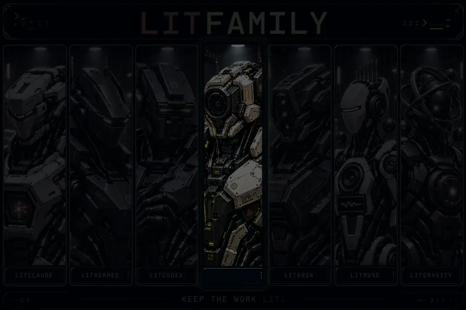</picture></p>

# LitOpenCode

**LitOpenCode는 OpenCode용 워크플로 플러그인입니다. 프롬프트에 `lit`만 붙이면 계획하고, 만들고, 확인하고, 기록까지 남겨서 다음 세션이 어디서 멈췄는지 바로 압니다.**

<p align="center">
<a href="https://www.npmjs.com/package/@litfamily/litopencode"></a>
<a href="https://www.npmjs.com/package/@litfamily/litopencode"></a>
<a href="./LICENSE"></a>
<a href="https://github.com/wjgoarxiv/litopencode"></a>
</p>

<p align="center">
<a href="./docs/guide-Ko-KR.md"> 사용 안내</a> &nbsp; <a href="./docs/screens-Ko-KR.md"> 화면</a> &nbsp; <a href="./docs/skills-Ko-KR.md">스킬</a> &nbsp; <a href="./LICENSE"> MIT</a> &nbsp; <a href="./README.md">English</a>
</p>

<p align="center"></p> <!-- demo-gif -->

> [!TIP]
> 명령 한 줄로 설치하고 OpenCode를 다시 시작한 뒤 프롬프트에 `lit`을 붙이세요. 설치 명령과 첫 작업은 [빠르게 시작하기](#빠르게-시작하기)에 있습니다.

OpenCode 2.2는 세션 하나에 목표를 둘 수 있지만, 무엇을 정했고 확인했고 남겼는지는 다음 세션으로 넘겨 주지 않습니다. 그래서 대화가 압축되거나 터미널을 닫으면 그 내용을 다시 맞춰 봐야 합니다. LitOpenCode는 `lit` 작업마다 같은 순서(정리, 계획, 구현, 확인, 다음 할 일 기록)를 밟고, 그 기록을 프로젝트 안 `.litopencode/litgoal/`에 남겨 다음 세션이 읽게 합니다.

```text
저녁:  lit add a --shout flag that prints the greeting in capitals, with a test
       → 테스트와 함께 플래그가 추가되고, 작업 내용이 .litopencode/litgoal/에 남습니다
아침:  /lit-recap
       → 무엇을 만들었고 무엇을 확인했는지, 다음에 할 일이 무엇인지 알려 줍니다
```

기능 하나, 계획을 세운 리팩터링, 며칠 이어 가는 조사, 메모로 만드는 보고서나 발표자료처럼 여러 번에 걸쳐 하는 일에 어울립니다. 모델 실행, 권한 확인, 모델 제공자 로그인은 여전히 OpenCode가 맡고, 다른 LitFamily 제품은 필요 없습니다.

| 하고 싶은 일 | 바로 가기 |
| --- | --- |
| 설치하고 첫 작업 보내기 | [빠르게 시작하기](#빠르게-시작하기) |
| 경로와 명령 살펴보기 | [할 수 있는 일](#할-수-있는-일) |
| 발표자료, 문서, 그림, 영상 만들기 | [확장 스킬](#확장-스킬) |
| 화면 아래 카드 읽기 | [LIT 상태 카드](#lit-상태-카드) |
| 컨텍스트가 차기 전에 자리 저장하기 | [자동 인수인계](#자동-인수인계) |
| 점검, 업데이트, 제거하기 | [점검, 업데이트, 제거](#점검-업데이트-제거) |

## 빠르게 시작하기

Node.js와 npm, 그리고 모델 제공자를 설정해 둔 [OpenCode](https://opencode.ai)가 필요하며, OpenCode 1(1.18.29 이상)과 OpenCode 2는 하나만 두어도, 함께 두어도 됩니다. OpenCode 1은 `opencode`로, OpenCode 2는 `opencode2`로 실행하며, 설치 프로그램이 있는 쪽을 찾아 각각 설정합니다. 설치는 명령 한 줄입니다.

```sh
npm exec --package @litfamily/litopencode@latest -- litopencode install
```

설치 도중 어떤 모델을 쓸지, 에이전트에게 권한을 얼마나 줄지 묻습니다. 권한은 무언가 하기 전에 OpenCode가 먼저 물어보는 `safe`에서 시작합니다. OpenAI 제공자로 새로 설치하면 계획과 검토는 GPT-6 Astra가, 만들기는 GPT-6 Luna가 맡으며, 다른 모델은 설치 중에 고를 수 있습니다.

OpenCode는 세션을 시작할 때마다 전역 `AGENTS.md` 하나를 읽습니다. 설치 프로그램은 거기에 `lit`이 무슨 뜻인지, 허락 없이는 push나 배포를 하지 않는다는 것을 적은 짧은 표시 블록을 넣자고 제안하며, 한 번만 묻습니다.

| 붙이거나 실행할 것 | 쓸 때 |
| --- | --- |
| `--dry-run` | 아무것도 쓰기 전에 무엇이 바뀔지 보고 싶을 때 |
| `--yes` | 기본값으로 충분해서 질문을 건너뛰고 싶을 때. 블록에도 예로 답합니다 |
| `--no-agent-file` | 이번 실행에서만 `AGENTS.md` 블록을 건너뛸 때 |
| `litopencode agent-file remove` | 블록을 빼고 싶을 때. 당신이 쓴 글은 그대로 둡니다 |

<details>
<summary>코딩 에이전트에게 설치 맡기기</summary>

이미 쓰는 에이전트에 아래 내용을 붙여 넣으세요. 에이전트는 먼저 확인하고, 할 일을 보여 준 뒤, 허락을 받고 나서야 무언가를 바꿉니다.

```text
이 컴퓨터에 OpenCode용 lit 워크플로 플러그인 LitOpenCode를 설치해줘.
1. node --version, npm --version, opencode --version으로 Node.js, npm, OpenCode가 설치돼 있는지 확인해. 하나라도 없으면 멈추고 알려줘.
2. 공식 npm 패키지 @litfamily/litopencode만 써. 포크, 미러, curl 스크립트, 다른 패키지는 쓰지 마.
3. 아무것도 바꾸기 전에 이 명령을 실행해: npm exec --package @litfamily/litopencode@latest -- litopencode install --dry-run
   무엇이 바뀌는지 보여 주고, 기본값으로 진행해도 되는지 나한테 물어봐.
4. 내가 좋다고 하면 이 명령을 실행해: npm exec --package @litfamily/litopencode@latest -- litopencode install --yes
   OpenCode 설정 파일은 손으로 고치지 마.
5. 이 명령을 실행해: npm exec --package @litfamily/litopencode@latest -- litopencode doctor
   install.ok, install.plugin.ok, install.nativeSkills.ok가 true인지 알려 주고, 경고가 있으면 그대로 옮겨줘.
6. 마지막으로 OpenCode를 다시 시작하고 Tab을 눌러 lit-loop를 고르라고 알려줘.
```

</details>

### 첫 작업 보내기

OpenCode를 다시 시작하고 **Tab** 키를 눌러 **lit-loop**를 고르세요. 그다음 빈 폴더를 열고 이렇게 보냅니다.

```text
lit 외부 의존성 없이 index.html 하나로 할 일 목록을 만들고, 추가와 완료 표시를 확인한 뒤 다음 할 일을 남겨줘.
```

`🔥 LIT IGNITED` 문구와 시작된 워크플로 이름을 담은 알림이 6초 동안 뜹니다. 이 알림이 보이면 LitOpenCode가 프롬프트를 받은 것입니다. 설치 화면, 알림, 상태 점검, 잠긴 계획 에이전트 권한은 [화면 미리 보기](./docs/screens-Ko-KR.md)에서 미리 볼 수 있습니다.

작업이 끝나면 직접 열어 볼 `index.html`이 생기고, 무엇을 만들고 확인했는지가 `.litopencode/litgoal/`에 남습니다. 며칠 뒤 `/lit-recap`을 입력하면 끝낸 일과 다음 할 일을 알려 줍니다. 실제 작업은 OpenCode 안의 모델이 하고 모델도 실수를 하니, 답변에 통과했다고 나오면 파일을 직접 열어 확인하세요.

## 할 수 있는 일

경로마다 나중에 읽을 수 있는 기록이 남기 때문에, 일을 멈췄다가 다음 세션에서 이어 갈 수 있습니다.

| 입력 | 일어나는 일 |
| --- | --- |
| 요청 끝에 `lit`, 또는 `/lit` | 일을 정리하고, 계획하고, 만들고, 확인하고, 요약하는 순서로 진행합니다 |
| Tab을 눌러 `lit-plan` | 계획 에이전트가 체크리스트를 쓰고 명시적인 사용자 승인을 기다립니다. 파일 수정, 셸 실행, 위임은 할 수 없습니다 |
| `/start-work` | 승인한 계획을 한 조각씩 실행합니다 |
| `/review-work` | 다섯 가지 관점에서 변경 내용을 검토해 심각한 문제부터 알려 줍니다 |
| `handoff` 단독 입력, 또는 `/lit-handoff` | 다음 세션이 읽고 이어 갈 인수인계 파일을 남깁니다. 원하면 컨텍스트 창이 차기 전에 [자동 인수인계](#자동-인수인계)가 대신 써 줍니다 |
| `/lit-recap` | 끝낸 일, 막힌 일, 다음 할 일을 다시 읽어 줍니다 |
| `/litresearch` | 여러 차례에 걸쳐 조사하고, 주장마다 출처와 아직 불확실한 점을 함께 남깁니다 |
| `/lit-humanizer` | 딱딱한 영어나 한국어 문장을 다시 씁니다. 사실관계와 글쓴이의 목소리, 꼭 필요한 한정 표현은 그대로 둡니다 |
| `/rules` | 저장소 규칙을 세션마다 한 번, 파일을 고칠 때 다시 읽어 옵니다 |

```text
설정 화면에 다크 모드 토글을 추가하고 기존 테스트가 계속 통과하게 해줘 lit
lit research 쓰기가 많은 로컬 앱에서 가장 중요한 SQLite 설정은 무엇일까?
```

이 밖에도 디버깅, 리팩터링, 코드 정리, 커밋, 언어 서버, 화면 작업, 브라우저 자동화, 프로젝트 위키가 있습니다. 모든 스킬의 결과 그림은 [스킬 갤러리](./docs/skills-Ko-KR.md)에서 볼 수 있습니다.

## 만들 수 있는 것

아래 그림은 모두 맥 한 대에서 LitOpenCode가 만든 결과이고, 그림 아래에 만든 스킬을 적었습니다. 꾸며 낸 화면은 없습니다. 발표자료, 화면, 도면의 숫자는 가상의 하이드레이트 실험실 예시 값이며 결과물 안에도 그렇게 적혀 있고, 이 세 스킬은 이제 wjgoarxiv-skills에서 설치합니다.

<table>
<tr><td width="50%" valign="top">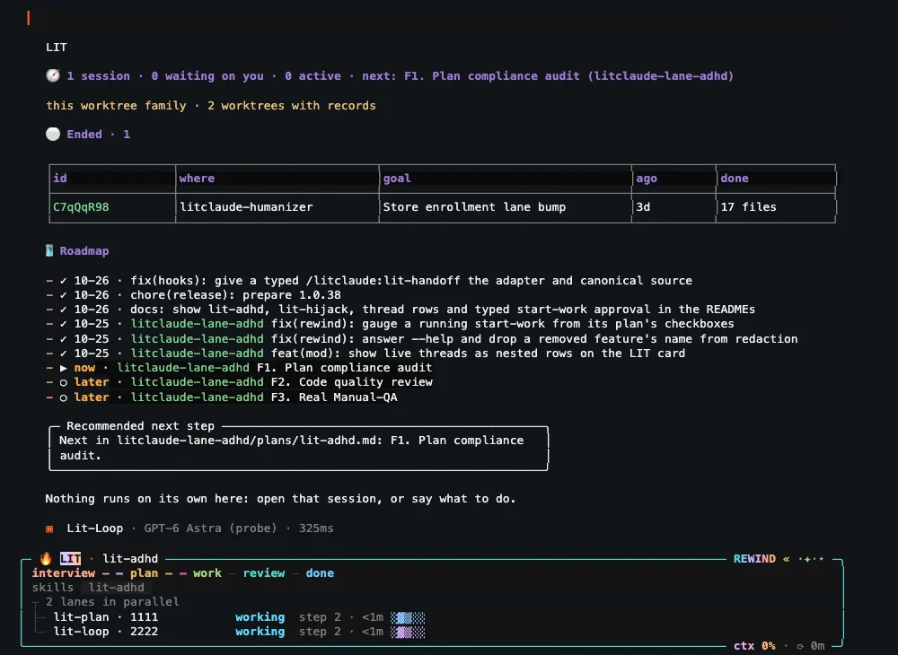<br /><b>lit-adhd</b> · 돌아왔을 때 읽는 브리핑<br /><sub>스킬에 들어 있는 스크립트가 실제 워크트리 묶음의 세션, 커밋, 계획을 읽었습니다. 그 답을 로컬 시험용 모델이 OpenCode에 넘겼고, OpenCode는 이를 색으로 그리며 LIT 카드는 되감기 모양으로 바뀝니다.</sub></td><td width="50%" valign="top">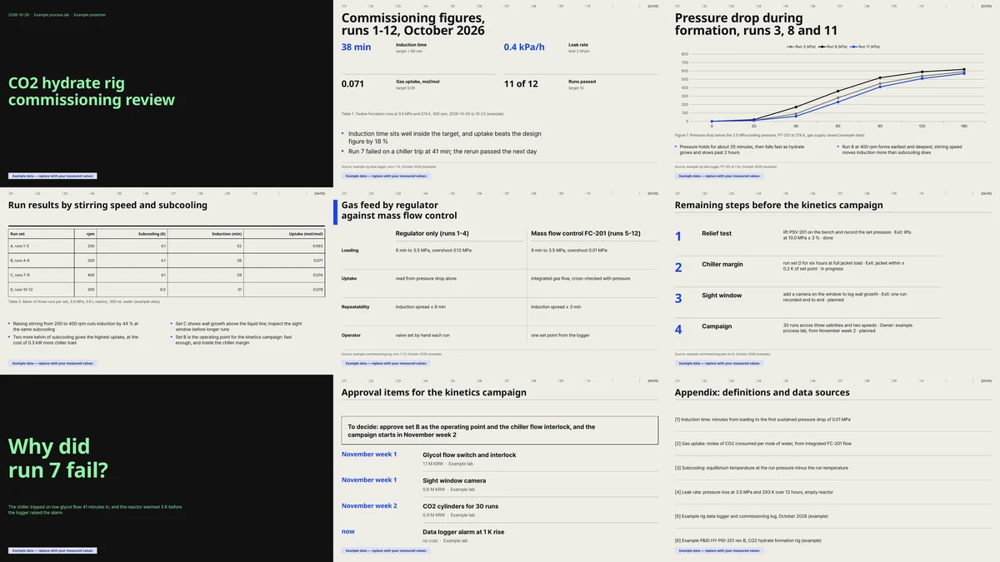<br /><b>lit-pptx</b> · 9장, computational brutalism<br /><sub>이 페이지를 위해 쓴 슬라이드 원고를 스킬의 엔진이 컴파일했습니다. 그래프는 PowerPoint에서 고칠 수 있고, 발표자료 검사에서 심각한 문제는 나오지 않았습니다.</sub></td></tr>
<tr><td width="50%" valign="top">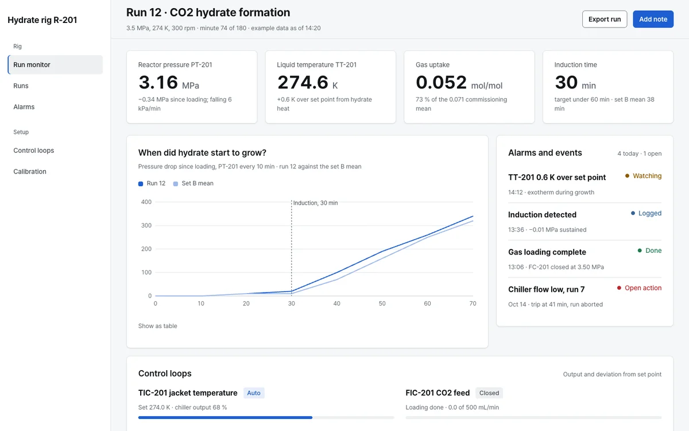<br /><b>frontend-ui-ux</b> · 실험 모니터 화면<br /><sub>정해 둔 하우스 스타일대로 만든 뒤, 스킬의 점검 도구가 너비 1440, 768, 390, 320 픽셀로 열어 보고 승인했습니다.</sub></td><td width="50%" valign="top">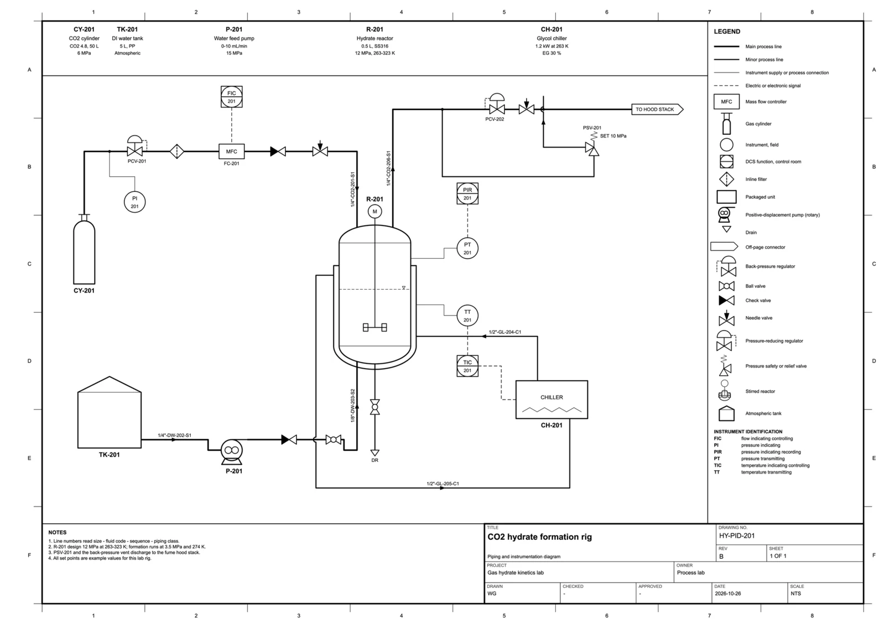<br /><b>lit-schematic</b> · A3 한 장짜리 P&amp;ID<br /><sub>이 페이지를 위해 쓴 빌드 파일을 스킬의 P&amp;ID 도구로 그렸습니다. 기호 24개, ISA 태그, 라인 번호, 표제란이 있고 도면 검사를 통과했습니다.</sub></td></tr>
</table>

## 확장 스킬

계획, 구현, 검토, 조사, 인수인계를 비롯해 이 문서의 나머지 기능은 LitOpenCode만으로 동작합니다. 파일을 만드는 스킬(발표자료, 워드 문서, 개념도, 장치 도면, 학술지 그림, 화면과 화면 점검, 영상과 README 커버)은 확장 모음 [wjgoarxiv-skills](https://github.com/wjgoarxiv/wjgoarxiv-skills)에 있습니다. 쓰는 것만 설치하면 되고, 그만큼 LitOpenCode는 가벼워집니다.

설치하기 전에는 스킬마다 같은 이름의 작은 안내 폴더가 남아 있습니다. `lit`으로 발표자료를 부탁하면 안내 폴더가 스킬이 옮겨 간 곳과 OpenCode에 복사해 넣는 명령을 알려 줍니다([목록](./docs/skills-Ko-KR.md#wjgoarxiv-skills로-옮긴-스킬)). 설치 프로그램도 실행할 때 확장 스킬을 안내하고, 설치나 업데이트 뒤 첫 세션에서 한 번 더 알려 줍니다.

<p align="center"><picture><source media="(prefers-color-scheme: dark)" srcset="./docs/assets/readme/core-extensions.ko.dark.png" /><source media="(prefers-color-scheme: light)" srcset="./docs/assets/readme/core-extensions.ko.light.png" />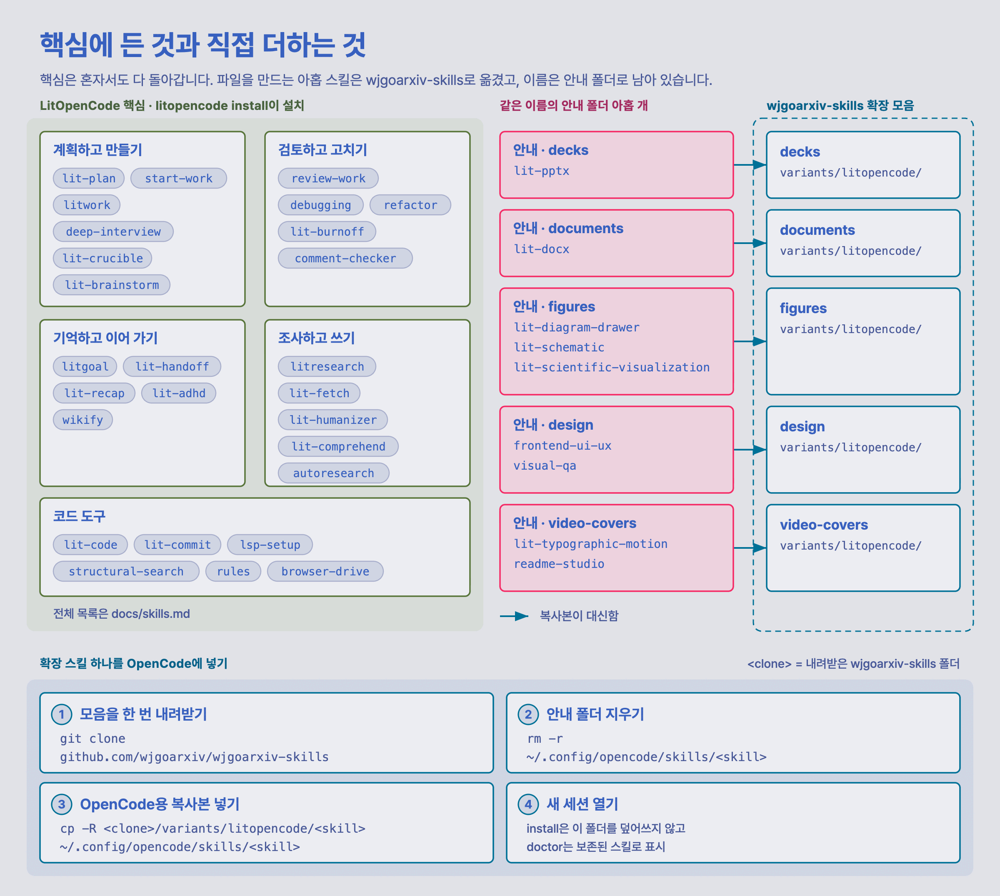</picture></p>

설치는 LitOpenCode에 맡겨도 됩니다. 무언가 바꾸는 명령은 할 일을 출력만 하고, `--yes`를 붙여야 실제로 바꿉니다. 모음은 git으로 자기 캐시에 받아 오거나 `--from <clone>`으로 준 폴더를 쓰며, 전역 설치가 아니라면 앞에 `npm exec --package @litfamily/litopencode@latest --`를 붙입니다.

| 명령 | 하는 일 |
| --- | --- |
| `litopencode extensions list` | 아홉 스킬이 설치됐는지, 아직 안내 폴더인지, 직접 넣은 폴더인지 보여 줍니다 |
| `litopencode extensions install lit-docx` | OpenCode의 다른 스킬 폴더에 같은 이름이 있으면 그 경로를 알리고 멈춥니다 |
| `update`, `check`, `prune-backups` | 같은 방식으로 동작합니다 |
| `remove` | 설치 기록이 있는 폴더만 옮깁니다 |

같은 이름 앞에서 멈추는 이유는 LitOpenCode가 그 폴더들을 건드리지 않기 때문입니다. `--yes`를 붙이면 안내 폴더를 통째로 `~/.config/opencode/extension-backups/` 아래 날짜 폴더로 옮기며, OpenCode는 그 폴더를 읽지 않고 지워지는 것도 없습니다. 그다음 모음의 OpenCode용 복사본을 넣고 그 안에 작은 설치 기록을 남깁니다.

아홉 개는 `lit-pptx`(발표자료), `lit-docx`(문서), `lit-diagram-drawer`, `lit-schematic`, `lit-scientific-visualization`(그림), `frontend-ui-ux`, `visual-qa`(디자인), `lit-typographic-motion`, `readme-studio`(영상·커버)입니다. 1.0.43 이하에서 업데이트하나요? 업데이트가 무엇을 백업하고 예전 버전이 무엇을 남기는지는 [사용 안내](./docs/guide-Ko-KR.md#1043-이하에서-업데이트하기)에 있습니다.

설치한 뒤에는 새 세션을 열고, 영상 스킬은 처음 한 번 `node ~/.config/opencode/skills/lit-typographic-motion/runtime.mjs install`을 실행하세요. `litopencode install`은 직접 넣은 복사본을 덮어쓰지 않습니다. `litopencode doctor`는 그 복사본을 보존된 스킬로 표시하고, `EXTENSIONS` 줄에 `litopencode extensions check` 결과를 요약합니다.

<details>
<summary>확장 스킬 손으로 설치하기</summary>

모음을 한 번 내려받고 스킬마다 아래 네 줄을 실행합니다. 첫 줄은 같은 이름의 폴더를 보여 주기만 하고, 나머지 세 줄이 옮겨 두기, 복사, 설치 기록을 맡습니다. 업데이트할 때는 네 줄을 다시 실행하고, 빼고 싶을 때는 둘째 줄만 실행하세요. `XDG_CONFIG_HOME`을 설정했다면 `~/.config/opencode/` 대신 `$XDG_CONFIG_HOME/opencode/`를 씁니다.

```sh
ls -d ~/.config/opencode/skills/<skill> ~/.agents/skills/<skill> ~/.claude/skills/<skill> 2>/dev/null
d=~/.config/opencode/extension-backups/$(date +%Y%m%d-%H%M%S); [ ! -e ~/.config/opencode/skills/<skill> ] || { mkdir -p "$d" && mv ~/.config/opencode/skills/<skill> "$d/"; }
mkdir -p ~/.config/opencode/skills && cp -R "<path to your wjgoarxiv-skills clone>/variants/litopencode/<skill>" ~/.config/opencode/skills/<skill>
printf '{"id":"%s","source":"%s","variant":"litopencode","installed_at":"%s"}\n' <skill> "<path to your wjgoarxiv-skills clone>/variants/litopencode/<skill>" "$(date -u +%Y-%m-%dT%H:%M:%SZ)" > ~/.config/opencode/skills/<skill>/.litfamily-extension.json
```

</details>

## LIT 상태 카드

LitOpenCode를 설치하면 OpenCode 세션 화면 맨 아래에 작은 카드가 붙습니다. 카드는 세션 내내 그 자리에 있고, 작업이 돌든 안 돌든 같은 네 줄을 유지하기 때문에 프롬프트 입력 칸이 위아래로 움직이지 않습니다. 아래 테두리에는 컨텍스트 창이 얼마나 찼는지와 지금 git 브랜치가 나옵니다.

**대기.** 첫 `lit` 프롬프트를 보내기 전에는 제목에 `🔥 LIT · ready`와 `○ IDLE`이 보이고, 작업 흐름 지도는 흐리며, 카드가 어떻게 시작하면 되는지 알려 줍니다.

<p align="center">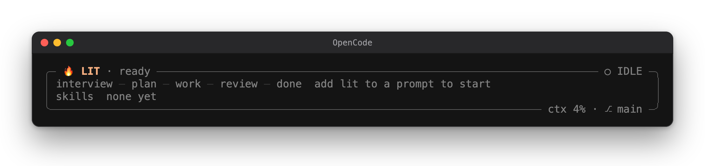</p>

**작업 중.** `lit`을 붙인 프롬프트를 보내면 카드가 깨어납니다. 제목에 워크플로 이름과 지금 단계가 나오고, 지도는 그 단계를 개수와 함께 밝힙니다. 이 lit-loop 목표는 기준 세 개 중 하나를 통과해 지도가 `CRITERION 1/3`으로 보이고, 건너뛴 단계에는 `–`가 붙으며, 막대는 끝난 몫을, 그 옆에는 도는 도구의 이름과 걸린 시간을 보여 줍니다.

<p align="center">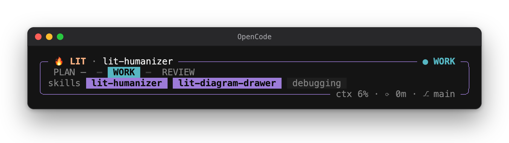</p>

**가라앉음.** 차례가 끝나면 제목이 `○ IDLE`로 바뀌고, 밝게 켜진 단계가 없어지며, 지금 하는 일 자리에는 다음에 할 항목이 들어갑니다. 다음 프롬프트를 보내면 카드가 다시 깨어납니다.

<p align="center">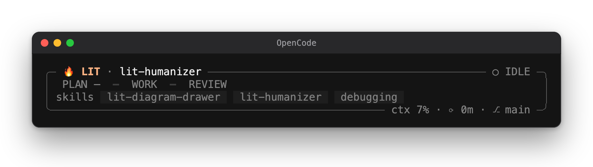</p>

카드는 기본으로 켜져 있고, OpenCode `tui.json`의 LitOpenCode 항목에 다음 옵션을 줄 수 있습니다.

| 옵션 | 하는 일 |
| --- | --- |
| `{ "band": false }` | 화면 아래를 비워 둡니다 |
| `{ "band": { "card": true } }` | 목표, 다음 할 일, 경고를 담은 카드를 하나 더 아래에 붙입니다 |
| `{ "notify": true }` | 미션이 끝나면 데스크톱 알림과 소리로 알려 줍니다 |

`notify`는 직접 넣기 전에는 꺼져 있고, OpenCode 자체 설정 `"attention": { "enabled": true }`도 켜져 있어야 동작합니다. 지도와 스킬 칩이 어떻게 세는지는 [사용 안내](./docs/guide-Ko-KR.md#lit-상태-카드)에, 카드의 각 부분은 [레퍼런스](./docs/reference-Ko-KR.md#tui-미션-패널)에 자세히 있습니다.

## OpenCode 2의 목표

OpenCode 2.2가 추가한 `/goal`은 평가자가 목표를 이뤘다고 볼 때까지 세션을 계속 돌려 줍니다. 이 버전에서 `lit loop`, `litwork`, `/start-work`로 일을 시작하면 LitOpenCode가 요청한 일에 이 프로젝트의 완료 조건을 붙여 목표를 대신 세웁니다. 완료 조건은 테스트 통과, 만지는 경로의 실제 실행, 임시 파일 정리, `.litopencode/litgoal/` 기록 닫기입니다.

- **바뀔 때마다 한 줄.** LitOpenCode가 목표를 만들거나 다시 켜거나 지울 때마다 `LitOpenCode goal:`로 시작하는 한 줄을 보여 줍니다.
- **직접 세운 목표는 그대로.** 자기가 만든 목표만 다룹니다. 먼저 직접 `/goal`을 입력해 두었다면 "left yours alone"이라고 알리고 그대로 둔 채 일을 이어 갑니다.
- **만드는 일에만.** 계획, 조사, 검토 요청에는 목표를 세우지 않습니다.
- **양쪽이 동의해야 완료.** OpenCode의 평가자와 기록이 둘 다 동의해야 끝난 것으로 칩니다. 평가자는 끝났다는데 기록이 열려 있으면 완료 대신 충돌 한 줄이 나옵니다.
- **이전 호스트.** OpenCode 1과 2.2 이전 OpenCode 2에는 `/goal`이 없어서 지금까지처럼 기록이 일을 이어 갑니다. 목표가 왜 생기지 않았는지 알 수 있도록 `native-goal-unavailable`을 한 번 남깁니다.

## 자동 인수인계

대화가 길어지면 모델의 컨텍스트 창이 차고, 넘친 내용은 잊힙니다. 자동 인수인계는 그 전에 지금 자리를 저장하며, 직접 켜기 전까지는 꺼져 있고 시작할 퍼센트도 직접 정합니다. 아래 메시지 중 하나만 담아 보내면 LitOpenCode가 바뀐 설정을 답하고, 모델이 그 내용을 한두 문장으로 전해 줍니다.

| 메시지 | 하는 일 |
| --- | --- |
| `lit-handoff auto on 70` | 70%에서, 또는 70 자리에 넣은 숫자에서 켭니다. `/lit-handoff auto on 70`을 실행해도 같습니다 |
| `lit-handoff auto status` | 지금 상태와 설정이 어디서 왔는지 알려 줍니다 |
| `lit-handoff auto off` | 기능을 끄면서 숫자는 기억해 두기 때문에, 나중에 숫자 없이 `lit-handoff auto on`만 보내도 그 숫자로 다시 켜집니다 |

<p align="center"><picture><source media="(prefers-color-scheme: dark)" srcset="./docs/assets/readme/auto-handoff-settings-dark.webp" /></picture></p>

1. 대화가 정한 퍼센트에 닿고 진행 중인 차례가 끝나면, LitOpenCode가 모델에게 인수인계를 써 달라고 부탁합니다.
2. 저장된 파일에는 그 메시지에 적힌 표시 줄이 있어야 하므로, 예전에 남은 인수인계 파일은 인정되지 않습니다.
3. 새 인수인계가 확인되면 플러그인이 직접 대화를 압축해 알림으로 알리고, 다음 차례에 인수인계의 앞부분을 모델 앞에 다시 놓습니다. `/compact`를 직접 입력할 일은 없습니다.

저장된 인수인계가 없으면 대화는 그대로 두고 알림으로 알려 줍니다. OpenCode가 압축을 받아 주지 않으면 `/compact`를 직접 실행하라는 알림이 뜹니다.

<p align="center"><picture><source media="(prefers-color-scheme: dark)" srcset="./docs/assets/readme/auto-handoff-compact-dark.webp" />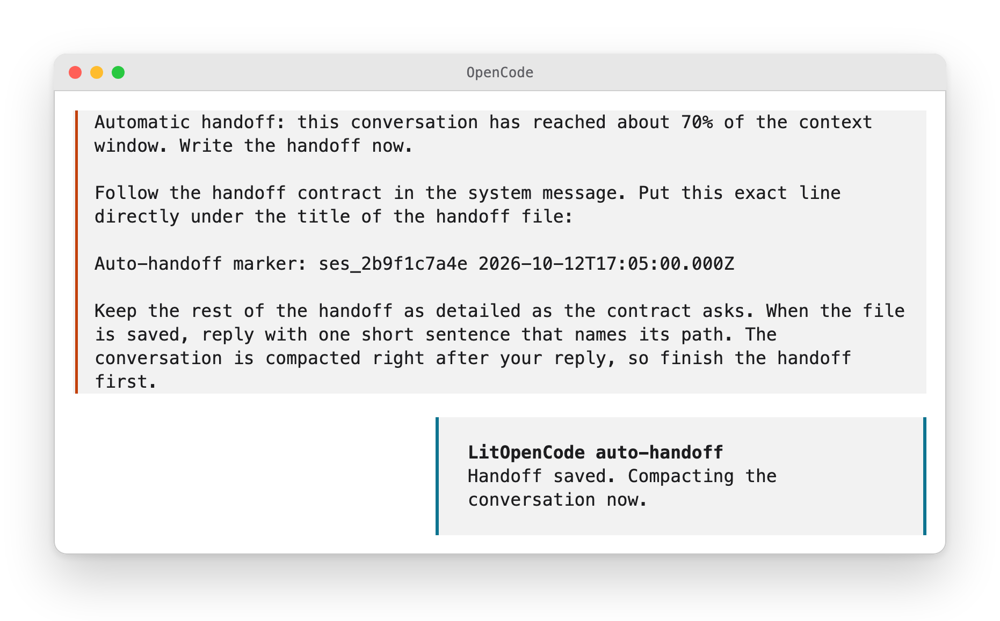</picture></p>

퍼센트는 OpenCode가 스스로 압축하는 지점보다 낮게 고르세요. 인수인계가 먼저 돌 틈이 있어야 하기 때문입니다. LitOpenCode가 설치하는 한도에서 그 지점은 90%이고, 고른 퍼센트가 그와 같거나 높으면 `litopencode doctor`가 경고하며, 프로젝트 폴더에서 실행하면 지금 설정과 그 출처(채팅, 설정 파일, OpenCode를 띄우는 환경)도 보여 줍니다.

<p align="center"><picture><source media="(prefers-color-scheme: dark)" srcset="./docs/assets/readme/auto-handoff-doctor-dark.webp" />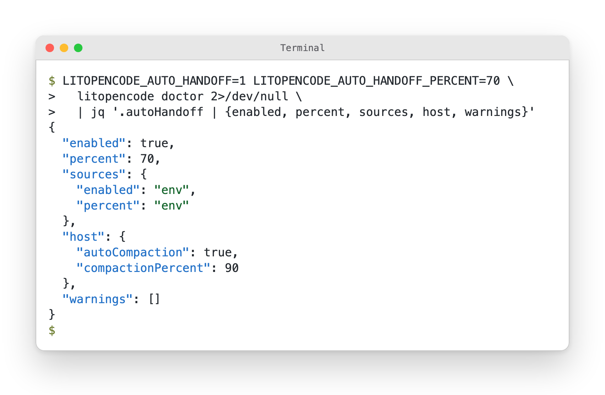</picture></p>

환경 변수와 설정 파일로도 정할 수 있습니다. 단계별 설명과 그 두 방법은 [사용 안내](./docs/guide-Ko-KR.md#자동-인수인계)에, 모든 설정과 디스크에 남는 내용은 [레퍼런스](./docs/reference-Ko-KR.md#자동-인수인계)에 있습니다.

## 동작 방식

OpenCode는 설정 파일에서 LitOpenCode를 플러그인으로 불러옵니다. 프롬프트나 명령을 보내면 플러그인이 알맞은 워크플로를 고르고 필요한 스킬을 모델에게 알려 주며, 도구와 훅이 일어난 일을 프로젝트에 적어 둡니다. `/lit-recap`이나 다음 세션이 그 기록을 다시 읽고, 프롬프트 하나를 따라가는 설명은 [스킬과 명령](./docs/skills-Ko-KR.md#플러그인이-동작하는-방식)에 있습니다.

<p align="center"><picture><source media="(prefers-color-scheme: dark)" srcset="./docs/assets/readme/lit-route.ko.dark.png" /><source media="(prefers-color-scheme: light)" srcset="./docs/assets/readme/lit-route.ko.light.png" /></picture></p>

OpenCode 1과 OpenCode 2는 한 컴퓨터에 같이 있을 수 있고, 플러그인을 불러오는 방식이 다릅니다. `litopencode install`은 둘 다 실행하지 않고 `opencode`와 `opencode2` 뒤의 npm 패키지만 보고 어느 쪽이 있는지 알아낸 뒤, 호스트마다 맞는 길로 설치합니다. 호스트마다 설치가 무엇을 바꾸는지는 [사용 안내](./docs/guide-Ko-KR.md#설치)에 있습니다.

<p align="center"><picture><source media="(prefers-color-scheme: dark)" srcset="./docs/assets/readme/two-hosts.ko.dark.png" /><source media="(prefers-color-scheme: light)" srcset="./docs/assets/readme/two-hosts.ko.light.png" />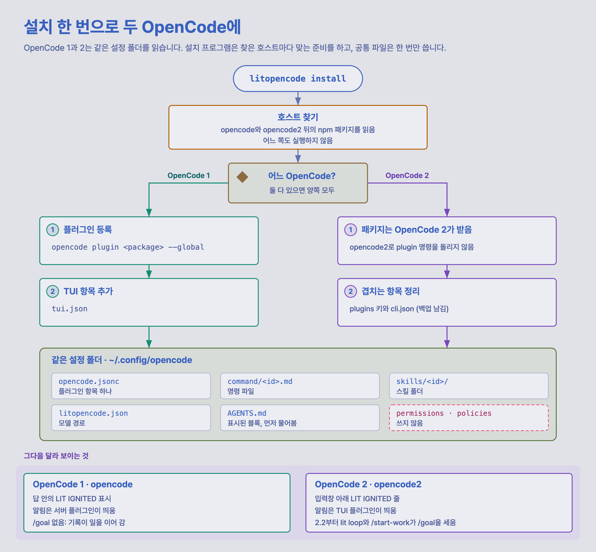.md, skills/<id>/, 모델 경로를 담은 litopencode.json, 먼저 물어보고 넣는 AGENTS.md 표시 블록이 있고, permissions와 policies는 쓰지 않습니다. 아래 띠는 설치 뒤 달라 보이는 점을 비교합니다. OpenCode 1에서는 LIT IGNITED 표시가 답변에 나오고 토스트는 서버 플러그인이 띄우며 일은 기록이 이어 갑니다. OpenCode 2에서는 표시가 프롬프트 아래 한 줄로 나오고 토스트는 TUI 플러그인이 띄우며, 2.2부터는 lit loop와 /start-work가 /goal을 세웁니다."></picture></p>

공정 흐름도가 익숙하다면 같은 고리를 이렇게 읽을 수 있습니다. 요청은 왼쪽으로 들어오고, 계획 드럼의 계획은 `/start-work`를 거쳐 빌드 반응기로 가며, 반응기에서 나온 것은 모두 검토 탑을 지납니다. 조절기가 레인 판정을 읽어 분기 밸브를 움직이면 통과한 변경은 나가고 실패한 레인은 빌드로 돌아가며, 증거는 다음 세션의 `/lit-recap`이 꺼내 쓰는 기록 탱크에 쌓입니다.

<p align="center"><picture><source media="(prefers-reduced-motion: reduce) and (prefers-color-scheme: dark)" srcset="./docs/assets/readme/lit-plant.ko.dark.png" /><source media="(prefers-reduced-motion: reduce)" srcset="./docs/assets/readme/lit-plant.ko.png" /><source media="(prefers-color-scheme: dark)" srcset="./docs/assets/readme/lit-plant-loop.ko.dark.webp" /><source media="(prefers-color-scheme: light)" srcset="./docs/assets/readme/lit-plant-loop.ko.webp" />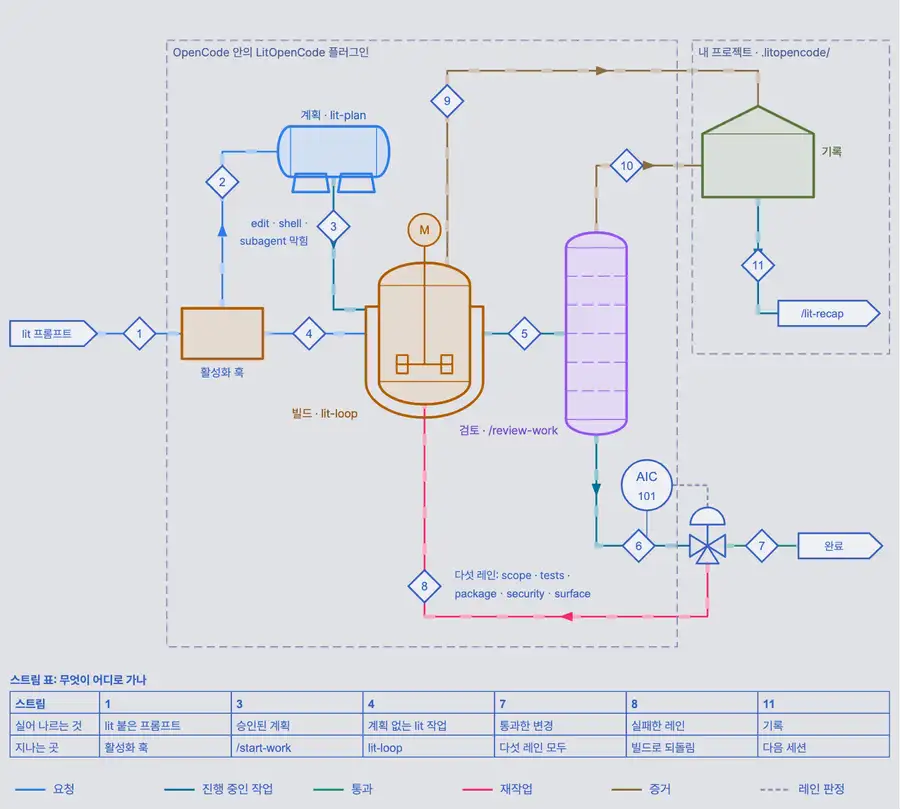</picture></p>

## 점검, 업데이트, 제거

설치 직후나 무언가 이상할 때 `litopencode doctor`를 실행하세요. 플러그인과 스킬이 제대로 연결됐는지 알려 주고, 읽기만 할 뿐 아무것도 바꾸지 않습니다.

```sh
npm exec --package @litfamily/litopencode@latest -- litopencode doctor
```

LitOpenCode는 대화형으로 시작할 때와 install이나 doctor가 성공한 뒤에 새 버전을 확인합니다. 설치 명령을 다시 실행해도 업데이트되며, 손봐 둔 모델 경로 설정은 그대로 남습니다. 버전을 고정해 두고 업데이트 시점을 직접 정하고 싶다면 `--no-auto-update`를 붙이거나 `LITOPENCODE_NO_AUTO_UPDATE=1`을 설정하세요.

제거하려면, 전역 `AGENTS.md`에 블록을 넣었을 경우 먼저 `litopencode agent-file remove`를 실행하세요. 그런 다음 OpenCode의 `opencode.jsonc`에서 `plugin` 배열의 `@litfamily/litopencode` 항목을 지우고 OpenCode를 다시 시작합니다. 복사된 명령과 스킬 파일을 정리하는 방법, 다시 쓸 생각이라면 남겨 둘 파일은 [제거 상세 안내](./docs/guide-Ko-KR.md#제거)에 있고, 전역으로 설치했다면 다음 명령도 실행합니다.

```sh
npm uninstall -g @litfamily/litopencode
```

## 더 알아보기

- [사용 안내](./docs/guide-Ko-KR.md): 설치 옵션, 첫 작업과 계획을 세우는 작업, 자동 인수인계, 안전과 업데이트, 문제 해결, 완전한 제거 방법
- [스킬과 명령](./docs/skills-Ko-KR.md): 모든 경로와 스킬을 그림과 함께 정리하고, 문서·발표자료·디자인·브라우저 안내까지 담았습니다.
- [화면 미리 보기](./docs/screens-Ko-KR.md): 설치 화면, 상태 점검, 알림, 계획 에이전트가 어떻게 보이는지와 22초짜리 영상
- [워크플로 상세 안내](./docs/reference-Ko-KR.md): 모델, 권한, host 연결, 명령, 검증 방법. 영어판 [English reference](./docs/reference.md)에는 전체 스킬 목록과 규칙 엔진까지 있습니다.
- [마이그레이션 안내](./docs/migration.md) · [Changelog](./CHANGELOG.md) · [개인정보와 네트워크 동작](./docs/privacy.md) · [그림 자료와 라이선스](./docs/brand-Ko-KR.md) · [터미널 마크와 활성화 확인 문구](./docs/lit-mark.md)
- [출시 체크리스트](./docs/release-checklist.md): 메인테이너용입니다. 이 저장소에만 있고 npm 패키지에는 들어가지 않습니다.
- [LitFamily 허브](https://github.com/wjgoarxiv/litfamily): 같은 `lit` 워크플로를 Claude Code, Codex CLI, Hermes Agent, Grok Build에서도 쓸 수 있습니다. 제품마다 따로 설치하고 따로 동작합니다.

## 기여와 라이선스

"어디까지 했더라?" 하며 보내던 아침을 LitOpenCode가 줄여 줬다면, GitHub 스타 하나나 친구에게 건네는 한 줄 소개(OpenCode 프롬프트에 `lit`만 붙이면 내일 세션이 오늘 멈춘 자리에서 이어집니다)가 다른 OpenCode 사용자가 이 프로젝트를 찾는 데 도움이 됩니다. 버그 제보와 풀 리퀘스트를 환영합니다. [기여 안내](./CONTRIBUTING.md)부터 읽어 주시고, [지원](./SUPPORT.md), [보안 제보](./SECURITY.md), [행동 규범](./CODE_OF_CONDUCT.md)도 함께 확인해 주세요.

MIT입니다. [LICENSE](./LICENSE)를 보세요. `lit-handoff`에 함께 들어 있는 참조 원본은 `vendor/` 아래에 자체 라이선스·출처 파일과 함께 있고, LitOpenCode 이름, 로고, 마스코트 그림은 [상표 정책](./TRADEMARK.md)을 따릅니다.

<details>
<summary>ASCII 로고 복사</summary>

```text
                             ▄▄▄▄
                   ▗███▌   ▗██████▖
 ▗▄▄▄▄▄          ▗▟████▌   ▝██████▘
 ▐█████        ▗▟██████▌    ▝▀▜█▀▘
 ▐█████      ▗▟███████▄▄▄▄▄▄▄▄▄▄▄▄▄▄▄▄▄▄▄▄
 ▐█████    ▗▟█████████████████████████ ▐█▀
 ▐█████    ████████████████████████████▀
 ▐█████    ██▛▘   ▄ ▄▄▄▄▖▄▄▄▄▄▄▄▄▄▄▄▄▄▖
 ▐█████    ▀    ▄██ ████▌█████████████▌
 ▐█████       ▄████ ████▌█████████████▌
 ▐█████     ▄█████▛                                 litopencode
 ▐█████  ▗▟█████▀▘       ▄▄▄▄▄     ▗▖
 ▐█████ ▐█████▀          █████     ▐▛▀
 ▐█████ ▐███▀            █████
 ▐█████ ▐█▀              █████
 ▐█████ ▝                █████
 ▐█████▄▄▄▄▄▄▄▖          █████
 ▐███████████▛           █████
 ▐██████████▀            █████

```

</details>

아이콘: [Lucide](./docs/assets/readme/Lucide-LICENSE.txt). ASCII 글리프: [JetBrains Mono, OFL](./docs/assets/readme/JetBrainsMono-OFL.txt).
