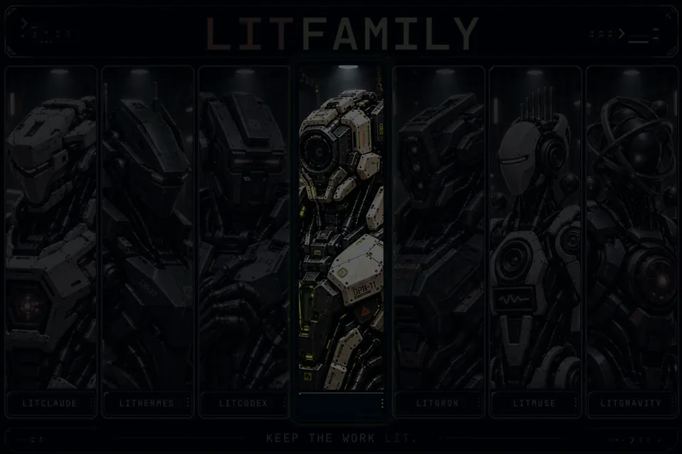
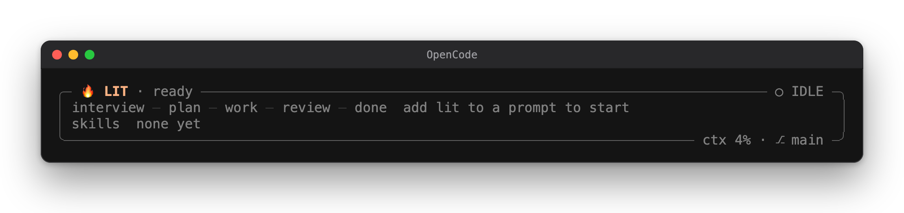
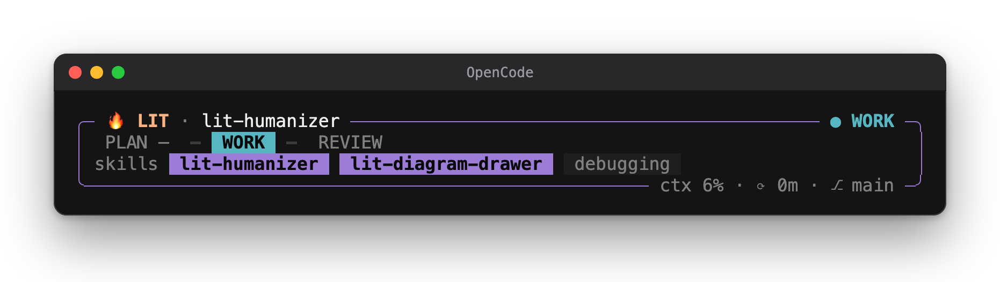
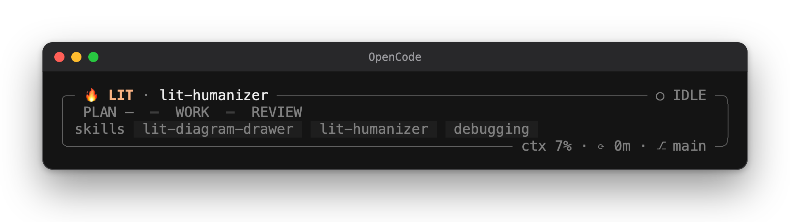
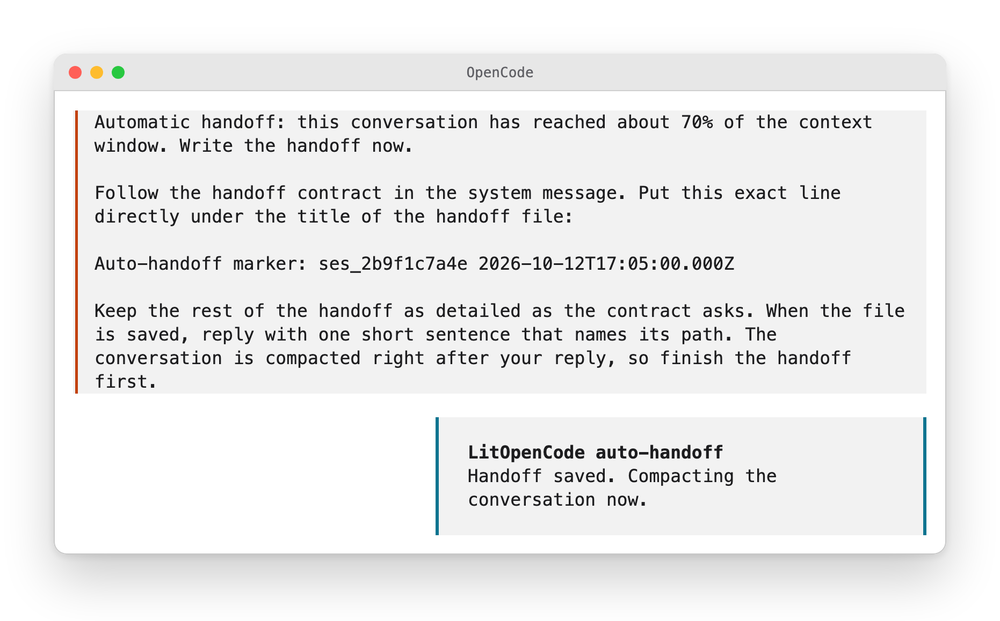
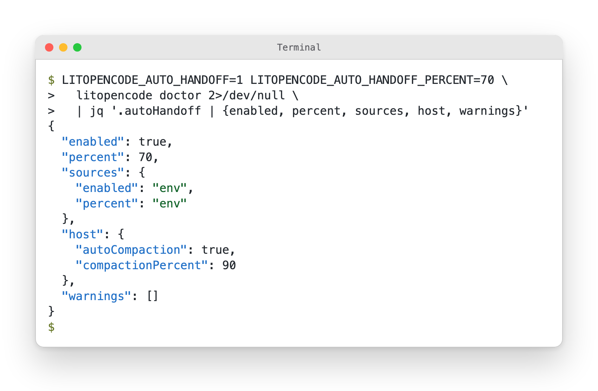
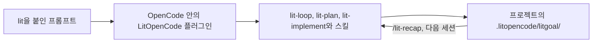

<p align="center"><picture><source media="(prefers-reduced-motion: reduce)" srcset="./docs/assets/cover-motion-still.webp" /></picture></p>

# LitOpenCode

**LitOpenCode는 OpenCode용 워크플로 플러그인입니다. 프롬프트에 `lit`만 붙이면 계획하고, 만들고, 확인하고, 기록까지 남겨서 다음 세션이 어디서 멈췄는지 바로 압니다.**

<p align="center">
<a href="https://www.npmjs.com/package/@litfamily/litopencode"></a>
<a href="https://www.npmjs.com/package/@litfamily/litopencode"></a>
<a href="./LICENSE"></a>
<a href="https://github.com/wjgoarxiv/litopencode"></a>
</p>

<p align="center">
<a href="./docs/guide-Ko-KR.md"> 사용 안내</a> &nbsp; <a href="./docs/screens-Ko-KR.md"> 화면</a> &nbsp; <a href="./docs/skills-Ko-KR.md">스킬</a> &nbsp; <a href="./LICENSE"> MIT</a> &nbsp; <a href="./README.md">English</a>
</p>

<p align="center"></p> <!-- demo-gif -->

## 이런 분께 맞습니다

OpenCode는 눈앞의 대화를 잘 처리합니다. 문제는 그 대화가 끝난 뒤입니다. 세션이 길어지면 대화가 압축되고, 터미널을 닫고 나면 다음 날 아침에는 무엇을 정했고 무엇을 이미 확인했고 무엇이 남았는지부터 다시 맞춰 봐야 합니다. OpenCode에는 세션을 넘어 목표를 보관할 자리가 따로 없습니다.

LitOpenCode는 작업에 일정한 순서와 기억을 붙여 줍니다. 프롬프트에 `lit`을 붙이면 일이 매번 같은 순서를 밟습니다. 무엇을 할지 정리하고, 계획하고, 만들고, 확인한 뒤, 다음 할 일을 적어 둡니다. 이 기록은 프로젝트 안의 `.litopencode/litgoal/`에 쌓이기 때문에 다음 세션은 그 기록을 읽고 멈춘 자리에서 이어 갑니다. 규모가 큰 일은 파일에 손댈 수 없는 에이전트가 먼저 계획을 세우고, 그다음에 실행과 검토를 거칩니다.

OpenCode는 지금 쓰던 그대로 쓰면 됩니다. 모델을 돌리고 권한을 묻는 일은 여전히 OpenCode가 하고, 모델 제공자 로그인도 그대로입니다. 다른 LitFamily 제품을 설치할 필요도 없습니다.

## 빠르게 시작하기

Node.js와 npm, 그리고 모델 제공자를 설정해 둔 [OpenCode](https://opencode.ai)가 있으면 됩니다. 설치는 명령 한 줄입니다.

```sh
npm exec --package @litfamily/litopencode@latest -- litopencode install
```

설치 도중 어떤 모델을 쓸지, 에이전트에게 권한을 얼마나 줄지 묻습니다. 기본값으로 바로 설치하려면 `--yes`를, 아무것도 쓰지 않고 무엇이 바뀔지만 보려면 `--dry-run`을 붙이세요. 권한은 `safe`에서 시작하는데, 무언가 하기 전에 OpenCode가 먼저 물어보는 설정입니다.

**코딩 에이전트에게 설치를 맡겨도 됩니다.** 이미 쓰는 에이전트에 아래 내용을 붙여 넣으세요. 에이전트는 먼저 확인하고, 할 일을 보여 준 뒤, 허락을 받고 나서야 무언가를 바꿉니다.

```text
이 컴퓨터에 OpenCode용 lit 워크플로 플러그인 LitOpenCode를 설치해줘.
1. node --version, npm --version, opencode --version으로 Node.js, npm, OpenCode가 설치돼 있는지 확인해. 하나라도 없으면 멈추고 알려줘.
2. 공식 npm 패키지 @litfamily/litopencode만 써. 포크, 미러, curl 스크립트, 다른 패키지는 쓰지 마.
3. 아무것도 바꾸기 전에 이 명령을 실행해: npm exec --package @litfamily/litopencode@latest -- litopencode install --dry-run
   무엇이 바뀌는지 보여 주고, 기본값으로 진행해도 되는지 나한테 물어봐.
4. 내가 좋다고 하면 이 명령을 실행해: npm exec --package @litfamily/litopencode@latest -- litopencode install --yes
   OpenCode 설정 파일은 손으로 고치지 마.
5. 이 명령을 실행해: npm exec --package @litfamily/litopencode@latest -- litopencode doctor
   install.ok, install.plugin.ok, install.nativeSkills.ok가 true인지 알려 주고, 경고가 있으면 그대로 옮겨줘.
6. 마지막으로 OpenCode를 다시 시작하고 Tab을 눌러 lit-loop를 고르라고 알려줘.
```

OpenCode를 다시 시작하고 **Tab** 키를 눌러 **lit-loop**를 고르세요. 그다음 빈 폴더를 열고 첫 작업을 보냅니다.

```text
lit 외부 의존성 없이 index.html 하나로 할 일 목록을 만들고, 추가와 완료 표시를 확인한 뒤 다음 할 일을 남겨줘.
```

**이렇게 보입니다.** `🔥 LIT IGNITED` 문구와 시작된 워크플로 이름을 담은 알림이 6초 동안 뜹니다. LitOpenCode가 프롬프트를 받았다는 표시입니다. 작업이 끝나면 직접 열어 볼 수 있는 `index.html`이 생기고, 무엇을 만들고 무엇을 확인했는지는 `.litopencode/litgoal/`에 남습니다. 며칠 뒤 돌아와 `/lit-recap`을 입력하면 끝낸 일과 다음 할 일을 알려 줍니다. 설치 화면, 알림, 상태 점검, 잠긴 계획 에이전트 권한은 [화면 미리 보기](./docs/screens-Ko-KR.md)에서 미리 볼 수 있습니다.

실제 작업은 OpenCode 안의 모델이 하고, 모델은 틀릴 수 있습니다. 답변에 무언가 통과했다고 나오면 파일을 직접 열어 확인하세요.

## 할 수 있는 일

**한 단어로 시작합니다.** 요청 끝에 `lit`을 붙이거나 `/lit`을 입력하세요. 일을 정리하고, 계획하고, 만들고, 확인하고, 요약하는 순서로 진행되며 단계마다 나중에 읽을 수 있는 기록이 남습니다.

```text
설정 화면에 다크 모드 토글을 추가하고 기존 테스트가 계속 통과하게 해줘 lit
```

**큰 일은 계획부터 세웁니다.** Tab을 눌러 `lit-plan`을 고르세요. 계획 에이전트는 프로젝트를 읽고 체크리스트를 쓴 뒤 명시적인 사용자 승인을 기다립니다. 파일을 고치거나, 셸 명령을 실행하거나, 다른 에이전트에게 일을 넘길 수는 없습니다. 승인한 계획은 `/start-work`가 한 조각씩 실행하고, `/review-work`가 다섯 가지 관점에서 변경 내용을 검토해 심각한 문제부터 알려 줍니다.

**멈춘 곳에서 이어 갑니다.** `handoff`만 단독으로 입력하거나 `/lit-handoff`를 실행하면 다음 세션이 읽고 이어 갈 인수인계 파일이 남고, `/lit-recap`은 끝낸 일, 막힌 일, 다음 할 일을 다시 읽어 줍니다. 원하면 컨텍스트 창이 차기 전에 [자동 인수인계](#자동-인수인계)가 인수인계를 대신 써 줍니다.

**출처를 남기며 조사합니다.** `/litresearch`는 여러 차례에 걸쳐 조사하고, 주장마다 출처와 아직 불확실한 점을 함께 남깁니다.

```text
lit research 쓰기가 많은 로컬 앱에서 가장 중요한 SQLite 설정은 무엇일까?
```

**보고서, 발표자료, 그림.** 보고서나 발표자료 요청에 `lit`을 붙이면 편집할 수 있는 워드 파일이나 파워포인트 덱이 나옵니다. 마크다운 원고도 함께 남고, 스킬이 먼저 디자인 방향을 골라 이름을 알려 줍니다. 측정 데이터로 학술지 크기의 그림을 만드는 일은 `/lit-scientific-visualization`이, 개념도는 전용 스킬이 맡습니다.

```text
lit notes.md를 금요일 팀 회의용 발표자료 10장으로 만들어줘
```

**사람이 쓴 것 같은 글.** `/lit-humanizer`는 딱딱한 영어나 한국어 문장을 다시 씁니다. 사실관계와 글쓴이의 목소리, 꼭 필요한 한정 표현은 그대로 둡니다.

이 밖에도 디버깅, 리팩터링, 코드 정리, 커밋, 언어 서버, 세션을 시작할 때와 파일을 고칠 때 저장소 규칙을 읽어 오는 `/rules`, 화면 작업, 브라우저 자동화, 프로젝트 위키가 있습니다. 스킬마다 만들어 내는 결과의 그림은 [스킬 갤러리](./docs/skills-Ko-KR.md)에서 볼 수 있습니다.

## LIT 상태 카드

LitOpenCode를 설치하면 OpenCode 세션 화면 맨 아래에 작은 카드가 붙습니다. 카드는 세션 내내 그 자리에 있고, 작업이 돌든 안 돌든 같은 네 줄을 유지하기 때문에 프롬프트 입력 칸이 위아래로 움직이지 않습니다.

첫 `lit` 프롬프트를 보내기 전에는 카드가 조용합니다. 제목에는 `🔥 LIT · ready`와 `○ IDLE`이 보이고, 작업 흐름 지도는 흐리며, 어떻게 시작하면 되는지 알려 줍니다. 아래 테두리에는 컨텍스트 창이 얼마나 찼는지와 지금 git 브랜치가 나옵니다.

<p align="center"></p>

`lit`을 붙인 프롬프트를 보내면 카드가 깨어납니다. 제목에 워크플로 이름과 지금 단계가 나오고, 지도는 그 단계를 개수와 함께 밝힙니다. 아래 lit-loop 요청은 목표 기준 세 개 가운데 하나를 통과했으므로 지도가 `CRITERION 1/3`으로 보이고, 하지 않고 지나간 단계에는 `–`가 붙으며, 막대는 끝난 몫을 보여 줍니다. 도구가 도는 동안에는 막대 옆에 도구 이름과 걸린 시간이 나옵니다. 요청이 쓰는 LitOpenCode 스킬마다 밝은 칩이 하나씩 붙고, 새 칩이 붙을 때는 빛이 한 번 훑고 지나갑니다. 앞선 차례에 쓴 스킬은 회색으로 남습니다.

<p align="center"></p>

차례가 끝나면 카드가 가라앉습니다. 제목이 `○ IDLE`로 바뀌고, 밝게 켜진 단계가 없어지며, 지금 하는 일 자리에는 다음에 할 항목이 들어갑니다. 칩은 흐려지지만 사라지지 않고 가장 최근에 쓴 것부터 남아 무엇이 돌았는지 보여 줍니다. 다음 프롬프트를 보내면 카드가 다시 깨어납니다. 같은 스킬을 다시 쓰면 그 칩이 다시 밝아지고, 칩이 자리보다 많으면 나머지는 `+N`으로 접힙니다.

<p align="center"></p>

단계 표시는 작업 흐름 전체를 담은 지도입니다. 인터뷰로 시작한 요청은 `interview › plan › work › review › done`을 따라가고, 지금 단계는 개수와 함께 밝게 켜집니다. 예를 들어 `/start-work`가 저장된 계획을 처리하는 동안에는 `WORK 3/7`처럼 보입니다. lit-loop 목표는 기준과 반복 횟수를 세고, litresearch 실행은 `decompose`에서 `wave`를 거쳐 `synthesis`까지 자기 단계를 따릅니다. 입력창 옆 칩은 지금 단계 앞뒤를, 사이드바는 같은 지도를 위에서 아래로 그리며 다음 단계로 넘어갈 때 선이 차오릅니다. 도구가 도는 동안에는 `⠹ bash · 0:48`처럼 도구 이름과 걸린 시간이 함께 보입니다. 긴 작업 중에 자리를 비운다면 같은 `tui.json` 항목에 `{ "notify": true }`를 주세요. OpenCode 자체 설정 `"attention": { "enabled": true }`도 켜 두면, 미션이 끝날 때 데스크톱 알림과 소리로 알려 줍니다. 직접 넣기 전에는 꺼져 있습니다.

카드는 기본으로 켜져 있습니다. 화면 아래를 비워 두고 싶다면 OpenCode `tui.json`의 LitOpenCode 항목에 `{ "band": false }` 옵션을 주세요. 더 자세히 보고 싶을 때는 `{ "band": { "card": true } }`를 주면 목표, 다음 할 일, 경고를 담은 카드가 하나 더 아래에 붙습니다. 카드의 각 부분은 [레퍼런스](./docs/reference-Ko-KR.md#tui-미션-패널)에 자세히 있습니다.

## 자동 인수인계

대화가 길어지면 모델의 컨텍스트 창이 차고, 넘친 내용은 잊힙니다. 자동 인수인계는 그렇게 되기 전에 지금 자리를 저장해 둡니다. 직접 켜기 전까지는 꺼져 있고, 몇 퍼센트에서 시작할지도 직접 정합니다.

켜려면 `lit-handoff auto on 70`만 담은 메시지를 보내세요. 70 자리에는 원하는 숫자를 넣으면 되고, `/lit-handoff auto on 70`을 실행해도 같습니다. LitOpenCode가 바뀐 설정을 답하면 모델이 그 내용을 한두 문장으로 전해 줍니다. `lit-handoff auto status`는 지금 상태와 설정이 어디서 왔는지 알려 줍니다. `lit-handoff auto off`는 기능을 끄면서 숫자는 기억해 두기 때문에, 나중에 숫자 없이 `lit-handoff auto on`만 보내도 그 숫자로 다시 켜집니다.

<p align="center"><picture><source media="(prefers-color-scheme: dark)" srcset="./docs/assets/readme/auto-handoff-settings-dark.webp" /></picture></p>

그때부터 LitOpenCode가 컨텍스트 창이 얼마나 찼는지 지켜봅니다. 대화가 정한 퍼센트에 닿고 진행 중인 차례가 끝나면, 인수인계를 써 달라는 짧은 메시지를 모델에게 보냅니다. 저장된 파일에는 그 메시지에 적힌 표시 줄이 들어 있어야 하므로, 예전에 남은 인수인계 파일은 인정되지 않습니다. 새 인수인계가 확인되면 플러그인이 직접 대화를 압축하고 알림으로 알려 준 뒤, 다음 차례에 그 인수인계의 앞부분을 모델 앞에 다시 놓습니다. `/compact`를 직접 입력할 일은 없습니다.

<p align="center"><picture><source media="(prefers-color-scheme: dark)" srcset="./docs/assets/readme/auto-handoff-compact-dark.webp" /></picture></p>

저장된 인수인계가 없으면 대화는 그대로 두고 알림으로 알려 줍니다. OpenCode가 압축을 받아 주지 않으면 `/compact`를 직접 실행하라는 알림이 뜹니다.

퍼센트는 OpenCode가 스스로 압축하는 지점보다 낮게 고르세요. 인수인계가 먼저 돌 틈이 있어야 하기 때문입니다. LitOpenCode가 설치하는 한도에서는 OpenCode가 90%에서 압축하고, 고른 퍼센트가 그와 같거나 높으면 `litopencode doctor`가 경고합니다. 프로젝트 폴더에서 doctor를 실행하면 지금 설정과 그 출처도 보여 줍니다. 채팅으로 저장했든, 설정 파일에 적었든, OpenCode를 띄우는 환경에서 정했든 마찬가지입니다. 환경 변수로는 `LITOPENCODE_AUTO_HANDOFF=1`이 기능을 켜고, `LITOPENCODE_AUTO_HANDOFF_PERCENT`에는 1부터 99 사이의 정수를 넣으며, 환경 변수는 채팅으로 정한 설정보다 우선합니다.

<p align="center"><picture><source media="(prefers-color-scheme: dark)" srcset="./docs/assets/readme/auto-handoff-doctor-dark.webp" /></picture></p>

설정을 파일에 두고 싶다면 프로젝트의 `.litopencode/config.json`에, 모든 프로젝트에 적용하려면 `~/.config/opencode/litopencode.json`에 `autoHandoff` 블록을 넣으세요. 환경 변수와 채팅 설정이 모두 파일보다 먼저입니다.

```json
{ "autoHandoff": { "enabled": true, "percent": 70 } }
```

단계별 설명은 [사용 안내](./docs/guide-Ko-KR.md#자동-인수인계)에, 모든 설정과 디스크에 남는 내용은 [레퍼런스](./docs/reference-Ko-KR.md#자동-인수인계)에 있습니다.

## 동작 방식

OpenCode는 설정 파일에서 LitOpenCode를 플러그인으로 불러옵니다. 프롬프트나 명령을 보내면 플러그인이 알맞은 워크플로를 고르고, 필요한 스킬을 모델에게 알려 줍니다. 도구와 훅이 일어난 일을 프로젝트에 적어 두고, `/lit-recap`이나 다음 세션이 그 기록을 다시 읽습니다.



설치는 OpenCode 설정(`opencode.jsonc`)에 플러그인을 등록하고, 명령과 스킬 파일을 OpenCode 설정 폴더에 복사하고, 모델 경로 설정을 `~/.config/opencode/litopencode.json`에 저장합니다. 자세한 내용은 [사용 안내](./docs/guide-Ko-KR.md#설치)에 있습니다.

## 준비물, 업데이트, 제거

**준비물.** Node.js와 npm, 그리고 모델 제공자에 로그인해 둔 OpenCode입니다. OpenAI 제공자로 새로 설치하면 계획과 검토는 GPT-6 Astra가, 만들기는 GPT-6 Luna가 맡습니다. 다른 모델은 설치 중에 고를 수 있습니다.

**설치 확인.** `litopencode doctor`는 플러그인과 스킬이 제대로 연결됐는지 알려 줍니다. 읽기만 하고 아무것도 바꾸지 않습니다.

```sh
npm exec --package @litfamily/litopencode@latest -- litopencode doctor
```

**업데이트.** LitOpenCode는 대화형으로 시작할 때와 install이나 doctor가 성공한 뒤에 새 버전을 확인합니다. 끄려면 `--no-auto-update`를 붙이거나 `LITOPENCODE_NO_AUTO_UPDATE=1`을 설정하세요. 설치 명령을 다시 실행해도 업데이트되며, 손봐 둔 모델 경로 설정은 그대로 남습니다.

**제거.** OpenCode의 `opencode.jsonc`에서 `plugin` 배열의 `@litfamily/litopencode` 항목을 지우고 OpenCode를 다시 시작하세요. 전역으로 설치했다면 다음 명령도 실행합니다.

```sh
npm uninstall -g @litfamily/litopencode
```

복사된 명령과 스킬 파일을 정리하는 방법, 다시 쓸 생각이라면 남겨 둘 파일은 [제거 상세 안내](./docs/guide-Ko-KR.md#제거)에 있습니다.

## 더 알아보기

- [사용 안내](./docs/guide-Ko-KR.md): 설치 옵션, 첫 작업과 계획을 세우는 작업, 자동 인수인계, 안전과 업데이트, 프롬프트에 맞는 스킬을 제안하는 선택 기능(Jev), 문제 해결, 완전한 제거 방법
- [스킬과 명령](./docs/skills-Ko-KR.md): 모든 경로와 스킬을 그림과 함께 정리하고, 문서·발표자료·디자인·브라우저 안내까지 담았습니다.
- [화면 미리 보기](./docs/screens-Ko-KR.md): 설치 화면, 상태 점검, 알림, 계획 에이전트가 어떻게 보이는지와 22초짜리 영상
- [워크플로 상세 안내](./docs/reference-Ko-KR.md): 모델, 권한, host 연결, 명령, 검증 방법. 영어판 [English reference](./docs/reference.md)에는 전체 스킬 목록과 규칙 엔진까지 있습니다.
- [마이그레이션 안내](./docs/migration.md) · [Changelog](./CHANGELOG.md) · [개인정보와 네트워크 동작](./docs/privacy.md)
- [그림 자료와 라이선스](./docs/brand-Ko-KR.md) · [터미널 마크와 활성화 확인 문구](./docs/lit-mark.md)
- [출시 체크리스트](./docs/release-checklist.md): 메인테이너용입니다. 이 저장소에만 있고 npm 패키지에는 들어가지 않습니다.
- [LitFamily 허브](https://github.com/wjgoarxiv/litfamily): 같은 `lit` 워크플로를 Claude Code, Codex CLI, Hermes Agent, Grok Build에서도 쓸 수 있습니다. 제품마다 따로 설치하고 따로 동작합니다.

## 기여와 라이선스

"어디까지 했더라?" 하며 보내던 아침을 LitOpenCode가 줄여 줬다면, GitHub 스타 하나가 다른 OpenCode 사용자가 이 프로젝트를 찾는 데 도움이 됩니다.

버그 제보와 풀 리퀘스트를 환영합니다. [기여 안내](./CONTRIBUTING.md)부터 읽어 주시고, [지원](./SUPPORT.md), [보안 제보](./SECURITY.md), [행동 규범](./CODE_OF_CONDUCT.md)도 함께 확인해 주세요.

MIT입니다. [LICENSE](./LICENSE)를 보세요. `lit-handoff`와 `lit-scientific-visualization`에 함께 들어 있는 참조 원본은 `vendor/` 아래에 자체 라이선스·출처 파일과 함께 있습니다.

<details>
<summary>ASCII 로고 복사</summary>

```text
                             ▄▄▄▄
                   ▗███▌   ▗██████▖
 ▗▄▄▄▄▄          ▗▟████▌   ▝██████▘
 ▐█████        ▗▟██████▌    ▝▀▜█▀▘
 ▐█████      ▗▟███████▄▄▄▄▄▄▄▄▄▄▄▄▄▄▄▄▄▄▄▄
 ▐█████    ▗▟█████████████████████████ ▐█▀
 ▐█████    ████████████████████████████▀
 ▐█████    ██▛▘   ▄ ▄▄▄▄▖▄▄▄▄▄▄▄▄▄▄▄▄▄▖
 ▐█████    ▀    ▄██ ████▌█████████████▌
 ▐█████       ▄████ ████▌█████████████▌
 ▐█████     ▄█████▛                                 litopencode
 ▐█████  ▗▟█████▀▘       ▄▄▄▄▄     ▗▖
 ▐█████ ▐█████▀          █████     ▐▛▀
 ▐█████ ▐███▀            █████
 ▐█████ ▐█▀              █████
 ▐█████ ▝                █████
 ▐█████▄▄▄▄▄▄▄▖          █████
 ▐███████████▛           █████
 ▐██████████▀            █████

```

</details>

아이콘: [Lucide](./docs/assets/readme/Lucide-LICENSE.txt). ASCII 글리프: [JetBrains Mono, OFL](./docs/assets/readme/JetBrainsMono-OFL.txt).
