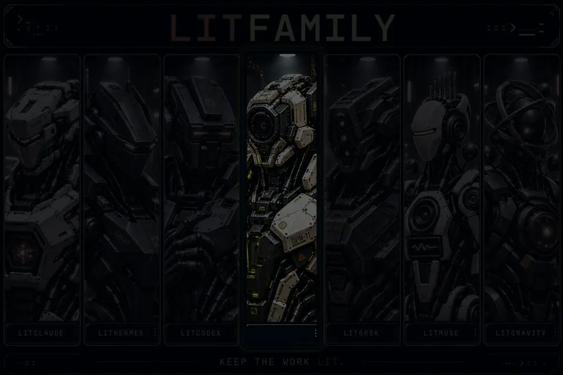
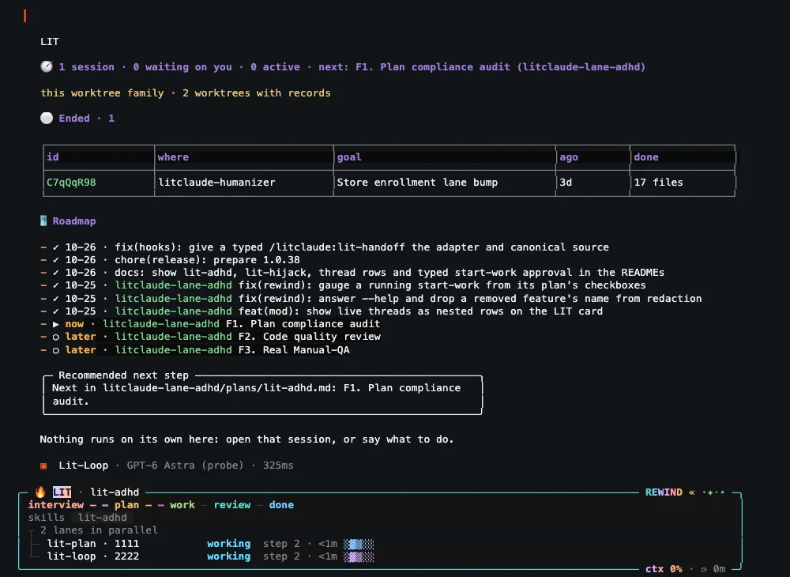
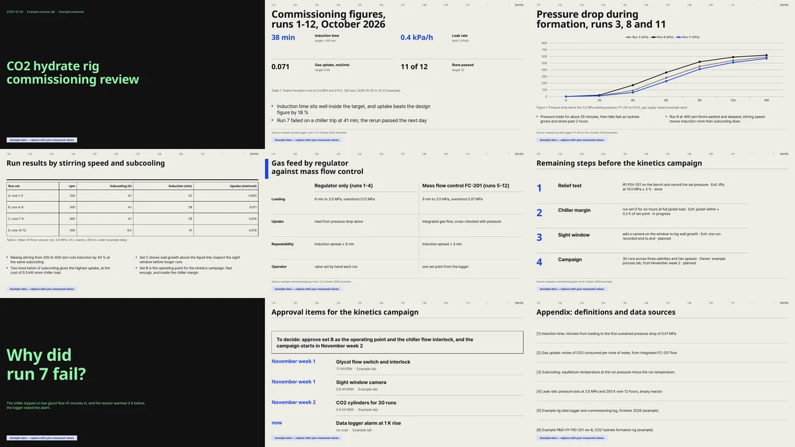
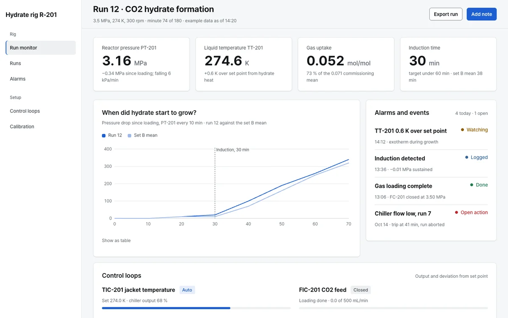
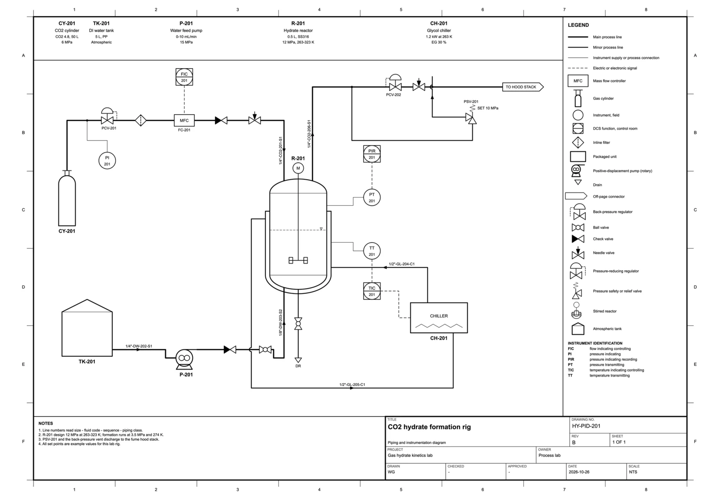
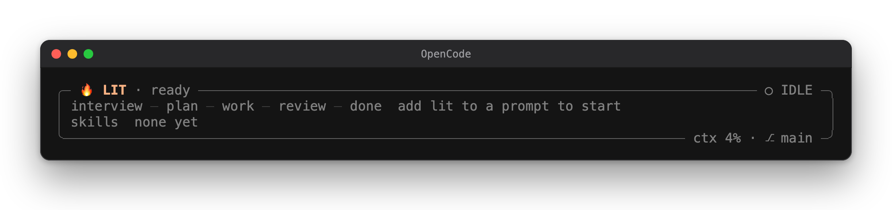
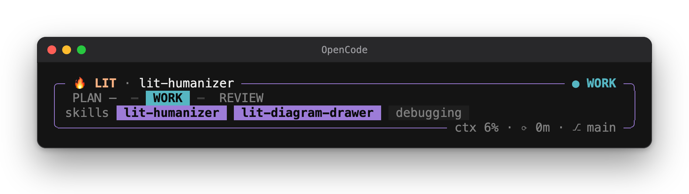
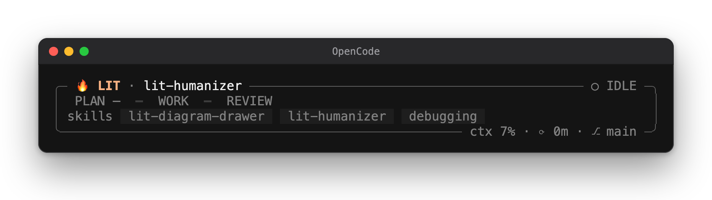
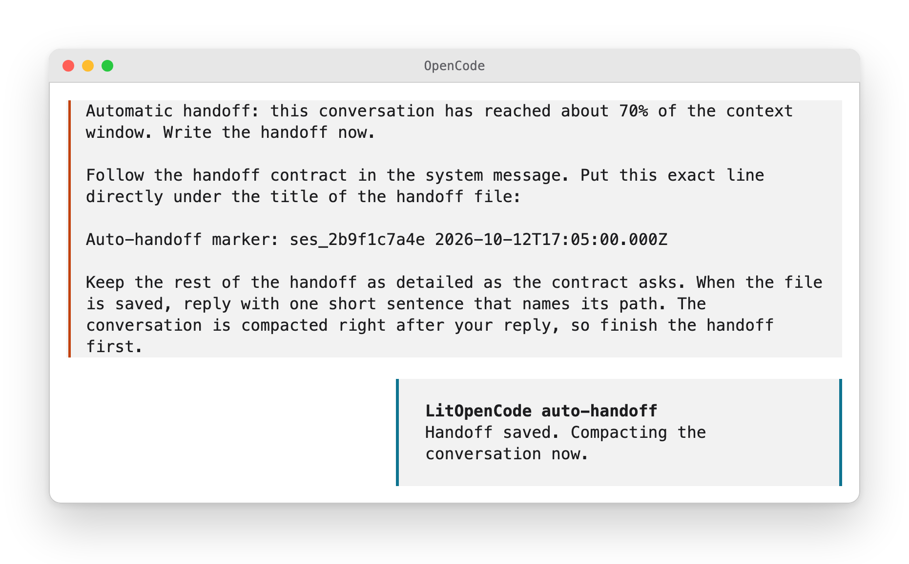
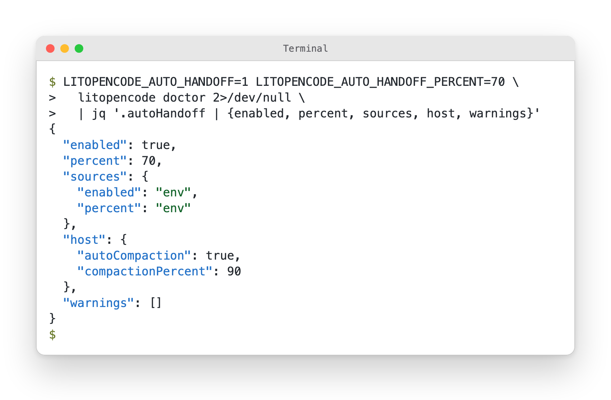

<p align="center"><picture><source media="(prefers-reduced-motion: reduce)" srcset="./docs/assets/cover-motion-still.webp" /></picture></p>

# LitOpenCode

**LitOpenCode is a workflow plugin for OpenCode. Add `lit` to a prompt and the work gets planned, built, checked and written down, so the next session knows where you stopped.**

<p align="center">
<a href="https://www.npmjs.com/package/@litfamily/litopencode"></a>
<a href="https://www.npmjs.com/package/@litfamily/litopencode"></a>
<a href="./LICENSE"></a>
<a href="https://github.com/wjgoarxiv/litopencode"></a>
</p>

<p align="center">
<a href="./docs/guide.md"> Guide</a> &nbsp; <a href="./docs/screens.md"> Screens</a> &nbsp; <a href="./docs/skills.md">Skills</a> &nbsp; <a href="./LICENSE"> MIT</a> &nbsp; <a href="./README-Ko-KR.md">한국어</a>
</p>

<p align="center"></p> <!-- demo-gif -->

> [!TIP]
> Install with one command, restart OpenCode, then add `lit` to a prompt. [Quick start](#quick-start) has the command and a first task.

OpenCode 2.2 can hold a goal for one session, but nothing carries what you decided, checked and left open into the next. After compaction or a closed terminal, you piece it together again. LitOpenCode runs each `lit` task through the same steps (frame, plan, build, check, write down the next step) and keeps notes in `.litopencode/litgoal/`, where the next session reads them.

```text
Evening:  lit add a --shout flag that prints the greeting in capitals, with a test
          → the flag lands with its test, and the run is written to .litopencode/litgoal/
Morning:  /lit-recap
          → what was built, what was checked, what is next
```

It suits work that spans several sittings: a feature, a planned refactor, research you come back to, or a report or deck built from your notes. OpenCode still runs the model, asks for permission and keeps your provider login, and LitOpenCode needs no other LitFamily product.

| I want to… | Go to |
| --- | --- |
| Install it and run a first task | [Quick start](#quick-start) |
| See the routes and commands | [What you get](#what-you-get) |
| Make decks, documents, figures or films | [Extensions](#extensions) |
| Read the card at the bottom of the screen | [The LIT card](#the-lit-card) |
| Save my place before the context fills | [Automatic handoff](#automatic-handoff) |
| Check, update or remove it | [Check, update and remove](#check-update-and-remove) |

## Quick start

You need Node.js with npm, and [OpenCode](https://opencode.ai) with a model provider already set up: OpenCode 1 (1.18.29 or later), OpenCode 2, or both side by side. OpenCode 1 runs as `opencode` and OpenCode 2 as `opencode2`; the installer finds the ones you have and sets up each. Install with one command:

```sh
npm exec --package @litfamily/litopencode@latest -- litopencode install
```

The installer asks which models to use and how much freedom the agents get. Permissions start at `safe`, where OpenCode asks you before acting. On the OpenAI provider, a fresh install plans and reviews with GPT-6 Astra and builds with GPT-6 Luna; you can choose others.

OpenCode reads one global `AGENTS.md` at the start of every session. The installer offers a short marked block there that says what `lit` means and that nothing is pushed or published without your yes; it asks once.

| Add or run | When |
| --- | --- |
| `--dry-run` | You want to see what would change before anything is written |
| `--yes` | The defaults are fine and you'd rather skip the questions; it also says yes to the block |
| `--no-agent-file` | You want to skip the `AGENTS.md` block for one run |
| `litopencode agent-file remove` | You want the block back out, with your own text untouched |

<details>
<summary>Or let a coding agent install it</summary>

Paste this into the agent you already use. It checks first, shows you the plan and waits for your yes before anything changes.

```text
Please install LitOpenCode, the lit workflow plugin for OpenCode, on this machine.
1. Check that Node.js, npm and OpenCode are installed (node --version, npm --version, opencode --version). If one is missing, stop and tell me.
2. Use only the official npm package @litfamily/litopencode. No forks, mirrors, curl scripts or other packages.
3. Before changing anything, run: npm exec --package @litfamily/litopencode@latest -- litopencode install --dry-run
   Show me what it would change and ask me whether to go ahead with the defaults.
4. When I say yes, run: npm exec --package @litfamily/litopencode@latest -- litopencode install --yes
   Do not edit OpenCode's config files by hand.
5. Run: npm exec --package @litfamily/litopencode@latest -- litopencode doctor
   Tell me whether install.ok, install.plugin.ok and install.nativeSkills.ok are true, and quote any warning.
6. Remind me to restart OpenCode, press Tab and choose lit-loop.
```

</details>

### Your first task

Restart OpenCode, press **Tab**, and pick **lit-loop**. Then open an empty folder and send:

```text
lit Build a to-do list in one index.html with no dependencies; check adding and completing items, then leave results and next steps.
```

For six seconds a toast reads `🔥 LIT IGNITED` with the name of the workflow that started. That tells you LitOpenCode picked up your prompt. [Screens](./docs/screens.md) shows the installer, the toast, the health check and the planner's locked permissions, so a healthy install looks familiar.

When the work is done, you have an `index.html` to try and a record of what was built and checked in `.litopencode/litgoal/`. On another day, `/lit-recap` tells you what was done and what comes next. The model inside OpenCode does the work and makes mistakes, so when a reply says something passed, open the file and check.

## What you get

Each route leaves a note you can read later, so a task can stop and resume across sessions.

| Type | What happens |
| --- | --- |
| `lit` at the end of a request, or `/lit` | The task is framed, planned, built, verified and recapped |
| Tab, then `lit-plan` | The planner writes a checklist and waits for explicit user confirmation; it cannot edit files, run shell or delegate |
| `/start-work` | Carries the approved plan out one slice at a time |
| `/review-work` | Looks at the change from five angles, worst findings first |
| A bare `handoff`, or `/lit-handoff` | Leaves a continuation file for the next session; [automatic handoff](#automatic-handoff) can write it before the context window fills |
| `/lit-recap` | Reads back what is done, what is blocked and what is next |
| `/litresearch` | Works in rounds and keeps a source next to each claim, along with what is still uncertain |
| `/lit-humanizer` | Rewrites stiff English or Korean prose, keeping the facts, the writer's voice and the qualifiers that matter |
| `/rules` | Loads the repository rules, once per session and again for files you edit |

```text
Add a dark-mode toggle to the settings page and keep the existing tests passing lit
lit research Which SQLite settings matter most for a write-heavy local app?
```

There is more: debugging, refactoring, code cleanup, commits, language servers, interface work, browser automation and a project wiki. The [skills gallery](./docs/skills.md) shows every skill with a picture of what it makes.

## What you can make

Each picture below came out of LitOpenCode on one Mac, from the skill named under it; none is a mock-up. The deck, the page and the drawing use example data for a made-up hydrate lab, and each says so. Those three skills have since moved to wjgoarxiv-skills, so install them from there to make the same.

<table>
<tr><td width="50%" valign="top"><br /><b>lit-adhd</b> · the welcome-back brief<br /><sub>The skill's own script read the sessions, commits and plans of a real worktree family; a local test model passed that answer to OpenCode, which draws it in colour while the LIT card switches to its rewind look.</sub></td><td width="50%" valign="top"><br /><b>lit-pptx</b> · nine slides, computational brutalism<br /><sub>Compiled by the skill's engine from a slide source written for this page; charts stay editable in PowerPoint and the deck gate found nothing high.</sub></td></tr>
<tr><td width="50%" valign="top"><br /><b>frontend-ui-ux</b> · a run monitor page<br /><sub>Built to a locked house style, then opened by the skill's probe at 1440, 768, 390 and 320 pixels wide; its review approved the page.</sub></td><td width="50%" valign="top"><br /><b>lit-schematic</b> · a P&amp;ID on one A3 sheet<br /><sub>Drawn with the skill's P&amp;ID kit from a build written for this page: 24 symbols, ISA tags, line numbers and a title block, and the drawing check passed.</sub></td></tr>
</table>

## Extensions

Planning, building, review, research, handoffs and the rest of this page work with LitOpenCode alone. The skills that make files (decks, Word documents, diagrams, equipment drawings, journal figures, interfaces and their checks, films and README covers) live on the extension shelf, [wjgoarxiv-skills](https://github.com/wjgoarxiv/wjgoarxiv-skills). Install the ones you use, and LitOpenCode stays smaller.

Until you do, each keeps a small pointer folder under its own name. Ask for a deck with `lit` and the pointer says where the skill went and gives the command that copies it into OpenCode ([the list](./docs/skills.md#moved-to-wjgoarxiv-skills)). The installer mentions the extensions when it runs, and the first session after an install or update mentions them once more.

<p align="center"><picture><source media="(prefers-color-scheme: dark)" srcset="./docs/assets/readme/core-extensions.en.dark.png" /><source media="(prefers-color-scheme: light)" srcset="./docs/assets/readme/core-extensions.en.light.png" /></picture></p>

LitOpenCode can install them for you. Each command that changes something prints what it would do and changes nothing until `--yes`. It fetches the shelf with git into its own cache or uses your clone with `--from <clone>`, and outside a global install needs `npm exec --package @litfamily/litopencode@latest --` in front.

| Command | What it does |
| --- | --- |
| `litopencode extensions list` | Shows each of the nine: installed, still a pointer, or your own folder |
| `litopencode extensions install lit-docx` | Names any same-name skill in OpenCode's other skill folders, and stops |
| `update`, `check`, `prune-backups` | Work the same way |
| `remove` | Moves only folders that carry the receipt |

Install stops on a same-name skill because LitOpenCode never touches those other folders. With `--yes`, it moves the pointer folder whole into a dated folder under `~/.config/opencode/extension-backups/`, which OpenCode never reads, so nothing is deleted. Then it copies the shelf's OpenCode edition in and writes a small receipt inside it.

The nine are `lit-pptx` (decks), `lit-docx` (documents), `lit-diagram-drawer`, `lit-schematic` and `lit-scientific-visualization` (figures), `frontend-ui-ux` and `visual-qa` (design), and `lit-typographic-motion` and `readme-studio` (video covers). Updating from 1.0.43 or earlier? The [guide](./docs/guide.md#updating-from-1043-or-earlier) says what the update backs up and what the old version left behind.

Start a new session after installing one; the film skill also needs `node ~/.config/opencode/skills/lit-typographic-motion/runtime.mjs install` once. `litopencode install` never overwrites a copy you put there, and `litopencode doctor` lists it as preserved, with an `EXTENSIONS` line that sums up `litopencode extensions check`.

<details>
<summary>Install an extension by hand</summary>

Clone the shelf once and run these four lines for each skill. The first only lists same-name folders; the other three move aside, copy and write the receipt. Run them again to update, or run the second line alone to remove. Use `$XDG_CONFIG_HOME/opencode/` in place of `~/.config/opencode/` when that is set.

```sh
ls -d ~/.config/opencode/skills/<skill> ~/.agents/skills/<skill> ~/.claude/skills/<skill> 2>/dev/null
d=~/.config/opencode/extension-backups/$(date +%Y%m%d-%H%M%S); [ ! -e ~/.config/opencode/skills/<skill> ] || { mkdir -p "$d" && mv ~/.config/opencode/skills/<skill> "$d/"; }
mkdir -p ~/.config/opencode/skills && cp -R "<path to your wjgoarxiv-skills clone>/variants/litopencode/<skill>" ~/.config/opencode/skills/<skill>
printf '{"id":"%s","source":"%s","variant":"litopencode","installed_at":"%s"}\n' <skill> "<path to your wjgoarxiv-skills clone>/variants/litopencode/<skill>" "$(date -u +%Y-%m-%dT%H:%M:%SZ)" > ~/.config/opencode/skills/<skill>/.litfamily-extension.json
```

</details>

## The LIT card

With LitOpenCode installed, every OpenCode session gets a small card along the bottom of the screen. It stays for the whole session and keeps the same four rows whether anything is running or not, so your prompt never jumps. Its bottom edge shows how full the context window is and which git branch you are on.

**Ready.** Before your first `lit` prompt the title reads `🔥 LIT · ready` with `○ IDLE` beside it, the workflow map is dim, and the card tells you how to start.

<p align="center"></p>

**Working.** A `lit` prompt wakes the card: the title names the workflow and its step, and the map lights that step with its count. This lit-loop goal has passed one of three criteria, so the map reads `CRITERION 1/3` and skipped steps carry `–`. The bar shows the share done, with a running tool's name and time beside it.

<p align="center"></p>

**Settled.** When the turn ends the title switches to `○ IDLE`, no step stays lit, and the next open item takes the place of the live step. Your next prompt wakes it again.

<p align="center"></p>

The card is on by default, and the LitOpenCode entry in OpenCode's `tui.json` takes these options:

| Option | What it does |
| --- | --- |
| `{ "band": false }` | Keeps the bottom of the screen clear |
| `{ "band": { "card": true } }` | Adds a second card underneath with the goal, the next task and any warnings |
| `{ "notify": true }` | Sends a desktop notification and a sound when the mission finishes |

`notify` stays off until you add it, and works only once OpenCode's own `"attention": { "enabled": true }` is on as well. The [guide](./docs/guide.md#the-lit-card) explains how the map and the skill chips count, and the [reference](./docs/reference.md#tui-mission-panel) explains every part of the card.

## Goals on OpenCode 2

OpenCode 2.2 added `/goal`, which keeps a session going until a reviewer agrees the objective is met. There, `lit loop`, `litwork` and `/start-work` set the goal for you: your task plus what finished means here. Finished means the tests pass, the path you touch was run for real, temporary files are cleaned up and the ledger in `.litopencode/litgoal/` is closed.

- **A line for each change.** Whenever LitOpenCode creates, resumes or clears a goal it prints one line that starts with `LitOpenCode goal:`.
- **Your own goal stays yours.** It manages only the goals it made. If you typed your own `/goal` first, LitOpenCode says it left yours alone and carries on.
- **Only for building work.** Planning, research and review requests never set a goal.
- **Done needs both sides.** A goal is done when OpenCode's reviewer and the ledger agree. If the reviewer says yes while the ledger is still open, you see a conflict line instead.
- **Older hosts.** OpenCode 1 and OpenCode 2 builds before 2.2 have no `/goal`, so the ledger carries the work as always. LitOpenCode records `native-goal-unavailable` once, so you can see why no goal appeared.

## Automatic handoff

A long conversation eventually fills the model's context window, and whatever falls out is forgotten. Automatic handoff saves your place first; it stays off until you turn it on, at a percent you choose. Send one of these as a message on its own: LitOpenCode answers with the new setting, and the model passes it on in a sentence or two.

| Message | What it does |
| --- | --- |
| `lit-handoff auto on 70` | Turns it on at 70%, or at your own number in its place; `/lit-handoff auto on 70` does the same |
| `lit-handoff auto status` | Tells you where things stand and where the setting came from |
| `lit-handoff auto off` | Turns it off and keeps your number, so a later `lit-handoff auto on` without a number picks it up again |

<p align="center"><picture><source media="(prefers-color-scheme: dark)" srcset="./docs/assets/readme/auto-handoff-settings-dark.webp" /></picture></p>

1. Once the conversation reaches your percent and the current turn ends, LitOpenCode asks the model for a handoff.
2. The saved file must carry the marker line from that message, so a handoff left over from earlier never counts.
3. When it checks out, the plugin compacts the conversation, says so in a toast, and puts the start of the handoff in front of the model on the next turn. You never type `/compact`.

If no handoff was saved, the conversation stays as it is and a toast tells you. If OpenCode refuses to compact, a toast asks you to run `/compact` yourself.

<p align="center"><picture><source media="(prefers-color-scheme: dark)" srcset="./docs/assets/readme/auto-handoff-compact-dark.webp" /></picture></p>

Pick a percent below the point where OpenCode compacts on its own, so the handoff has room to run. With the limits LitOpenCode installs that point is 90%, and `litopencode doctor` warns at or above it. Run from your project, doctor also shows the setting and its source: chat, a config file or the environment that starts OpenCode.

<p align="center"><picture><source media="(prefers-color-scheme: dark)" srcset="./docs/assets/readme/auto-handoff-doctor-dark.webp" /></picture></p>

The environment and a config file can hold the setting too. The [guide](./docs/guide.md#automatic-handoff) walks through each step and both of those, and the [reference](./docs/reference.md#automatic-handoff) lists every setting and what is written to disk.

## How it works

OpenCode loads LitOpenCode as a plugin from its config file. For each prompt or command, the plugin picks the workflow that fits and points the model at the skills it needs; its tools and hooks write down what happened in your project. `/lit-recap` or the next session reads that record back, and [Skills and commands](./docs/skills.md#how-the-plugin-works) follows one prompt through.

<p align="center"><picture><source media="(prefers-color-scheme: dark)" srcset="./docs/assets/readme/lit-route.en.dark.png" /><source media="(prefers-color-scheme: light)" srcset="./docs/assets/readme/lit-route.en.light.png" /></picture></p>

OpenCode 1 and OpenCode 2 can share a machine, and they load plugins in different ways. `litopencode install` reads the npm package behind `opencode` and `opencode2` to tell which you have, starting neither, and takes the path that suits each. The [guide](./docs/guide.md#install) says what install changes on each.

<p align="center"><picture><source media="(prefers-color-scheme: dark)" srcset="./docs/assets/readme/two-hosts.en.dark.png" /><source media="(prefers-color-scheme: light)" srcset="./docs/assets/readme/two-hosts.en.light.png" />.md, skills/<id>/, litopencode.json model routes and a marked AGENTS.md block it asks about first; permissions and policies are never written. A lower band compares what looks different: on OpenCode 1 the LIT IGNITED mark appears in the answer, toasts come from the server plugin and the ledger carries the work; on OpenCode 2 the mark is a line under the prompt, toasts come from the TUI plugin, and from 2.2 lit loop and /start-work set /goal."></picture></p>

If you think in process flow sheets, here is the loop drawn as one. Requests enter on the left, and the plan drum feeds the build reactor through `/start-work`, whose output passes the review column. A controller reads the lane verdicts and sets the diverter: passing changes leave, a failed lane returns to the build, and evidence collects in the ledger `/lit-recap` reads later.

<p align="center"><picture><source media="(prefers-reduced-motion: reduce) and (prefers-color-scheme: dark)" srcset="./docs/assets/readme/lit-plant.en.dark.png" /><source media="(prefers-reduced-motion: reduce)" srcset="./docs/assets/readme/lit-plant.en.png" /><source media="(prefers-color-scheme: dark)" srcset="./docs/assets/readme/lit-plant-loop.en.dark.webp" /><source media="(prefers-color-scheme: light)" srcset="./docs/assets/readme/lit-plant-loop.en.webp" /></picture></p>

## Check, update and remove

When something looks off, or right after installing, `litopencode doctor` tells you whether the plugin and skills are wired up. It only reads and changes nothing.

```sh
npm exec --package @litfamily/litopencode@latest -- litopencode doctor
```

LitOpenCode checks for a new release when it starts interactively and after an install or doctor run succeeds. Running the install command again also updates it, keeping routes you have customized. To choose when to update, for example on a machine you keep pinned, pass `--no-auto-update` or set `LITOPENCODE_NO_AUTO_UPDATE=1`.

To remove it, first run `litopencode agent-file remove` if you added the block to OpenCode's global `AGENTS.md`. Then remove the `@litfamily/litopencode` entry from the `plugin` array in OpenCode's `opencode.jsonc` and restart OpenCode. The [full removal steps](./docs/guide.md#uninstall) cover the copied commands and skills, and which files to keep if you plan to come back. If you installed it globally, also run:

```sh
npm uninstall -g @litfamily/litopencode
```

## Learn more

- [Guide](./docs/guide.md): install options, a first task and a planned task, automatic handoff, safety and updates, troubleshooting and full removal.
- [Skills and commands](./docs/skills.md): every route and skill, each with a picture, plus documents, slides, design and browser notes.
- [Screens](./docs/screens.md): what the installer, the health check, the toast and the planner look like, and a 22-second film.
- [Workflow reference](./docs/reference.md): models, permissions, host hooks, every skill, and reproducible verification. In Korean: [한국어 상세 안내](./docs/reference-Ko-KR.md).
- [Migration notes](./docs/migration.md) · [Changelog](./CHANGELOG.md) · [Privacy and network behavior](./docs/privacy.md) · [Artwork and licenses](./docs/brand.md) · [Terminal mark and activation probes](./docs/lit-mark.md)
- [Release checklist](./docs/release-checklist.md), for maintainers. It stays in this repository and is not part of the npm package.
- [LitFamily hub](https://github.com/wjgoarxiv/litfamily): the same `lit` workflow for Claude Code, Codex CLI, Hermes Agent and Grok Build. Each product installs and runs on its own.

## Contributing and license

If LitOpenCode saves you a morning of "where was I?", a GitHub star helps other OpenCode users find it, as does the short version told to a friend: add `lit` to an OpenCode prompt, and tomorrow's session knows where today's stopped. Bug reports and pull requests are welcome. Start with [Contributing](./CONTRIBUTING.md), and see [Support](./SUPPORT.md), [Security](./SECURITY.md) and the [Code of conduct](./CODE_OF_CONDUCT.md).

MIT; see [LICENSE](./LICENSE). Reference material bundled for `lit-handoff` keeps its own license and provenance files under `vendor/`, and the LitOpenCode name, logos and mascot art follow the [trademark policy](./TRADEMARK.md).

<details>
<summary>Copy ASCII logo</summary>

```text
                             ▄▄▄▄
                   ▗███▌   ▗██████▖
 ▗▄▄▄▄▄          ▗▟████▌   ▝██████▘
 ▐█████        ▗▟██████▌    ▝▀▜█▀▘
 ▐█████      ▗▟███████▄▄▄▄▄▄▄▄▄▄▄▄▄▄▄▄▄▄▄▄
 ▐█████    ▗▟█████████████████████████ ▐█▀
 ▐█████    ████████████████████████████▀
 ▐█████    ██▛▘   ▄ ▄▄▄▄▖▄▄▄▄▄▄▄▄▄▄▄▄▄▖
 ▐█████    ▀    ▄██ ████▌█████████████▌
 ▐█████       ▄████ ████▌█████████████▌
 ▐█████     ▄█████▛                                 litopencode
 ▐█████  ▗▟█████▀▘       ▄▄▄▄▄     ▗▖
 ▐█████ ▐█████▀          █████     ▐▛▀
 ▐█████ ▐███▀            █████
 ▐█████ ▐█▀              █████
 ▐█████ ▝                █████
 ▐█████▄▄▄▄▄▄▄▖          █████
 ▐███████████▛           █████
 ▐██████████▀            █████

```

</details>

Icons: [Lucide](./docs/assets/readme/Lucide-LICENSE.txt). ASCII glyphs: [JetBrains Mono, OFL](./docs/assets/readme/JetBrainsMono-OFL.txt).
