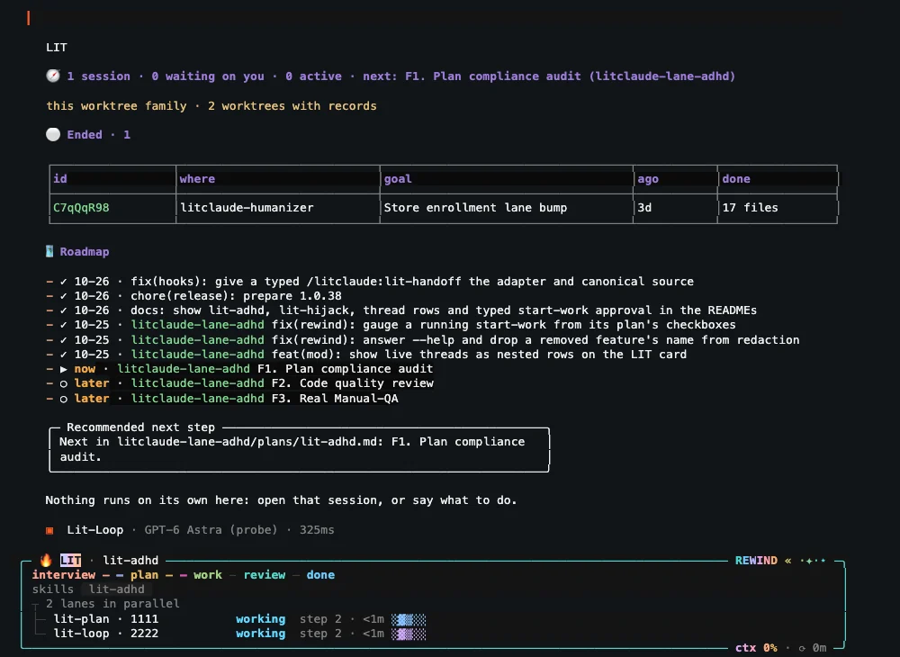
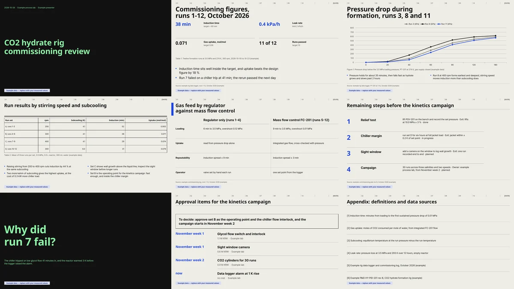
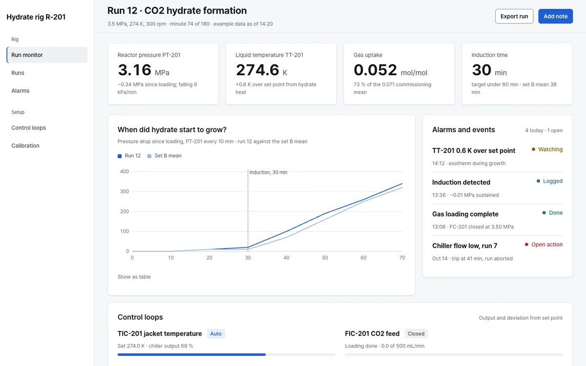
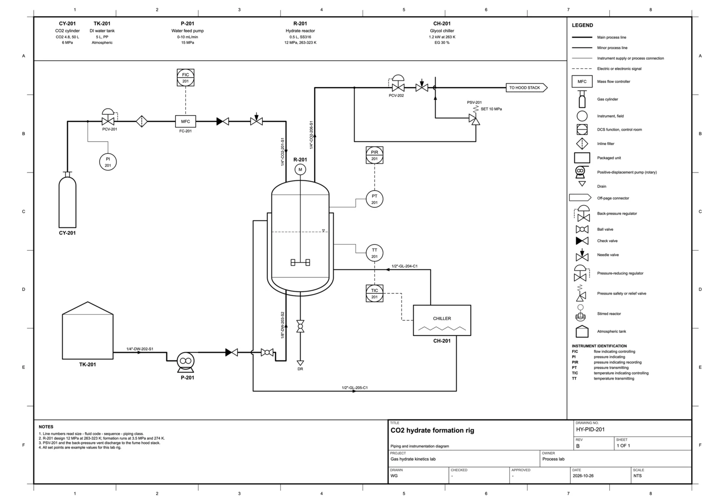
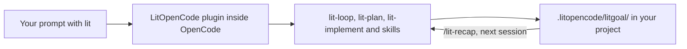

<p align="center"><picture><source media="(prefers-reduced-motion: reduce)" srcset="./docs/assets/cover-motion-still.webp" /></picture></p>

# LitOpenCode

**LitOpenCode is a workflow plugin for OpenCode. Add `lit` to a prompt and the work gets planned, built, checked and written down, so the next session knows where you stopped.**

<p align="center">
<a href="https://www.npmjs.com/package/@litfamily/litopencode"></a>
<a href="https://www.npmjs.com/package/@litfamily/litopencode"></a>
<a href="./LICENSE"></a>
<a href="https://github.com/wjgoarxiv/litopencode"></a>
</p>

<p align="center">
<a href="./docs/guide.md"> Guide</a> &nbsp; <a href="./docs/screens.md"> Screens</a> &nbsp; <a href="./docs/skills.md">Skills</a> &nbsp; <a href="./LICENSE"> MIT</a> &nbsp; <a href="./README-Ko-KR.md">한국어</a>
</p>

<p align="center"></p> <!-- demo-gif -->

## Why you might want it

OpenCode is good at the conversation in front of it. The trouble starts when that conversation ends. A long session gets compacted, you close the terminal, and the next morning you are piecing together what you decided, what you already checked and what was left. OpenCode 2.2 can hold a goal for a session, but nothing carries what you decided, checked and left open into the next one.

LitOpenCode gives the work a routine and a memory. Add `lit` to a prompt and the task goes through the same steps each time: frame it, plan it, build it, check it, and write down the next step. Those notes go into `.litopencode/litgoal/` inside your project, so the next session reads them and carries on from there. Bigger jobs can be planned first by an agent that is locked out of your files, then carried out and reviewed.

In practice it looks like this:

```text
Evening:  lit add a --shout flag that prints the greeting in capitals, with a test
          → the flag lands with its test, and the run is written to .litopencode/litgoal/
Morning:  /lit-recap
          → what was built, what was checked, what is next
```

## Quick start

You need Node.js with npm, and [OpenCode](https://opencode.ai) with a model provider already set up: OpenCode 1 (1.18.29 or later), OpenCode 2, or both side by side, with OpenCode 1 run as `opencode` and OpenCode 2 as `opencode2`. The installer finds the ones you have and sets up each. Install with one command:

```sh
npm exec --package @litfamily/litopencode@latest -- litopencode install
```

The installer asks which models to use and how much freedom the agents get. Add `--dry-run` when you want to see what would change before anything is written, or `--yes` when the defaults are fine and you'd rather skip the questions. Permissions start at `safe`, where OpenCode asks you before acting.

OpenCode reads one global `AGENTS.md` at the start of every session. The installer can put a short marked block there, so each session knows what `lit` means and that nothing is pushed or published without your yes. It asks once, `--yes` says yes, `--no-agent-file` skips it for a run, and `litopencode agent-file remove` takes it back out with your own text untouched.

### Or let a coding agent install it

Paste this into the agent you already use. It checks first, shows you the plan and waits for your yes before anything changes.

```text
Please install LitOpenCode, the lit workflow plugin for OpenCode, on this machine.
1. Check that Node.js, npm and OpenCode are installed (node --version, npm --version, opencode --version). If one is missing, stop and tell me.
2. Use only the official npm package @litfamily/litopencode. No forks, mirrors, curl scripts or other packages.
3. Before changing anything, run: npm exec --package @litfamily/litopencode@latest -- litopencode install --dry-run
   Show me what it would change and ask me whether to go ahead with the defaults.
4. When I say yes, run: npm exec --package @litfamily/litopencode@latest -- litopencode install --yes
   Do not edit OpenCode's config files by hand.
5. Run: npm exec --package @litfamily/litopencode@latest -- litopencode doctor
   Tell me whether install.ok, install.plugin.ok and install.nativeSkills.ok are true, and quote any warning.
6. Remind me to restart OpenCode, press Tab and choose lit-loop.
```

### Your first task

Restart OpenCode, press **Tab**, and pick **lit-loop**. Then open an empty folder and send:

```text
lit Build a to-do list in one index.html with no dependencies; check adding and completing items, then leave results and next steps.
```

For six seconds a toast appears that reads `🔥 LIT IGNITED` with the name of the workflow that started, which tells you LitOpenCode picked up your prompt. When the work is done you have an `index.html` to open and try, and a record of what was built and checked in `.litopencode/litgoal/`. Come back another day, type `/lit-recap`, and it tells you what was done and what comes next. [Screens](./docs/screens.md) shows the installer, the toast, the health check and the planner's locked permissions, so a healthy install looks familiar.

The model inside OpenCode does the work, and models make mistakes. When a reply says something passed, open the file and check it yourself.

## What you get

### Start with one word

Put `lit` at the end of any request, or type `/lit`. The task is framed, planned, built, verified and recapped, and each step leaves a note you can read later.

```text
Add a dark-mode toggle to the settings page and keep the existing tests passing lit
```

### Plan first when the job is big

Press Tab and pick `lit-plan`. The planner reads your project and writes a checklist, then waits for explicit user confirmation; it cannot edit files, run shell commands or hand work to another agent. Run `/start-work` to carry the approved plan out one slice at a time, and `/review-work` to have the change looked at from five angles, worst findings first.

### Pick up where you stopped

Type a bare `handoff`, or `/lit-handoff`, to leave a continuation file for the next session, and `/lit-recap` to read back what is done, what is blocked and what is next. If you like, [automatic handoff](#automatic-handoff) writes the handoff for you before the context window fills up.

### Research with sources

`/litresearch` works in rounds and keeps a source next to each claim, along with what is still uncertain.

```text
lit research Which SQLite settings matter most for a write-heavy local app?
```

### Reports, decks and figures

Ask for a report or slides with `lit` and you get an editable Word file or PowerPoint deck, built from a Markdown source you keep, in a design direction the skill picks and names first. Journal-sized figures from measured data come from `/lit-scientific-visualization`, and concept diagrams have a skill of their own.

```text
lit Turn notes.md into a ten-slide deck for Friday's team review
```

### Writing that sounds like a person

`/lit-humanizer` rewrites stiff English or Korean prose while keeping the facts, the writer's voice and the qualifiers that matter.

### And the rest

There is more: debugging, refactoring, code cleanup, commits, language servers, repository rules that load once per session and again for files you edit (`/rules`), interface work, browser automation and a project wiki. The [skills gallery](./docs/skills.md) shows each one with a picture of what it makes.

## What you can make

Each picture below came out of LitOpenCode on one Mac, from the skill named under it. None is a mock-up. The figures in the deck, the page and the drawing are example data for a made-up hydrate lab, and each says so on the page.

<table>
<tr><td width="50%" valign="top"><br /><b>lit-adhd</b> · the welcome-back brief<br /><sub>The skill's own script read the sessions, commits and plans of a real worktree family; a local test model passed that answer to OpenCode, which draws it in colour while the LIT card switches to its rewind look.</sub></td><td width="50%" valign="top"><br /><b>lit-pptx</b> · nine slides, computational brutalism<br /><sub>Compiled by the skill's engine from a slide source written for this page; charts stay editable in PowerPoint and the deck gate found nothing high.</sub></td></tr>
<tr><td width="50%" valign="top"><br /><b>frontend-ui-ux</b> · a run monitor page<br /><sub>Built to a locked house style, then opened by the skill's probe at 1440, 768, 390 and 320 pixels wide; its review approved the page.</sub></td><td width="50%" valign="top"><br /><b>lit-schematic</b> · a P&amp;ID on one A3 sheet<br /><sub>Drawn with the skill's P&amp;ID kit from a build written for this page: 24 symbols, ISA tags, line numbers and a title block, and the drawing check passed.</sub></td></tr>
</table>

The [skills gallery](./docs/skills.md) has a picture for every other skill.

## Who it's for

LitOpenCode is for people who already use OpenCode and give it work that spans more than one sitting: a feature that takes a few sessions, a refactor with a plan behind it, research you come back to, or a report or deck built from your notes. It also suits anyone who wants each change checked and reviewed before calling it done.

You keep using OpenCode the way you do now. It still runs the model and asks for permission the way it always has, and your provider login stays where it is. LitOpenCode needs no other LitFamily product.

## The LIT card

With LitOpenCode installed, every OpenCode session gets a small card along the bottom of the screen. It stays there for the whole session and keeps the same four rows whether anything is running or not, so your prompt never jumps.

Before your first `lit` prompt the card is quiet. The title reads `🔥 LIT · ready` with `○ IDLE` beside it, the workflow map is dim, and the card tells you how to start. Its bottom edge shows how full the context window is and which git branch you are on.

<p align="center"></p>

Send a prompt with `lit` and the card wakes up. The title names the workflow and the step it is on, and the map lights that step with its count. In this lit-loop request the goal has three criteria and one has passed, so the map reads `CRITERION 1/3`, the steps the request went past without doing carry `–`, and the bar shows the share that is done. While a tool runs, its name and running time sit beside the bar. Each LitOpenCode skill the request uses gets a bright chip of its own, with a short sweep of light as it arrives; skills from earlier turns wait in grey.

<p align="center"></p>

When the turn ends the card settles: the title switches to `○ IDLE`, no step stays lit, and the next open item takes the place of the live step. The chips dim but stay, newest first, so you can still see what ran. Your next prompt wakes it again. A skill used again lights up again, and when there are more chips than room, the rest fold into `+N`.

<p align="center"></p>

The track is a map of the whole workflow. A request that starts with an interview walks through `interview › plan › work › review › done`, and the step you are on is lit with its count, such as `WORK 3/7` while `/start-work` works through a saved plan. A lit-loop goal counts its criteria and loop turns instead, and a litresearch run follows its own steps from `decompose` through each `wave` to `synthesis`. The chip beside the prompt shows the same map around the current step, the sidebar draws it top to bottom with a line that fills as you move forward, and while a tool runs its name and elapsed time sit beside it, like `⠹ bash · 0:48`. If you step away during long work, `{ "notify": true }` in the same `tui.json` entry sends a desktop notification and a sound when the mission finishes, once OpenCode's own `"attention": { "enabled": true }` is on as well; it stays off until you add it.

The card is on by default. To keep the bottom of the screen clear, give the LitOpenCode entry in OpenCode's `tui.json` the option `{ "band": false }`. When you want more detail, `{ "band": { "card": true } }` adds a second card underneath with the goal, the next task and any warnings. The [reference](./docs/reference.md#tui-mission-panel) explains every part of the card.

## Goals on OpenCode 2

Long work needs a finish line, and OpenCode 2.2 added one: `/goal` keeps a session going until a reviewer agrees the objective is met. When you start a job with `lit loop`, `litwork` or `/start-work` on that version, LitOpenCode sets the goal for you. The objective is your task plus what finished means here: the tests pass, the path you touch was run for real, temporary files are cleaned up, and the ledger in `.litopencode/litgoal/` is closed. Whenever LitOpenCode creates, resumes or clears a goal it prints one line that starts with `LitOpenCode goal:`.

It manages only the goals it made. If you typed your own `/goal` first, LitOpenCode says it left yours alone and carries on. Planning, research and review requests never set a goal. A goal counts as done when OpenCode's reviewer and the ledger agree, and when the reviewer says yes while the ledger is still open you see a conflict line instead of a done.

OpenCode 1 and OpenCode 2 builds before 2.2 have no `/goal`. There the ledger carries the work as it always did, and LitOpenCode records `native-goal-unavailable` once so you can see why no goal appeared.

## Automatic handoff

A long conversation eventually fills the model's context window, and whatever falls out of it is forgotten. Automatic handoff saves your place before that happens. It stays off until you turn it on, and the percent is yours to choose.

To turn it on, send `lit-handoff auto on 70` as a message on its own, with your own number in place of 70; `/lit-handoff auto on 70` does the same. LitOpenCode answers with the new setting, and the model passes it on in a sentence or two. `lit-handoff auto status` tells you where things stand and where the setting came from. `lit-handoff auto off` turns it off and keeps your number, so a later `lit-handoff auto on` without a number picks it up again.

<p align="center"><picture><source media="(prefers-color-scheme: dark)" srcset="./docs/assets/readme/auto-handoff-settings-dark.webp" /></picture></p>

From then on LitOpenCode keeps an eye on how full the context window is. Once the conversation reaches your percent and the current turn ends, it sends the model a short message asking for a handoff. The saved file has to carry the marker line from that message, so a handoff left over from earlier never counts. When the new one checks out, the plugin compacts the conversation itself, says so in a toast, and puts the start of the handoff in front of the model on the next turn. You never have to type `/compact`.

<p align="center"><picture><source media="(prefers-color-scheme: dark)" srcset="./docs/assets/readme/auto-handoff-compact-dark.webp" /></picture></p>

If no handoff was saved, the conversation stays as it is and a toast tells you. If OpenCode refuses to compact, a toast asks you to run `/compact` yourself.

Pick a percent below the point where OpenCode compacts on its own, because the handoff needs room to run first. With the limits LitOpenCode installs, OpenCode compacts at 90%, and `litopencode doctor` warns you when your percent is at or above that. Run it from your project and doctor also shows the setting and where it came from, whether you saved it in chat, in a config file or in the environment that starts OpenCode. In the environment, `LITOPENCODE_AUTO_HANDOFF=1` switches it on, `LITOPENCODE_AUTO_HANDOFF_PERCENT` takes a whole number from 1 to 99, and the environment wins over the chat setting.

<p align="center"><picture><source media="(prefers-color-scheme: dark)" srcset="./docs/assets/readme/auto-handoff-doctor-dark.webp" /></picture></p>

To keep the setting in a file, add an `autoHandoff` block to `.litopencode/config.json` in your project, or to `~/.config/opencode/litopencode.json` for every project. The environment and the chat setting both come before the file.

```json
{ "autoHandoff": { "enabled": true, "percent": 70 } }
```

The [guide](./docs/guide.md#automatic-handoff) walks through each step, and the [reference](./docs/reference.md#automatic-handoff) lists every setting and what is written to disk.

## How it works

OpenCode loads LitOpenCode as a plugin from its config file. When you send a prompt or a command, the plugin picks the workflow that fits and points the model at the skills it needs. Its tools and hooks write down what happened in your project, and `/lit-recap` or the next session reads that record back.



Install registers the plugin in OpenCode's config (`opencode.jsonc`), copies commands and skills into your OpenCode config folder, and keeps your model routes in `~/.config/opencode/litopencode.json`. The [guide](./docs/guide.md#install) has the details.

## Requirements, updates and removal

### Requirements

Node.js with npm, and OpenCode 1 (1.18.29 or later) or OpenCode 2 with a provider you have already logged in to. On the OpenAI provider, a fresh install plans and reviews with GPT-6 Astra and builds with GPT-6 Luna; you can choose others during install.

### Check the install

When something looks off, or right after installing, `litopencode doctor` tells you whether the plugin and skills are wired up. It only reads and changes nothing.

```sh
npm exec --package @litfamily/litopencode@latest -- litopencode doctor
```

### Updates

LitOpenCode checks for a new release when it starts interactively and after an install or doctor run succeeds. If you'd rather choose when to update, for example on a machine you keep pinned, pass `--no-auto-update` or set `LITOPENCODE_NO_AUTO_UPDATE=1`. Running the install command again also updates it, and routes you have customized are kept.

### Uninstall

If you added the block to OpenCode's global `AGENTS.md`, run `litopencode agent-file remove` first. Then remove the `@litfamily/litopencode` entry from the `plugin` array in OpenCode's `opencode.jsonc`, then restart OpenCode. If you installed it globally, also run:

```sh
npm uninstall -g @litfamily/litopencode
```

The [full removal steps](./docs/guide.md#uninstall) cover the copied commands and skills, and which files to keep if you plan to come back.

## Learn more

- [Guide](./docs/guide.md): install options, a first task and a planned task, automatic handoff, safety and updates, troubleshooting and full removal.
- [Skills and commands](./docs/skills.md): every route and skill, each with a picture, plus documents, slides, design and browser notes.
- [Screens](./docs/screens.md): what the installer, the health check, the toast and the planner look like, and a 22-second film.
- [Workflow reference](./docs/reference.md): models, permissions, host hooks, every skill, and reproducible verification. In Korean: [한국어 상세 안내](./docs/reference-Ko-KR.md).
- [Migration notes](./docs/migration.md) · [Changelog](./CHANGELOG.md) · [Privacy and network behavior](./docs/privacy.md)
- [Artwork and licenses](./docs/brand.md) · [Terminal mark and activation probes](./docs/lit-mark.md)
- [Release checklist](./docs/release-checklist.md), for maintainers. It stays in this repository and is not part of the npm package.
- [LitFamily hub](https://github.com/wjgoarxiv/litfamily): the same `lit` workflow for Claude Code, Codex CLI, Hermes Agent and Grok Build. Each product installs and runs on its own.

## Contributing and license

If LitOpenCode saves you a morning of "where was I?", a star on GitHub helps other OpenCode users find it, and so does telling a friend the short version: add `lit` to an OpenCode prompt, and tomorrow's session knows where today's stopped.

Bug reports and pull requests are welcome. Start with [Contributing](./CONTRIBUTING.md), and see [Support](./SUPPORT.md), [Security](./SECURITY.md) and the [Code of conduct](./CODE_OF_CONDUCT.md).

MIT. See [LICENSE](./LICENSE). Reference material bundled for `lit-handoff` and `lit-scientific-visualization` keeps its own license and provenance files under `vendor/`.

The LitOpenCode name, logos and mascot art follow the [trademark policy](./TRADEMARK.md).

<details>
<summary>Copy ASCII logo</summary>

```text
                             ▄▄▄▄
                   ▗███▌   ▗██████▖
 ▗▄▄▄▄▄          ▗▟████▌   ▝██████▘
 ▐█████        ▗▟██████▌    ▝▀▜█▀▘
 ▐█████      ▗▟███████▄▄▄▄▄▄▄▄▄▄▄▄▄▄▄▄▄▄▄▄
 ▐█████    ▗▟█████████████████████████ ▐█▀
 ▐█████    ████████████████████████████▀
 ▐█████    ██▛▘   ▄ ▄▄▄▄▖▄▄▄▄▄▄▄▄▄▄▄▄▄▖
 ▐█████    ▀    ▄██ ████▌█████████████▌
 ▐█████       ▄████ ████▌█████████████▌
 ▐█████     ▄█████▛                                 litopencode
 ▐█████  ▗▟█████▀▘       ▄▄▄▄▄     ▗▖
 ▐█████ ▐█████▀          █████     ▐▛▀
 ▐█████ ▐███▀            █████
 ▐█████ ▐█▀              █████
 ▐█████ ▝                █████
 ▐█████▄▄▄▄▄▄▄▖          █████
 ▐███████████▛           █████
 ▐██████████▀            █████

```

</details>

Icons: [Lucide](./docs/assets/readme/Lucide-LICENSE.txt). ASCII glyphs: [JetBrains Mono, OFL](./docs/assets/readme/JetBrainsMono-OFL.txt).
