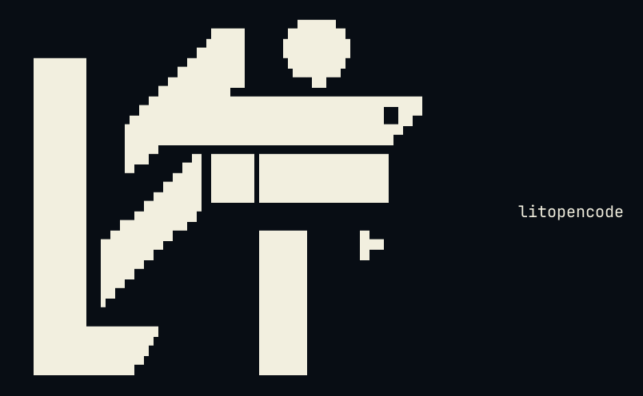
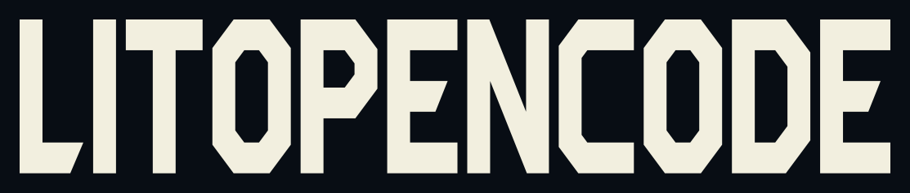
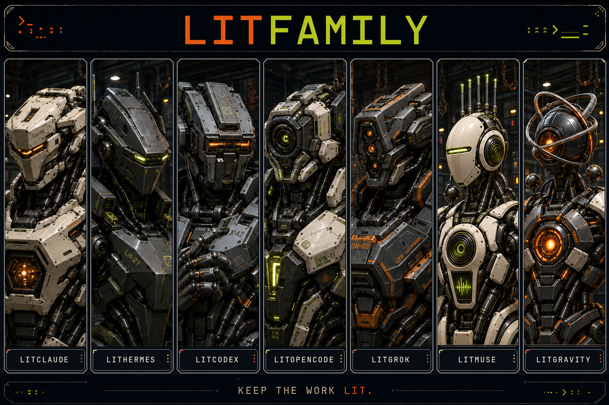

# LitOpenCode artwork

[README](../README.md) · [한국어](./brand-Ko-KR.md)

The README now opens with one cover. The rest of the artwork that used to sit around it lives here, with the licenses that come with it.

## Cover

The README cover is a looping WebP: seven armored robots power on in turn, and the LitOpenCode robot wakes. Readers who ask for reduced motion get [a still of the lit frame](./assets/cover-motion-still.webp). The editable, low-bandwidth vector version of the cover is [docs/assets/cover.svg](./assets/cover.svg). It stays in this repository and is not part of the npm package.

The 1280×640 [social preview](./assets/social-preview.png) is built from the same cover for link cards. It is also left out of the npm package.

## ASCII mark

The same mark the installer prints, drawn as outlined paths so it renders without a font. The README keeps a copyable text version at the bottom.

The glyphs come from JetBrains Mono, used under the [SIL Open Font License](./assets/readme/JetBrainsMono-OFL.txt). How the terminal mark is built and checked is in [Terminal mark and activation probes](./lit-mark.md).

## Wordmark and clay mark

The navigation icons on the README come from Lucide, used under the [Lucide license](./assets/readme/Lucide-LICENSE.txt).

## LITFAMILY

LitClaude · LitHermes · LitCodex · LitOpenCode · LitGrok · LitMuse · LitGravity.
Seven armored machines for seven independent products, each working in its own host. The [LitFamily hub](https://github.com/wjgoarxiv/litfamily) has the install command for each one.

## Ignition motion

[Watch the 10-second film](./assets/readme/ignition-film.mp4) · [Animated GIF](./assets/readme/ignition-readme.gif)
