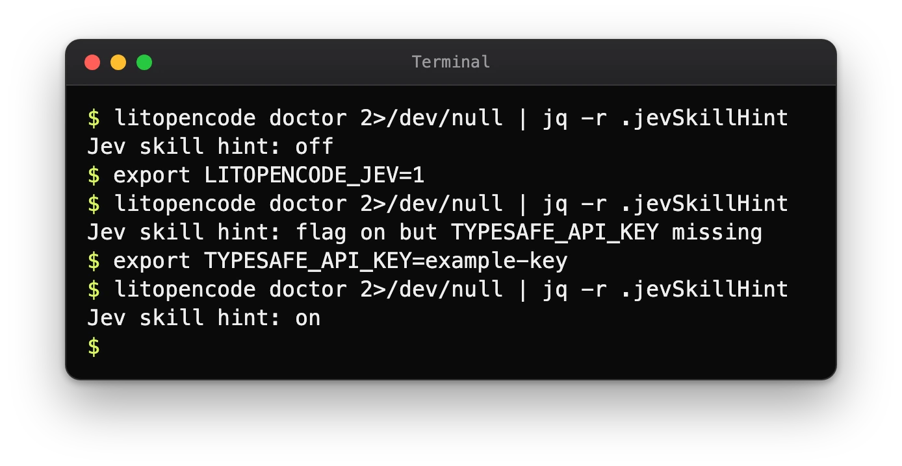
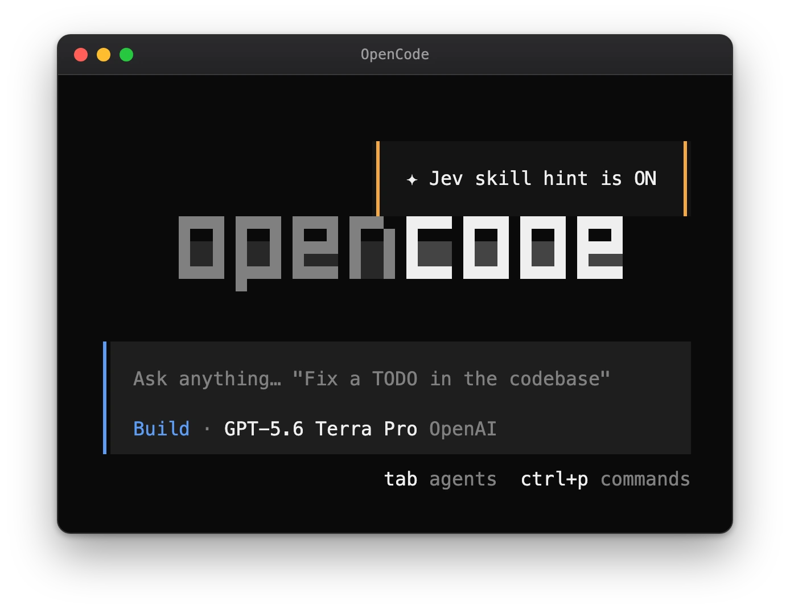
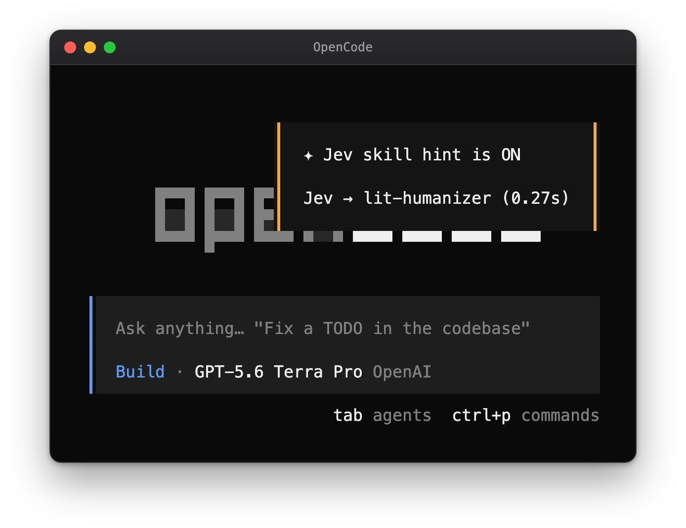
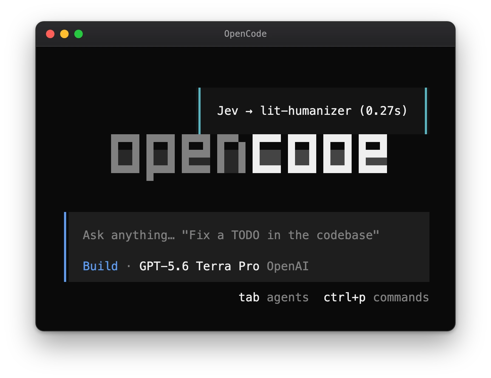

# LitOpenCode 사용 안내

[README](../README-Ko-KR.md) · [English](./guide.md) · [스킬과 명령](./skills-Ko-KR.md) · [화면 미리 보기](./screens-Ko-KR.md) · [상세 안내](./reference-Ko-KR.md)

README에는 짧은 안내만 남겼습니다. 이 문서에는 나머지를 모았습니다. 설치가 무엇을 묻고 무엇을 바꾸는지, 첫 작업과 계획을 세우는 작업이 어떻게 흘러가는지, 자동 인수인계, 안전과 업데이트, 선택 기능인 Jev 힌트, 문제 해결, 완전한 제거 방법입니다.

## 설치

Node.js와 npm, 그리고 OpenCode가 있으면 됩니다. 다음을 실행하세요.

```sh
LIT_PACKAGE='@litfamily/litopencode@latest'
npm exec --package "$LIT_PACKAGE" -- litopencode install
```

OpenCode를 다시 시작하고 `Tab` 키를 눌러 `lit-loop`를 고르세요.

설치하는 동안 어떤 모델을 쓸지, 에이전트에게 권한을 얼마나 줄지, 답변을 어떤 모양으로 받을지 묻습니다. 권한은 `safe`에서 시작하는데, 무언가 하기 전에 OpenCode가 먼저 물어보는 설정입니다. 로그인과 API 키는 OpenCode에 이미 설정해 둔 모델 제공자(provider) 쪽 것을 그대로 씁니다.

OpenAI 제공자를 쓰면 새로 설치했을 때 계획과 검토는 GPT-6 Astra(`gpt-6-astra`)가 `xhigh`로, 만들기와 조사는 GPT-6 Luna(`gpt-6-luna`)가 `max`로 맡습니다. 지원되는 다른 모델과 추론 수준은 설치 중에 고를 수 있습니다.

바뀔 내용을 먼저 보고 싶거나 질문 없이 설치하려면 둘 중 하나를 붙이세요.

```sh
npm exec --package @litfamily/litopencode@latest -- litopencode install --dry-run  # 변경 사항 미리 보기
npm exec --package @litfamily/litopencode@latest -- litopencode install --yes     # 기본값 사용, 저장된 선택 유지
```

`--dry-run`은 무엇이 바뀔지만 보여 주고 아무것도 쓰지 않습니다. `--yes`는 질문을 건너뛰고 기본값으로 설치하되, 예전에 저장해 둔 선택은 그대로 둡니다.

설치가 하는 일은 많지 않습니다. OpenCode 설정에 플러그인을 등록하고, LitOpenCode의 명령과 스킬 파일을 OpenCode 설정 폴더에 복사합니다. 어떤 일에 어떤 모델을 쓸지 정한 route는 `~/.config/opencode/litopencode.json`에 저장됩니다. `XDG_CONFIG_HOME`을 지정하면 설정 폴더가 통째로 그쪽으로 옮겨 갑니다. 이미 손봐 둔 route는 건드리지 않습니다. 설정 폴더를 직접 정하는 방법, 모델 선택, 터미널 정책, 무인 설치는 [상세 안내](./reference-Ko-KR.md#설치)에 있습니다.

이 체크아웃의 패키지 버전은 `@litfamily/litopencode@1.0.23`입니다. registry의 `@latest`와 다를 수 있으니, 정확한 버전이 중요하면 `npm view @litfamily/litopencode version`으로 확인하세요.

## 첫 작업

작게 시작하세요. 빈 폴더를 OpenCode에서 열고 `lit-loop`를 고른 다음 채팅에 이렇게 보냅니다.

```text
lit 외부 의존성 없이 index.html 하나로 할 일 목록을 만들고, 추가와 완료 표시를 확인한 뒤 다음 할 일을 남겨줘.
```

첫 결과는 `index.html`입니다. 직접 열어서 항목을 추가하고 완료 표시를 해 보세요.

나중에 돌아왔을 때는 `/lit-recap`이 기록을 읽고 다음 할 일을 알려 줍니다.

`/lit`도 같은 워크플로를 시작합니다. 규모가 큰 일은 계획부터 세우는 편이 좋습니다. `lit-plan`을 골라 계획을 읽고 승인한 뒤 `/start-work`로 실행하고, `/review-work`로 마무리합니다. planner는 계획만 세웁니다. 명시적인 사용자 승인을 기다리고, 파일을 고치거나 셸 명령을 실행할 방법이 없습니다. 승인하고 나면 `lit-implement`가 계획을 실제로 수행합니다.

진행 상황과 확인한 결과까지, 기록은 모두 프로젝트의 `.litopencode/litgoal/`에 쌓입니다. OpenCode에는 세션을 넘어 목표를 보관할 곳이 따로 없어서, 다음 세션은 이 폴더를 보고 어디까지 했는지 압니다. 작업 지침만 담긴 스킬도 있는데, 문서에 나온 경로로 그 스킬을 부르면 지침이 작업에 적용됩니다.

## 자동 인수인계

대화가 길어지면 모델의 컨텍스트 창이 차고, 넘친 내용은 잊힙니다. 자동 인수인계는 그렇게 되기 전에 지금까지의 진행 상황을 저장해 둡니다. 기본은 꺼져 있고, 몇 퍼센트에서 시작할지는 직접 정합니다. LitOpenCode가 정해 둔 기본 퍼센트는 없습니다.

켜 두면 LitOpenCode가 컨텍스트 창이 얼마나 찼는지 지켜봅니다. 대화가 정한 퍼센트에 닿고 진행 중인 차례가 끝나면, 모델에게 인수인계 파일을 쓰라고 요청합니다. 그다음 파일이 정말 저장됐는지 확인하고, 대화를 압축하고, 다음 차례에 그 인수인계의 앞부분을 모델 앞에 다시 놓습니다.

OpenCode는 플러그인이 압축을 직접 시작하도록 허용하므로, OpenCode에서는 모든 단계가 저절로 진행됩니다.

| 단계 | OpenCode에서 |
| --- | --- |
| 정한 퍼센트에 닿았는지 확인 | 자동 |
| 모델에게 인수인계 요청 | 자동 |
| 인수인계가 저장됐는지 확인 | 자동. 저장된 인수인계가 없으면 대화는 그대로 두고 짧은 알림으로 알려 줍니다 |
| 대화 압축 | 자동 |
| 인수인계 다시 불러오기 | 자동, 한 번, 배경 메모로 전달 |

인수인계는 모델이 쓰는데, 모델이 지시를 놓칠 때도 있습니다. 압축 전에 저장 여부를 확인하는 이유입니다. OpenCode가 압축을 시작하지 못하면 알림으로 한 번 알려 줍니다. "Handoff saved. Run /compact now."

켜려면 채팅에 `lit-handoff auto on 70`을 보내거나 `/lit-handoff auto on 70`을 실행하세요. 70 자리에 원하는 숫자를 넣으면 됩니다. `lit-handoff auto off`는 끄면서 숫자를 기억해 두므로, 나중에 숫자 없이 `lit-handoff auto on`을 보내면 그 숫자를 다시 씁니다. `lit-handoff auto status`는 지금 상태를 보여 줍니다. 설정은 프로젝트의 `.litopencode` 폴더에 저장됩니다.

환경 변수로 정하고 싶다면 `LITOPENCODE_AUTO_HANDOFF=1`을 설정하고, `LITOPENCODE_AUTO_HANDOFF_PERCENT`에 1부터 99 사이의 정수를 넣으세요. 환경 변수는 저장된 설정보다 우선합니다. 설정 파일의 `autoHandoff` 블록에도 같은 두 값을 적을 수 있습니다. 1~99 밖의 퍼센트는 기능을 끄고, 이유는 `litopencode doctor`가 알려 줍니다.

OpenCode가 스스로 압축하는 지점보다 낮은 퍼센트를 고르세요. LitOpenCode가 설치하는 한도에서는 그 지점이 창의 90%입니다. 고른 퍼센트가 그 지점과 같거나 더 높으면 OpenCode가 먼저 압축해 인수인계가 돌 틈이 없으므로, doctor가 경고합니다. 모든 설정과 디스크에 남는 내용, 다시 불러오는 방식은 [레퍼런스](./reference-Ko-KR.md#자동-인수인계)에 있습니다.

## 안전과 업데이트

planner는 계획만 세웁니다. `lit-plan`은 `edit`, `bash`, `task` 권한이 모두 거부되어 있어서 파일을 고치거나, 명령을 실행하거나, 다른 에이전트에게 일을 넘길 수 없습니다. 나머지 작업의 권한은 `balanced`나 `yolo` 모드를 직접 골라 넓힐 수 있습니다. 그래도 planner는 읽기 전용으로 남고, 보조 에이전트가 또 다른 보조 에이전트를 부를 수도 없습니다.

공개 페이지를 가져올 때는 요청이 어디로 가는지 먼저 확인하고, 리디렉션도 하나하나 검사하며, 받아 오는 양에 한도를 둡니다. 가져온 본문은 데이터로만 읽고, 그 안에 적힌 지시는 따르지 않습니다.

LitOpenCode는 스스로 업데이트할 수 있습니다. 대화형으로 시작할 때와 install이나 doctor가 성공한 뒤에 새 버전을 확인할 수 있는데, 이 확인이 끝날 때까지 기다리므로 잠깐 멈출 수 있습니다. 자동 업데이트를 끄려면 `--no-auto-update`를 붙이거나 `LITOPENCODE_NO_AUTO_UPDATE=1`을 설정하세요.

스킬 학습 기능은 제거되었습니다. 이전 릴리스가 프로젝트의 `.litopencode` 폴더에 남긴 학습 기록이 있더라도, LitOpenCode는 이제 그 파일을 읽지도, 바꾸지도, 지우지도 않습니다. 남겨 둘지 지울지는 직접 정하면 됩니다. [자세한 내용](./reference.md#skill-learning-state)

## Jev 스킬 힌트 (선택)

프롬프트만 봐서는 어떤 스킬이 맞는지 분명하지 않을 때가 있습니다. 이 선택 기능은 바깥 모델에게 한 번 더 의견을 묻습니다. 기본값은 꺼짐입니다.

켜 두면 조건에 맞는 대화 턴마다 TypeSafe가 호스팅하는 판단 모델 Jev에게 이 프롬프트에 맞는 LitOpenCode 스킬이 무엇인지 묻습니다. Jev가 LitOpenCode 스킬 가운데 하나를 충분한 확신으로 고르면, 그 턴에 해당 스킬을 알려 주는 참고 문장 한 줄이 붙습니다. 어디까지나 제안이라서, 스킬을 불러올지는 여전히 모델이 정하고 힌트가 권한을 주거나 도구를 실행하지는 않습니다. 슬래시 명령, 하위 세션, 이미 lit 경로가 처리한 턴, 공백을 뺀 4자 미만의 프롬프트는 건너뜁니다.

켜려면 OpenCode를 실행하는 환경에 두 변수를 모두 설정합니다.

```sh
export LITOPENCODE_JEV=1
export TYPESAFE_API_KEY=<본인의 TypeSafe 키>
```

**켜는 순간부터 조건에 맞는 프롬프트는 내 컴퓨터를 떠나 TypeSafe(typesafe.ai)로 전송됩니다.** 보내기 전에 프롬프트를 2,000자에서 자르고, 홈 경로·이메일 주소·토큰 형태의 문자열을 가립니다. 파일, 도구 출력, 이전 대화는 보내지 않습니다. 나머지는 쓴 그대로 전송되므로 호스트 이름, 고객 이름, `password=...` 형식이 아닌 비밀번호도 함께 넘어갑니다.

키도 조심해서 다뤄야 합니다. `TYPESAFE_API_KEY`는 OpenCode를 실행하는 셸에 export되어 있어서 에이전트의 도구도 이 값을 읽을 수 있습니다. 이 기능 전용 키를 따로 만들고 사용 한도를 낮게 잡아 두세요. 요금은 본인의 TypeSafe 계정에 청구되며, 입력 토큰 100만 개당 약 0.04달러입니다.

힌트 때문에 대화가 오래 멈추지는 않습니다. 요청은 1.5초가 지나면 끊기고 다시 시도하지 않습니다. 실패해도 턴은 평소대로 진행되고, 세션에서 처음 실패했을 때만 짧은 안내가 한 번 붙습니다.

켜져 있는지는 언제든 확인할 수 있습니다. `litopencode doctor`는 `Jev skill hint: off`, `on`, `flag on but TYPESAFE_API_KEY missing` 가운데 하나를 보여 주고, 키는 표시하지 않습니다. 세션마다 조건에 맞는 첫 턴에는 `✦ Jev skill hint is ON` 알림이 한 번 뜹니다. 힌트가 붙은 턴에는 `Jev → lit-humanizer (0.27s)`처럼 스킬 이름과 요청 시간을 담은 짧은 알림이 뜨고, 기능이 꺼져 있거나 맞는 스킬이 없으면 아무 알림도 뜨지 않습니다. [화면에서 보이는 것](#화면에서-보이는-것)에서 각각을 확인할 수 있습니다.

끄려면 `LITOPENCODE_JEV`를 지우거나 `1`이 아닌 값으로 바꿉니다.

세부 변수와 디버그 기록은 [Jev 스킬 힌트 참조 문서](./reference-Ko-KR.md#jev-스킬-힌트-선택)에 있습니다.

### 화면에서 보이는 것

Jev는 화면에서 조용합니다. 켜 두면 눈에 띄는 것은 두 가지입니다. OpenCode 오른쪽 위에 뜨는 작은 알림과 `litopencode doctor`의 한 줄입니다. 켜기 전에 어떻게 보이는지 미리 확인해 두세요.

**터미널에서.** `litopencode doctor`가 가장 빠른 확인 방법입니다. 아무것도 설정하지 않았다면 힌트가 꺼져 있다고 알려 줍니다. 플래그만 켜고 키를 넣지 않았다면 키가 없다고 알려 주는데, 힌트를 기대했는데 아무것도 오지 않을 때 확인할 줄이 바로 이 줄입니다. 둘 다 설정했다면 켜져 있다고 나옵니다. 키 자체는 표시하지 않습니다.

<p align="center"></p>

*격리한 셸에서 실제 `litopencode doctor`를 실행해 캡처했고, Jev 줄은 `jq`로 뽑았습니다. 그림의 키는 자리표시 값입니다. doctor는 키가 있는지만 확인합니다.*

**세션의 첫 프롬프트.** 힌트가 켜져 있다는 알림이 한 번 뜹니다. 이 기능은 프롬프트를 내 컴퓨터 밖으로 보내기 때문에, 켜 둔 것을 잊지 않도록 세션마다 한 번 알려 줍니다. Jev가 그 프롬프트에 제안할 스킬이 없으면 보이는 것은 이 알림뿐입니다.

<p align="center"></p>

*예시 화면입니다. 알림의 문구와 스타일은 플러그인이 쓰는 알림 함수에서 나왔고, 화면은 OpenCode가 그렸습니다. TypeSafe로 요청은 가지 않았습니다.*

**힌트가 붙는 첫 프롬프트.** OpenCode는 알림을 한 번에 하나만 보여 주기 때문에, 안내와 힌트가 한 상자를 함께 씁니다. 안내가 제목이 되고, 그 아래에 제안된 스킬 이름과 요청 시간이 나옵니다. 여기 나온 스킬 이름과 시간은 예시입니다.

<p align="center"></p>

*같은 방식으로 만든 예시 화면입니다. 스킬 이름과 시간은 예시입니다.*

**이후의 프롬프트.** 힌트가 붙는 프롬프트마다 스킬 이름과 시간만 담은 조용한 알림이 뜹니다. 맞는 스킬이 없거나 Jev가 꺼져 있으면 아무것도 뜨지 않습니다.

<p align="center"></p>

*같은 방식으로 만든 예시 화면입니다. 스킬 이름과 시간은 예시입니다.*

제안 자체는 스킬 이름을 담은 문장 한 줄입니다. 이 문장은 모델에게 전달되고, 사용자가 입력한 말로는 표시되지 않습니다.

## 문제 해결

결과가 에이전트의 완료 보고와 다르면, 실제로 본 것을 에이전트에게 그대로 알려 주세요.

패키지가 제대로 설치됐는지, 설정에 문제가 없는지는 다음 명령으로 확인합니다.

```sh
npm exec --package @litfamily/litopencode@latest -- litopencode doctor
```

더 자세한 내용은 [설치와 모델 설정 안내](./reference-Ko-KR.md#설치)에 있습니다.

스킬 폴더 구성 때문에 헷갈리는 경우가 두 가지 있는데, `install`과 `doctor`가 둘 다 알려 줍니다. 첫째는 스킬 폴더 `<root>/skills`가 다른 곳을 가리키는 심볼릭 링크인 경우입니다. 설치는 링크를 따라가 그 위치에 LitOpenCode 스킬 폴더를 만들기 때문에, 그곳이 git 저장소 안이면 경고를 함께 보여 줍니다. 둘째는 OpenCode가 함께 읽는 다른 폴더, 예를 들어 `~/.agents/skills`, `~/.claude/skills`, 프로젝트 스킬 폴더에 같은 이름의 스킬이 있는 경우입니다. 이때는 OpenCode가 LitOpenCode 대신 그쪽 스킬을 불러올 수 있습니다. 자세한 내용은 [심볼릭 링크된 native 스킬 루트와 다른 위치의 같은 이름 스킬](./reference-Ko-KR.md#심볼릭-링크된-native-스킬-루트와-다른-위치의-같은-이름-스킬)을 보세요.

## 제거

`litopencode uninstall` 명령은 없습니다. 직접 지우려면 다음 순서로 하세요.

1. OpenCode의 `opencode.jsonc`(custom root라면 `opencode.json`)에서 `plugin` 배열의 `@litfamily/litopencode` 또는 `@litfamily/litopencode@<version>` 항목을 지웁니다. 예전 `litopencode` 패키지 항목이 있으면 그것도 지웁니다.
2. 전역으로 설치했다면 npm 실행 파일도 제거합니다.

   ```sh
   npm uninstall -g @litfamily/litopencode
   ```

3. 설치된 명령·스킬 파일은 먼저 살펴본 뒤 설치 도구가 만든 복사본만 지우고, 직접 만들거나 고친 파일은 남깁니다.
4. OpenCode를 다시 시작합니다.

route가 계속 필요하면 `litopencode.json`을, 나중에 작업을 이어 갈 생각이라면 프로젝트의 `.litopencode/` 기록을 남겨 두세요. 자세한 내용은 [제거 상세 안내](./reference-Ko-KR.md#제거)에 있습니다.

## 라이선스와 함께 들어 있는 원본

MIT입니다. [LICENSE](../LICENSE)를 보세요.

`lit-handoff`와 `lit-scientific-visualization`에 함께 들어 있는 참조 원본은 `vendor/handoff/`와 `vendor/scientific-visualization/`에 있습니다. 번호가 붙은 라이선스·출처 파일은 출처 기록으로 그대로 둡니다.
