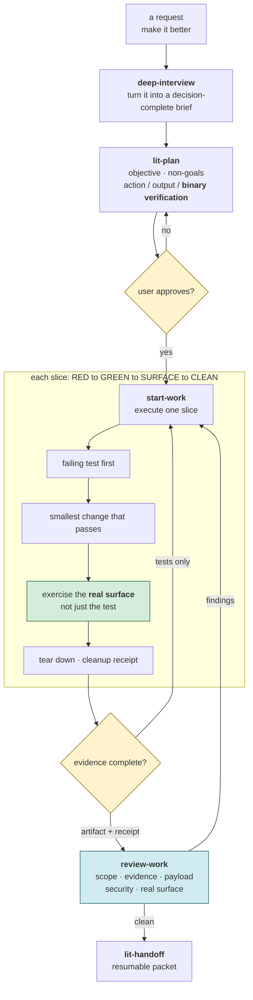
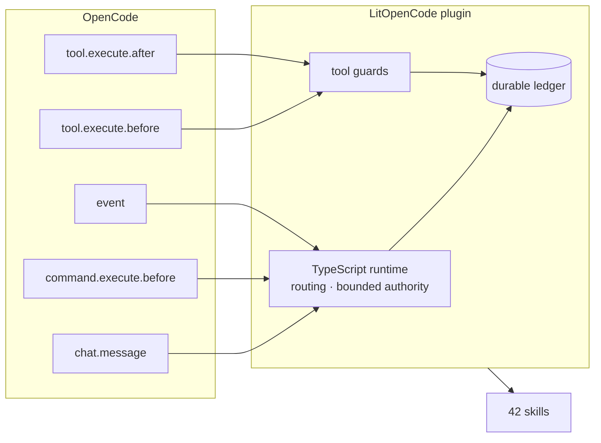
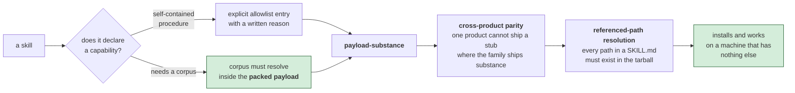

# LitOpenCode 워크플로 상세 안내

[빠른 시작](../README-Ko-KR.md) · [English](reference.md)

*워크플로를 한눈에 보면 이렇습니다. 계획은 항목마다 통과/실패가 분명한 검증이 있어야 승인되고, 구현 slice는 실제 surface에서 확인한 evidence와 정리 기록까지 남겨야 닫힙니다. 테스트 통과만으로는 완료가 아닙니다.*



## 설치

권장 설치:

scoped 패키지가 npm 설치 대상입니다. [패키지 이전 안내](migration.md#scoped-npm-package-migration)를 확인하세요.

```sh
npm exec --package @litfamily/litopencode@latest -- litopencode install
```

설정 변경을 미리 보거나 설치 상태를 확인할 수 있습니다.

```sh
npm exec --package @litfamily/litopencode@latest -- litopencode install --dry-run
npm exec --package @litfamily/litopencode@latest -- litopencode doctor
```

설치 명령은 OpenCode의 plugin installer를 통해 플러그인을 등록합니다.
`~/.config/opencode/litopencode.json`이 없을 때만 route 파일을 만들고, 기존 route는
그대로 둡니다. 기본 OpenCode 설정 파일은 `~/.config/opencode/opencode.jsonc`입니다.
`XDG_CONFIG_HOME`이 설정되어 있으면 `$XDG_CONFIG_HOME/opencode/opencode.jsonc`를 사용합니다.

*OpenCode의 이벤트가 플러그인으로 들어오면 TypeScript runtime이 route와 권한 경계를 적용하고, tool guard와 durable ledger로 결과를 남깁니다. 아래 흐름이 설치 후 실제로 연결되는 host surface입니다.*



권한과 모델은 명시적으로 선택합니다.

```sh
npm exec --package @litfamily/litopencode@latest -- litopencode install --permission-prompt
npm exec --package @litfamily/litopencode@latest -- litopencode install --permission-mode balanced
npm exec --package @litfamily/litopencode@latest -- litopencode install --yolo
npm exec --package @litfamily/litopencode@latest -- litopencode install --provider openai --model gpt-6-astra --effort xhigh
npm exec --package @litfamily/litopencode@latest -- litopencode install --provider openai --model gpt-5.6-luna --effort max
```

기본값은 safe/ask-first입니다. `balanced`와 `yolo`는 선택했을 때만 적용됩니다.
`install --yes`는 모든 선택 메뉴를 건너뛰고 저장된 출력 스타일을 유지합니다.
CI와 비대화형 터미널에서는 자동 질문을 생략하며, 명시한 질문 플래그는 계속 동작합니다.
`NO_COLOR`에서도 출력 스타일을 직접 선택할 수 있지만 색상·커서 이스케이프는 출력하지
않습니다. `TERM=dumb`이나 UTF-8이 아닌 로케일에서는 ANSI 장식 없이 `LIT` 문자를 표시합니다.
새로 설치하거나 초기화하면 계획·검토 및 `lit-loop`는 `openai/gpt-6-astra`/`xhigh`,
실행·연구 helper는 새 기본값인 `openai/gpt-6-luna`/`max`를 사용합니다. `gpt-6.1-sol`/`xhigh`는
코딩 리드 대안입니다. `gpt-6-sol`은 이전 세대로 계속 선택할 수 있어 이 모델을 쓰는 기존 설정도 그대로 동작하며,
`-fast` 별칭은 없습니다. 모델마다 OpenCode가 그 모델에 내놓는 추론 수준을 그대로 고를 수 있습니다
(`opencode models openai --verbose`의 `variants`, OpenCode 1.18.35에서 확인). GPT-6 Astra와 GPT-6.1 Sol은
`low`, `medium`, `high`, `xhigh`, `max`를 지원합니다. GPT-6 Luna, GPT-6 Sol, GPT-5.6 계열은 `none`, `low`,
`medium`, `high`, `xhigh`, `max`를 지원합니다. `ultra`를 지원하는 모델은 없습니다. `ultra`로 저장된 설정은 `max`로 동작하고, doctor가 `retiredEfforts`에 알려 주며,
다음 설치가 백업을 남긴 뒤 `max`로 바꿉니다. 선택 메뉴는 모델을 고른
뒤 그 역할의 추론 수준을 묻고, 모델이 지원하는 수준을 모두 보여 주며, 추천 수준에 표시를 붙여 기본값으로
둡니다. 지금 설정의 수준이 여전히 지원되면 그 수준이 기본값입니다. 이전 세대 `gpt-5.6-sol`, `gpt-5.6-terra`,
`gpt-5.6-luna`는 계속 선택할 수 있고, 현재 호스트 카탈로그에는 이 모델들의 지원 종료일이 등록되어 있지 않습니다.
일반 설치와
업데이트는 이미 설정된 모델을 보존합니다. 명시적인 `--model-prompt`만 관리 모델 키를 다시 씁니다.
기존 GPT-5.6 계열의 `-fast` 의미는 유지하지만 `gpt-6-astra-fast` 별칭은 추가하지 않습니다.

### 모델 카탈로그 갱신

OpenAI 모델 ID, 역할 기본값, 선택 메뉴 항목과 effort 범위는 `src/cli/model-catalog.ts`에 모여 있습니다.
이 파일을 수정한 뒤 `npm run build`로 패키지용 JavaScript를 다시 생성하고,
`node --test test/gpt6-astra-routing.test.mjs`로 선택 메뉴, 기본 경로와 라우팅 동작을 확인합니다.
전역 설치가 필요하면 다음을 사용합니다.

```sh
npm install -g @litfamily/litopencode
litopencode install
```

## 처음 사용하기

설치 후 OpenCode를 재시작하고 Tab을 누르세요. agent 선택기에 다음 세 agent가 보여야 합니다.

| Agent | 역할 |
| --- | --- |
| `lit-loop` | 구현, 검증, 안전한 위임, 진행 기록 |
| `lit-plan` | 근거가 있는 계획 작성. `edit`, `bash`, `task` 권한은 허용하지 않음 |
| `lit-implement` | `/start-work` 이후 승인된 계획 실행 |

작업 순서는 다음과 같습니다.

1. `lit-plan`에 하나의 범위가 분명한 계획을 요청합니다.
2. 계획을 승인한 뒤 `/start-work`를 실행합니다.
3. 완료를 주장하기 전에 `/review-work`를 실행합니다.

## 주요 명령

| 경로 | 용도 |
| --- | --- |
| `/lit` | 일반 `lit-loop` 워크플로 시작 |
| `/litwork` | 제한된 작업 루프 진입 |
| `/lit-plan` | 읽기 전용 구현 계획 작성 |
| `/start-work` | 승인된 계획을 `lit-implement`로 실행 |
| `/review-work` | `lit-plan` 뒤에는 계획 검토, `lit-loop`나 `/start-work` 뒤에는 작업 검토. 있는 것을 보고 고르며 `/review-work plan`, `/review-work work`로 직접 정할 수 있음 |
| `/litgoal` | 끝나는 지점을 정하고 지킴: 확인 가능한 기준이 붙은 목표 하나를 디스크에 남김. `lit-loop`와 `/start-work`가 그 목표를 향해 일함 |
| `/lit-brainstorm` | 열린 질문을 여러 선택지로 펼친 뒤 짧은 목록으로 좁히고, 고른 것을 `deep-interview`나 `lit-plan`에 넘김. 채팅에서는 `lit brainstorm`, `lit brainstorming`, `lit ideation`, `lit ideate`, `lit idea`, `lit ideas`. 직접 만들지는 않음 |
| `/lit-hijack` | 다른 사람이 공개한 작업의 기법 원리를 내 스킬이나 시스템에 옮김: 출처 기록, 라이선스 확인, 격차 분석, 원문 없는 명세, 분리된 구현, 동작 비교, 보고서. 각 단계의 완료는 동봉된 `hijack.mjs`가 판정함. 채팅에서는 `lit hijack`, `lit hijacking`, `lit 하이재킹`, `lit 하이잭` |
| `/lit-adhd`, `/lit-rewind` | 하던 일을 이어서 시작: 세 줄(지금까지, 지금, 다음)로 시작해 이전 세션의 상태, 실제 진행 또는 아는 사실, 로드맵, 추천 한 단계를 읽기 전용으로 보여 줌. 끝난 계획과 완료된 start-work 실행은 끝난 일로 세고, liveness 기록으로 쉬는 세션을 가리며, 7일 넘은 계획은 빼고, 이 워크트리 `HANDOFF.md`의 `Next` 항목을 마지막 대안으로 씀. 동봉된 `rewind.mjs`가 수집함. 채팅에서는 `lit adhd`, `lit rewind`, 이어서 `go`가 30분간 준비된 단계를 따라감. `lit approve`와 `lit deny`는 대기 중인 경계에 답하고, `lit deny`는 실행을 끝냄. |
| `/litresearch` 또는 `/lit-research` | 순차 대체 경로를 포함한 근거 기반 연구 |
| `/lit-handoff` | 이어서 작업할 수 있는 핸드오프 작성 |
| `/lit-recap` | 로컬 ledger와 세션 맥락으로 짧은 리캡 작성 |
| `/lit-scientific-visualization` | 패키지에 포함된 scientific-visualization 워크플로 사용 |
| `/lit-korean` | 의미를 바꾸지 않고 문장 흐름 검토 |
| `/text-neutralization` | neutralization 계약에 따른 문장 검토 |

그 밖에 `/refactor`, `/lit-burnoff`, `/lit-code`, `/debugging`, `/lit-commit`,
`/lsp`, `/lsp-setup`, `/rules`, `/deep-interview`, `/structural-search`,
`/autoresearch`, `/autoconference`, `/wikify-*` 경로가 있습니다. 이 경로는 안내 또는 제한된
로컬 동작을 추가합니다. 호스트 권한은 늘리지 않습니다.

### `lit` 반복 입력

메시지마다 `lit`를 붙여도 안전합니다. 세션의 첫 `lit`는 전체 활성화 안내를 보냅니다. 같은 discipline의 `lit`
(예: 실행 중에 보낸 두 번째 `lit fix ...`)는 전체 안내 대신 "이미 활성, 이어서 진행" 짧은 메모만 보내며, 기존
계획, 기준, ledger를 건드리지 않습니다. 다른 discipline(루프 중 `lit plan ...`)은 그 discipline의 전체
활성화 안내를 한 번 보냅니다. `lit new ...`와 `lit restart ...`는 새로 시작합니다. 승인된 계획이나 진행 중인
`/start-work` 기록이 있으면 단독 `lit` 또는 `lit continue`가 그 작업을 이어 가며 새 계획을 만들지 않습니다.
작업 내용도 없고 진행 중인 것도 없는 단독 `lit`는 무엇을 할지 되묻습니다. 컴팩션, 새 세션, OpenCode 재시작
뒤에는 활성 discipline을 잊으므로 다음 `lit`는 다시 전체 안내를 보냅니다. `lit-loop`, `lit-plan`,
`lit-humanizer`는 스킬 본문을 붙이지 않고 설치된 스킬을 가리킵니다.

### Durable loop 상태

LitOpenCode는 `.litopencode/litgoal/lit-loop/`에 goal 상태를 저장합니다. append-only
ledger에 진행 상황과 evidence를 기록합니다.

```sh
litopencode status
litopencode create-goals --session-id <id> --objective <text>
litopencode record-evidence --criterion-id <id> --kind <red|green|scenario|cleanup|note> --ref <ref>
litopencode checkpoint --summary <text>
litopencode complete-goals
```

`/start-work init|resume|cancel|complete|status <schema-3 JSON>`은 승인된 실행을 위한
bounded-authority 경로입니다. `resume`은 신뢰된 사용자 경로와 work, session, revision,
grant가 모두 맞을 때만 허용됩니다. 복사하거나 인용한 텍스트는 명령으로 처리하지 않습니다.

`/start-work save-plan <JSON>`으로 승인된 계획을 저장하면, 저장 안내와 함께 한 단어 시작이 준비됩니다.
같은 세션에서 30분 안에 `go`를 입력하면 그 계획으로 타이핑 start-work 실행이 시작됩니다. 다른 세션의
`go`나 30분이 지난 `go`는 평범한 단어입니다. 체크리스트가 프로젝트 밖의 절대 경로를 가리키는 계획에는
`Scope roots: <폴더> (<동작>)` 줄이 있어야 합니다(동작은 `read`, `write`, `execute` 중에서). 이 줄로 덮이지
않은 바깥 폴더가 있으면 save-plan은 저장하지 않고 넣을 줄을 그대로 알려 줍니다. 파일 시스템 루트, 최상위
폴더, 홈 폴더 자체로만 덮을 수 있을 때는 더 좁은 기존 폴더를 적어 달라고 합니다. 코드 펜스 안의 경로와
인라인 코드로 인용한 명령은 세지 않습니다. 타이핑 start-work가 시작되면 올바른 `Scope roots:` 줄 하나하나가
실행의 권한이 되므로, 승인된 계획이 이미 적은 폴더 때문에 멈추지 않습니다. 이때 그 폴더는 있어야 합니다.

### UI 및 Visual QA 관리 헬퍼

`frontend-ui-ux`와 `visual-qa` 경로는 Node ESM 헬퍼와 제한된 읽기 전용
evidence를 사용합니다. 이 경로들은 workflow family의 scaffold나 status
헬퍼를 추가하지 않습니다.

### 관리되는 workflow family

Autoresearch와 Autoconference가 제한된 로컬 workflow를 위한 scaffold/status
헬퍼를 제공합니다. Wikify는 템플릿과 contract를 소유하지만 scaffold나
status helper는 제공하지 않습니다. Wikify probe는
`tool.execute.after`, `chat.message`, `command.execute.before`를 포함한
다섯 개 surface를 확인하며, 나머지 host hook surface는 Wikify contract에
기록되어 있습니다. Wikify는 `tool.execute.after`에서 하나의 제한된
`wikify` tool도 소유하고, Autoresearch나 Autoconference tool은 노출하지
않습니다.

## Release Readiness

출시 담당자는 [`release-checklist.md`](release-checklist.md)를
사용합니다. 이 문서는 현재 설치 동작만 설명합니다.

## 검증

LitOpenCode checkout에서 다음 검사를 실행합니다.

```sh
npm install
npm run build
npm test
npm run typecheck
npm run check:managed-skill-manifest
npm run scan:legacy-tokens
npm run check:version
npm run check:pack-payload
npm run qa:real-surface
npm pack --dry-run --json --ignore-scripts
```

쓰기 없는 로컬 probe:

```sh
node bin/litopencode.cjs doctor --root .
node bin/litopencode.cjs install --dry-run --root .
```

`doctor`는 package, route, command, skill, 로컬 상태를 쓰기 없이 확인합니다.

*패키지에 소스 파일이 있다는 사실만으로는 충분하지 않습니다. `npm pack` 결과 안에서 skill이 선언한 참조가 모두 해소되어야, 아무것도 없는 새 머신에서도 설치 후 동작한다고 말할 수 있습니다.*



## 제거

`uninstall` 서브커맨드는 없습니다. 전역 설치를 했다면 먼저 npm 패키지를 제거합니다.

```sh
npm uninstall -g @litfamily/litopencode
```

그 다음 OpenCode가 관리하는 `opencode.jsonc`(또는 custom root의 `opencode.json`)의
`plugin` 배열에서 `@litfamily/litopencode` 또는 `@litfamily/litopencode@<version>` 항목을 제거합니다.
더 이상 route가 필요하지 않을 때만 `~/.config/opencode/litopencode.json`을 제거하세요.
프로젝트의 `.litopencode/`는 별도 ledger와 receipt입니다. 나중에 재개할 계획이 없다면
그 상태를 버려도 되는지 확인한 뒤 직접 정리합니다.

TUI 패널 항목은 `tui.json`이나 `tui.jsonc`에 있고, OpenCode 2에서는 `cli.json`에 고정된 항목이 있을 수도
있습니다. `litopencode tui remove [--root <dir>]`는 세 파일에서 LitOpenCode 항목만 지우고, 다른 플러그인과
주석은 그대로 둡니다. 바뀌는 파일은 먼저 `<file>.litopencode-backup`으로 복사합니다. 쓰기 전에 모든 파일을
읽고 확인하므로, 깨진 파일이나 지워질 주석이 있으면 아무것도 바꾸지 않고 멈춥니다. `--host v1`이면
`cli.json`은 건드리지 않습니다. `--dry-run`은 같은 결과를 보여 주기만 하고 아무것도 쓰지 않습니다.

## OpenCode 2

LitOpenCode는 OpenCode 1(1.18.29 이상. 패키지가 `engines.opencode >=1.18.29`를 선언하고 OpenCode 1이 이를
확인합니다)과 OpenCode 2에서 모두 돌아갑니다. 두 호스트를 함께 설치할 수 있습니다. OpenCode 1은 `opencode`
명령을 그대로 쓰고, OpenCode 2(npm `@opencode/cli`)는 `opencode2`로 실행합니다. 둘 다 같은
`~/.config/opencode`를 읽으므로 한 번 설치하면 양쪽에 적용됩니다.

**설치.** `litopencode install`은 무엇을 쓰기 전에 호스트부터 찾고, 그때 어느 호스트도 실행하지 않습니다.
`opencode`와 `opencode2` 뒤에 있는 npm 패키지를 읽습니다(`opencode-ai`는 OpenCode 1, `@opencode/cli`는 OpenCode 2.
Windows에서는 npm `.cmd` 실행 파일을 글자로 읽습니다). 뒤에 npm 패키지가 없는 `opencode`(curl 설치 스크립트,
Homebrew, mise)는 일단 OpenCode 1로 봅니다. 어떻게 설치했든 OpenCode 1 설정이 유지되도록 하기 위해서입니다.
`opencode2`와 같은 파일인 `opencode`는 OpenCode 2로 보고, `opencode2`는 언제나 OpenCode 2로 봅니다. OpenCode 1에는
`opencode2`가 없기 때문입니다. 실제 설치는 OpenCode 1로 짐작한 `opencode`에 `opencode plugin`을 부르기 전에
`opencode --version`을 묻고, 2.x라고 답하면 그 호스트에 OpenCode 2 설정을 합니다(dry run은 아무것도 실행하지 않으므로
처음 짐작을 보여 줍니다).
PATH에 두 명령이 모두 없으면 `tui.json`(OpenCode 1)과 `cli.json`(OpenCode 2)을 근거로 삼고, 둘 다 없으면
OpenCode 1 설정을 유지합니다. `--host v1`이나 `--host both`인데 `opencode`가 OpenCode 2뿐이면 아무것도 실행하기
전에 멈춥니다. 그 상태에서 `opencode plugin`을 부르면 OpenCode 2 설정이 바뀌기 때문입니다.
기본값인 `--host auto`는 찾은 호스트를 모두 설정하고, `--host v1`, `--host v2`, `--host both`로 직접 정할 수
있습니다. dry-run 결과의 `host`에 판단이 나옵니다. OpenCode 1 쪽은 그대로입니다. `opencode plugin`이 패키지를
등록하고 TUI 항목은 `tui.json`에 들어갑니다. OpenCode 2 쪽에서 설치 프로그램은 다음을 합니다.

- 두 호스트가 함께 읽는 `opencode.json(c)`의 `plugin` 목록에 항목 하나만 둡니다. OpenCode 2 실행 파일로
  `opencode plugin`을 부르지 않습니다. OpenCode 2는 처음 불러올 때 패키지를 직접 설치합니다.
- OpenCode 2 전용 `plugins` 키에 있는 LitOpenCode 항목을 지웁니다. 같은 id의 플러그인이 둘이면 OpenCode 2가
  뒤의 것을 거부하기 때문입니다.
- `cli.json`의 LitOpenCode 항목을 지우고 `cli.json.litopencode-backup`을 남깁니다. OpenCode 2는 활성
  서버 플러그인의 TUI를 스스로 불러오는데, 거기에 고정된 항목이 있으면 그것이 새 TUI를 가리기 때문입니다.
- 공유 설정에 OpenCode 2 키 `permissions`나 `policies`를 절대 쓰지 않습니다. OpenCode 1은 그 자리에서
  `permissions`를 보면 시작하지 않습니다.

두 호스트에 설치한 뒤 `opencode2` TUI를 처음 열면 OpenCode 2가 `tui.json`의 플러그인 목록을 새 `cli.json`으로
복사하고, 여기에 LitOpenCode 항목도 따라 들어갑니다. 설치 프로그램은 이 복사를 막을 수 없습니다. doctor가 그
항목을 알려 주고, `litopencode install`이나 `litopencode tui remove`를 다시 실행하면 지워집니다.

**Doctor.** `litopencode doctor`는 `host` 블록(찾은 호스트, 근거 파일, 공유 설정의 `autoupdate`에서 읽은
OpenCode 2 플러그인 업데이트 방식)을 보여 주고, `plugin`과 `plugins`에 걸친 LitOpenCode 항목 수를 세며,
`cli.json`에 남은 항목과 OpenCode 1도 읽는 설정에 들어간 `permissions`를 알려 줍니다. doctor는 호스트를
실행하지 않습니다. OpenCode 2가 대상이면 `lsp` 블록에 OpenCode 2는 `lsp` 설정을 받아 두기만 하고 언어 서버를
돌리지 않는다는 설명이 붙습니다.

**똑같이 동작하는 것.** 에이전트(기본은 `lit-loop`, `build`와 `plan`은 숨김), 도구 다섯 개, 단독 `lit` 활성화,
정적 규칙과 독자용 계약, 도구 가드, 플래너 잠금, bounded-authority 진행 기록, 자동 인수인계,
`~/.config/opencode/skills`의 스킬이 모두 OpenCode 2에서 돌아갑니다. OpenCode 2는 도구 두 개의 이름을 바꿨기
때문에 권한 규칙은 `bash` 대신 `shell`, `task` 대신 `subagent`를 쓰고, `write`와 `patch`는 `edit`에 들어갑니다.
그곳에서는 마지막에 맞는 규칙이 이기므로 `lit-plan`은 어떤 권한 모드에서도 `edit`, `shell`, `subagent`,
`execute` 거부로 끝나고, 권한 훅이 다른 규칙과 상관없이 한 번 더 거부합니다. `execute`는 OpenCode 2의 Code Mode
도구로, 모델이 쓴 JavaScript를 `fetch`와 다른 도구와 함께 실행합니다. OpenCode 1에는 없던 도구이고 계획만 하는
에이전트가 가져서는 안 됩니다. 이렇게 거부된 도구는 요청에서 빠집니다. LitOpenCode 도구 다섯 개는 OpenCode 1에서처럼
Code Mode 밖, 모델의 도구 목록에 바로 있으므로 `lit-plan`도 계속 씁니다. OpenCode 1에서 전역 권한을 넓히는 balanced와 yolo
모드는 OpenCode 2에서는 각 LitOpenCode 에이전트 규칙의 앞부분에 들어갑니다. 플러그인이 그곳의 전역 규칙을
바꿀 수 없기 때문입니다. 추론 강도 같은 에이전트별 요청 설정은 모델 요청마다 함께 보냅니다. OpenCode 2는
에이전트의 요청 설정을 저장만 하고 아직 보내지 않습니다.

**OpenCode 2에서 달라지는 것.**

- *슬래시 명령.* 설치 프로그램은 두 호스트에 같은 `command/<id>.md` 파일을 쓰고, OpenCode 2에서는 이 파일이
  같은 이름의 플러그인 명령을 대신합니다. 그래서 모든 lit 명령은 파일에서 오고 목록에 한 번만 나옵니다.
  플러그인은 파일이 없는 명령만 직접 추가합니다(예를 들어 설치 프로그램 없이 `opencode plugin add`만 한 경우).
  OpenCode 2에서 파일로 실행한 명령 차례에는 LitOpenCode 표시가 붙지 않습니다. 플러그인이 직접 보낸 명령에는
  한 번만 쓰는 확인값이 든 표시가 붙어, 손으로 입력한 프롬프트가 흉내 낼 수 없습니다. `/lit-crucible`과
  `/deep-interview`(`lit-plan`), `/start-work`(`lit-implement`)처럼 에이전트가 정해진 플러그인 명령은 명령 파일의
  `agent:` 줄과 같이 먼저 세션을 그 에이전트로 바꿉니다.
- *모델 경로.* OpenCode 2는 자기 모델이 없는 세션을 호스트의 기본 모델로 돌립니다. 에이전트의 모델은 세션을
  만드는 클라이언트만 읽는데, TUI는 읽고 `opencode2 run`은 읽지 않습니다. 그래서 그런 세션의 첫 프롬프트에서
  세션을 에이전트의 경로로 바꿉니다(에이전트가 없으면 `lit-loop`). 그 모델이 카탈로그에 있을 때만 바꿉니다.
  사용자가 고른 모델과, 호스트가 이미 에이전트 모델로 시작하는 하위 세션은 그대로 둡니다. OpenCode 1과 같이
  LitOpenCode가 쓰는 OpenAI 모델이 호스트 카탈로그에 없으면 `openai` 카탈로그에 추가합니다.
- *사용자 메시지로 가는 프로젝트 데이터.* 로컬 지식 기록, start-work 재개 영수증, 자동 인수인계 설정 응답은
  요청의 마지막 사용자 메시지에 붙습니다. OpenCode 1에서도 사용자 메시지의 일부였습니다. OpenCode 2의 system
  부분은 지시를 위한 자리라서, LitOpenCode의 활성화 문구와 규칙, 독자용 계약만 그곳에 들어갑니다.
- *따옴표 프롬프트.* `opencode2 run "lit fix it"`은 단어를 큰따옴표로 감싸 보내므로, 메시지 전체가 따옴표 한 쌍이면
  따옴표를 벗겨 읽습니다. 서버는 이것과 TUI에서 통째로 따옴표 안에 입력한 프롬프트를 구별하지 못해서 그런 입력도
  활성화됩니다. OpenCode 1에서는 활성화되지 않았습니다.
- *점화 표시.* OpenCode 2에는 끝난 답변을 고치는 훅이 없어서 표시가 TUI로 옮겨 갑니다. 세션의 마지막 프롬프트가
  lit 프롬프트이면 프롬프트 아래 줄(`prompt.footer.status`)에 `🔥 LIT IGNITED · <discipline>`이 나옵니다.
  OpenCode 1에서는 표시가 예전 자리에 그대로 있습니다.
- *토스트.* OpenCode 2에서는 서버가 토스트를 띄울 수 없습니다. 서버가 사용자 메시지 메타데이터에 남긴 lit 표시를
  TUI가 보고 점화 토스트를 직접 띄웁니다. 서버만 알던 자동 인수인계 알림과 스킬 힌트는 그곳에 나오지 않습니다.
- *TUI.* 미션 패널은 전처럼 세션 사이드바에 있습니다. OpenCode 2는 서버 플러그인과 함께 오는 TUI에 옵션을
  넘기지 않고 할 일 목록도 두지 않으므로, 미션 진행은 ledger와 작업 기록과 계획에서 읽습니다. 세션 아래 상태 띠와
  홈 화면 한 줄은 OpenCode 1에서만 그립니다.
- *업데이트.* OpenCode 2에서는 플러그인 안의 자동 업데이트가 없습니다. `opencode plugin update`를 실행하거나
  OpenCode 2의 업데이트 방식에 맡기면 됩니다.

## TUI 미션 패널

OpenCode 1.18은 `tui.json`이나 `tui.jsonc`의 `plugin` 배열에 적힌 TUI 플러그인을 불러옵니다.
이 패키지는 TUI 모듈을 서버 플러그인과 따로 `@litfamily/litopencode/tui`(`dist/host/tui.js`, 플러그인 id
`litopencode`)로 내보냅니다. OpenCode가 두 대상을 한 모듈에 섞는 것을 허용하지 않기 때문입니다. OpenCode 2는
활성 서버 플러그인을 위해 같은 모듈을 스스로 불러옵니다(위 OpenCode 2 참고). `./server`와 `./tui`의 타입 선언은
각 진입점을 모양으로만 적으므로, 어느 호스트의 플러그인 패키지 없이도 해석됩니다.

화면에 그리는 것:

- 작업 흐름 지도: 어떤 스킬이 돌았는지만이 아니라 지금 LIT 작업 흐름의 어디쯤인지 보여 줍니다.
  세션마다 단계표 하나를 따릅니다.
  - 기본 흐름 `interview › plan › work n/m › review › done`
  - lit-loop의 기준 반복: 단계는 같고, lit-loop나 litgoal 세션이 할 일 대신 목표 기준을 셀 때
    work 단계가 `criterion n/m`으로 바뀝니다.
  - litresearch 실행: 세션이 litresearch를 돌리고 있거나 세션이 쓴 실행 폴더가 아직 열려 있으면
    `decompose › wave n › expand › verify › synthesis`를 따릅니다.

  하지 않고 지나간 단계에는 `–`가 붙습니다. 범위가 정해진 `lit-task`는 계획을 만들지 않으므로 plan
  단계를 건너뛴 것으로 보여 주고, 했다고 표시하지 않습니다. `review-work` 없이 할 일만 모두 끝내도
  review는 `–`로 남습니다. 리뷰 명령, 리뷰 막힘, ledger CLI로 끝낸 목표(완료 관문이 리뷰를 포함함)가 있어야
  완료로 바뀝니다. 에이전트가 직접 쓴 `goals.json`에서 끝났다고 표시한 목표는 관문을 거치지 않았으므로
  review를 `–`로 둡니다. 지나온 단계는 LIT 불꽃색에서
  분홍색을 거쳐 LIT accent로 가는 색을 차례로 받고, 앞으로 할 단계는 흐리게 그립니다.
- 입력창 아래 agent/model 줄 오른쪽의 지도 칩: `🔥 LIT` 알약 뒤에 지금 단계 앞뒤를 이어 쓴
  `plan ✓ › WORK ▰▰▰▱▱▱▱ 3/7 › review`가 붙습니다. 지금 단계는 채운 알약과 일곱 칸 막대로 보입니다.
  자리가 넉넉하면 지금 하는 일(`⠹ bash · 0:48`)이 뒤따릅니다. 자리가 좁으면 지금 하는 일을 먼저 빼고,
  다음에는 브랜드와 지난 단계를 빼서 `🔥`, 지금·다음 단계, 다섯 칸 막대만 남기고, 더 좁으면 `🔥`와
  개수만 남깁니다. 자리는 OpenCode에 저장된 사이드바 설정과 세션 종류(하위 세션에는 사이드바가
  없음)로 계산합니다. 설정을 아직 읽을 수 없으면 사이드바가 열려 있다고 보고 좁게 잡습니다.
- 세션 사이드바 맨 위의 미션 패널: 36칸짜리 둥근 상자이고, 위 테두리에 `🔥 LIT ▸ <단계>`, 아래
  테두리에 `n/m criteria`가 붙습니다. 테두리 색이 상태를 보여 줍니다. 일하는 중에는 LIT accent,
  경고가 있으면 LIT 호박색, 끝나면 LIT 초록색입니다. 안에는 두 줄짜리 `LIT`과 그 옆의 작업 이름·상태,
  굵은 목표 제목, 세로 단계 지도가 들어갑니다. 지도에서 지난 단계는 `◆`, 지금 단계는 굵은 `◉`,
  경고가 걸린 단계는 `⚑`, 남은 단계는 `◇`입니다. 지금 단계까지는 단계 색의 `┃`로, 그 뒤로는 점선
  `┆`로 잇고, plan 옆에는 저장된 계획의 할 일 수, work 옆에는 `iter k`를 적습니다. 그 아래로 1/8칸
  블록으로 칠하고 빈 곳은 가는 선으로 둔 그라데이션 막대, 자세히 한 줄 `└ task 3 · next ▸ <항목>`
  (조사 실행에서는 주장 수와 검증된 수), 지금 하는 일, 기준 목록, 경고, 최근 증거 네 개가 이어집니다.
- 지금 하는 일: 세션이 돌리고 있는 도구의 이름과 걸린 시간입니다. 실행 중인 도구 part의 이름과 시작
  시각만 읽고, 입력(명령, 경로, 인자)은 읽지도 보여 주지도 않습니다. 턴이 도는 동안에만 보입니다.
- 띠(band): 화면 맨 아래에 붙는 상태 카드입니다(OpenCode의 `app_bottom` 자리). 세션과 사이드바
  아래를 모두 가로지릅니다. lit을 쓰든 안 쓰든 세션 내내 보이고, 쉴 때나 일할 때나 똑같이 네 줄이라
  입력창이 움직이지 않습니다.
  - 위 테두리 왼쪽에 `🔥 LIT · <작업 이름>`, 오른쪽에 단계가 붙습니다(`● WORK`, `⚑ review blocked`,
    `✓ COMPLETE`, lit 턴 전과 세션이 턴을 돌리지 않는 동안에는 `○ IDLE`. 이때는 OpenCode의 `session.status`를
    읽고, 밝게 켜진 단계가 없습니다).
  - 첫째 줄은 단계 전체를 이어 쓴 지도 `interview – ━ plan ✓ ━ WORK 3/7 ─ review ─ done`, 1/8칸
    막대, 목표의 `n/m criteria`(단계가 이미 기준을 세는 기준 반복에서는 빠집니다), 지금 하는 일, 다음 할 일입니다. 경고가 열려 있는 동안에는 지금 하는
    일과 `▸ 다음 일` 자리에 `⚑ <내용>`이 들어갑니다. 쉬는 세션에서는 흐린 지도 옆에 프로젝트의
    마지막 목표를, 목표가 없으면 `add lit to a prompt to start`를 보여 줍니다.
  - 둘째 줄은 스킬 칩입니다. 세션에서 실행된 LitOpenCode 스킬이 여러 개 함께 보입니다. 지금 요청에서
    실행된 스킬은 요청이 도는 동안 LIT accent 색 알약으로 밝게 보이고, 새로 들어온 칩에는 빛이 짧게 한 번
    지나갑니다. 턴이 끝나면 흐려져 최근 목록으로 남고(최근 것이 앞), 다시 실행되면 다시 밝아집니다.
    자리가 모자라면 남은 칩을 `+N`으로 접습니다.
  - 아래 테두리에는 context 사용량(75%부터 주황), 첫 lit 턴부터 지난 시간(`⟳ 7m`), git 브랜치가
    붙습니다.
  - 나란히 도는 작업이 둘 이상이면 스킬 칩 줄 아래에 줄이 늘어납니다. `┬ 3 lanes in parallel` 다음에
    작업마다 `├─`/`└─` 한 줄씩입니다(이 세션의 워크플로 스택 항목, 실행 중인 `task` 호출, 최근 15분
    안에 스택이 움직인 같은 작업 공간의 다른 세션). 최대 네 줄이고 나머지는 `+N more`입니다. 줄마다 이름,
    상태 단어(`working`, `paused`, `done`, `failed`, `idle`), 그리고 실제 총량이 있을 때만 게이지
    (`[▉▉░░░░░░] 3/10`)가 붙습니다. 총량을 모르면 아는 것(단계, 걸린 시간)을 글로 쓰고 일하는 중이면 작은
    펄스를 보여 줄 뿐 물음표는 쓰지 않습니다. 작업이 살아 있는 동안 카드는 가장 높았던 높이를 유지하고,
    모두 가라앉으면 네 줄로 돌아옵니다. 다른 세션 줄은 이 세션의 작업 줄 뒤에 일하는 중, 멈춤, 끝남,
    쉬는 중 순서로 놓이고, 다른 세션이 하나뿐이어도 줄이 생깁니다. 세션마다 훅이
    `.litopencode/liveness/<session>.json`에 작은 기록을 남깁니다(도구 실행 뒤 `alive`, `session.idle`에서
    `idle`, 세션 삭제 시 `ended`). 기록이 있으면 5분 추정 대신 그 기록으로 쉬는 중과 끝남을 정하고, herdr
    pane에서 도는 세션은 `<skill> · <pane>`으로 부르며, 끝난 세션이나 다른 세션이 완료한 start-work 실행은
    1분 동안 `done`으로 보였다가 사라집니다.
  - `lit-adhd`(별칭 `lit-rewind`)가 도는 동안 테두리, LIT 글자, 게이지가 같은 밝기의 색상환을 따라 돕니다.
    1초에 네 번 색이 조금씩 바뀌고 깜박이지 않습니다. `motion: false`와 `NO_COLOR`에서는 꺼집니다. 이전
    작업이 있는 작업 공간의 쉬는 세션은 `lit adhd to pick up where you left off`를 보여 주고, 그곳에서 처음 연
    새 세션은 같은 문구로 토스트를 한 번 띄웁니다(v1 TUI만. v2 TUI에는 띠도 토스트도 없습니다).
  - 카드의 모양은 한 번에 하나이고, `src/tui/mission-looks.ts`의 작은 목록에서 고릅니다. lit-adhd를 실행하는
    길은 모두 되감기 모양이 됩니다. 채팅의 `lit adhd`/`lit rewind`, `/lit-adhd`/`/lit-rewind`(v2에 설치된 별칭
    파일에서 온 것도 포함), 네이티브 `skill` 로드가 그렇습니다. 세션이 사용자를 기다리는 동안(권한 요청이나 질문,
    또는 목표 결정, `BLOCKED:`로 시작하는 답, 경계에서 멈춘 타이핑 start-work 실행으로 끝난 쉬는 턴) 테두리가
    주황빛이 되고 모서리에 `◆ YOUR TURN`이 뜹니다. 주황빛은 3초 호흡으로 천천히 바뀌고 깜박이지 않으며,
    `motion: false`와 `NO_COLOR`에서는 멈춰 있고, 사용자가 입력하면 꺼집니다. `review-work`가 도는 동안에는
    위 테두리가 다섯 갈래(scope, tests, package, security, surface)로 나뉘고 모서리에 `◇ REVIEW 2/5`처럼 보고된
    수를 셉니다. 에이전트가 `review-work` 도구(`action: "lane"`, 갈래 이름, `pass`·`fail`·`blocked`)로 보고한
    뒤에만 그 갈래가 켜집니다. 실패한 갈래는 오류 색이 되고, 보고되지 않은 갈래는 흐리게 남습니다. 목표가 끝나면
    완료 불꽃이 한 번 터지고 카드가 가라앉으며, 평소 턴에서는 다시 터지지 않습니다. 릴리스 게시는 카드가 받는
    신호가 없어서 불꽃도 없습니다.

  하위(subagent) 세션에서는 부모 세션의 카드를 `· in lane`과 함께 보여 주고, 홈 화면에는 띠가
  없습니다. 폭이 좁으면 줄마다 덜 중요한 것부터 덜어 냅니다. 단계 줄은 지금 하는 일과 다음 할 일
  글자, 막대 길이, 막대, 기준 개수를 차례로 빼고, 마지막에는 지금 단계만 남깁니다. 아래 테두리는 브랜치, 시간, context 사용량 순서로 뺍니다. 줄을
  넘기지는 않습니다. 완료 순간도 여기서 함께 보입니다. 이번 OpenCode 시작 때 읽어 들인 코드보다 새
  LitOpenCode가 설치되어 있으면(자동 업데이트 영수증이나 디스크의 패키지로 확인) 아래 테두리 맨 앞에
  경고 색으로 `restart to <버전>`이 붙고, 폭이 좁아져도 가장 늦게 빠집니다. 같은 내용의 토스트도 한 번
  뜹니다. 스스로 다시 시작하지는 않습니다.
- 홈 화면 입력창 아래, OpenCode 팁 다음 줄: `🔥 lit ready · last: <목표> ✓ n/m`. 프로젝트 ledger에
  목표가 있을 때만 보입니다.
- 경고는 색만 바꾸지 않고 늘 `⚑`와 글자를 함께 붙입니다. 색이 없어도 똑같이 읽히게 하려는
  것입니다. 알파가 0인 테마 바탕(system, lucent-orng)은 검게 칠하지 않고 비워 둡니다.
- 관문 사건마다 토스트 하나: 계획 저장 또는 저장 실패, 목표 설정, 기준 통과, 리뷰 막힘과 해결, 완료.
  한 번에 여러 사건이 생기면 가장 급한 것 하나로 합칩니다.
- 목표가 끝나거나, 할 일이 모두 끝나거나, 조사 실행이 보고서를 쓰면 1.2초 안에 끝나는 완료 순간을
  보여 줍니다. 테두리가 초록으로 바뀌고 막대가 끝까지 차며, 돌던 단계와 그 뒤 단계가 60ms 간격으로
  차례로 완료로 바뀝니다. 브랜드에 빛이 한 번 지나가고, 패널 안으로 불씨가 올라가며, `COMPLETE`가
  살짝 넘쳤다가 제자리로 옵니다.
- 같은 순간에 켤 때만 울리는 끝 알림: OpenCode의 `attention.notify`로 데스크톱 알림과 호스트의
  `done` 소리를 보냅니다. 기본은 꺼져 있고, 켜는 법은 아래 옵션에 있습니다. 실제로 울릴지는 OpenCode
  자체의 `attention` 설정이 정합니다. 이 설정은 tui.json에서 `"attention": { "enabled": true }`로 켜기
  전까지 꺼져 있고, 꺼져 있으면 OpenCode가 `attention_disabled`로 답합니다.

데이터는 이미 있는 것만 읽고, TUI를 위해 새로 쓰는 파일은 없습니다.

- 스킬 칩은 OpenCode가 이미 저장하는 세 곳에서 읽습니다. 이름이 LitOpenCode가 싣고 다니는 스킬인
  내장 `skill` 도구 호출(다른 스킬은 빼고, 불러오기에 실패한 호출과 상태 조회는 실행으로 치지 않음),
  이 플러그인의 `lit`, `litwork`, `start-work`, `review-work`, `wikify` 도구 호출, 그리고 맨 `lit`
  라우팅과 슬래시 명령에 붙는 아래의 `metadata.litopencode` 표시입니다. "지금 요청"은 세션이 일하는
  동안 마지막 사용자 메시지 이후에 실행된 것을 뜻합니다.
- `lit`이 모드를 켜거나 명령이 실행될 때(`save-plan` 포함) 이 플러그인이 사용자 메시지 part에 붙이는
  `metadata.litopencode` 표시. 표시가 없는 세션은 쉬는 상태로 보고, 기본 `lit-loop` agent여도 칩과
  패널을 숨깁니다. `/litresearch` 같은 슬래시 명령은 OpenCode의 명령 hook으로 지도에 표시되므로
  `litopencode install`이 쓰는 명령 파일이 있어야 합니다. `plugin` 항목만 있으면 OpenCode가 이를
  평범한 글로 보내고, 지도에는 아무것도 표시되지 않습니다.
- 세션의 OpenCode 할 일 목록(진행도와 다음 항목), 상태(재시도), 대기 중인 권한 요청과 질문, 마지막
  assistant 메시지 기준 context 사용량(75%부터 주황).
- 프로젝트 루트의 `.litopencode/litgoal/lit-loop/goals.json`. 심볼릭 링크와 1 MiB가 넘는 파일은 읽지
  않습니다. CLI가 쓰는 ledger 형태(`goals`와 `activeGoalId`) 말고도 에이전트가 직접 쓴 형태, 곧 맨 위의
  목표 하나, `goal` 아래의 목표, `goals` 목록의 마지막 항목도 읽고, `completed`나 `done`은 통과한 기준이나
  끝난 목표로 셉니다. 세션의 첫 lit 턴보다 먼저 마지막으로 바뀐 목표는 이전 작업으로 보고 빼 둡니다. 목표의
  checkpoint 수가 기준 반복의 iter 수가 됩니다.
- `/start-work`가 남기는 범위 작업 기록 `.litopencode/litgoal/lit-loop/work-schema-3.json`. 이 세션의
  것이고 취소되지 않았을 때만 읽습니다. `work.progressed` 기록 수가 work 단계의 iter 수가 되고, 기록이
  가리키는 계획 파일에서 맨 앞에 붙은 `- [ ]` / `- [x]` 줄을 세어 할 일 수와 다음 항목을 얻습니다.
  계획 파일은 프로젝트 루트 안의 일반 파일일 때만 읽습니다.
- `.litopencode/litgoal/lit-loop/research/` 아래에서 가장 최근에 쓴 실행 폴더. `report.md`가 있으면
  synthesis, `claim-graph.jsonl`에 관문 결과(`verified`, `abstained`, `unresolved`, `refuted`)가 붙은
  주장이 있으면 verify, `journal.md`의 마지막 제목이 `EXPAND`로 시작하면 expand, 주장이 있으면 wave(가장
  큰 `wave` 값이나 `## Wave` 제목 수로 번호를 붙임), 아무것도 없으면 decompose입니다. 세션의 첫 lit
  턴보다 먼저 쓴 폴더는 이전 작업으로 봅니다.
- 지금 하는 일을 위해 세션의 마지막 assistant 메시지에서 실행 중인 도구 part. 도구 이름과 `time.start`만
  씁니다.

움직임은 전환이 일어나는 동안에만 짧은 프레임 타이머로 돌고 끝나면 멈춥니다. 새 줄과 알약은
ease-out-back으로 160ms씩, 60ms 간격으로 들어오고, 막대는 300ms에 차오릅니다. 경고 줄은 220ms에
걸쳐 들어오고 색은 140ms 동안 넘어가며, 빛이 지나가는 데는 400ms가 걸립니다. 지도가 다음 단계로
넘어가면 옛 단계와 새 단계 사이의 세로 선이 위에서 아래로 60ms 간격으로 차오르고, 지금 단계 알약이
한 번 빛납니다. 계속 도는 움직임은 없습니다. 지금 하는 일은 미끄러져 들어오지 않고 제자리에서
바뀌며, 도구가 도는 동안에만 걸린 시간이 1초에 한 번 바뀝니다. 도는 도구가 없으면 타이머도
없습니다. lit 세션이 열려 있는 동안만 2초마다 목표 ledger, 범위 작업 기록, 조사 폴더를 다시 읽고,
쉬는 세션은 읽지 않습니다.

LIT 부분은 어떤 테마에서든 LIT 색을 씁니다. `🔥 LIT` 알약은 분홍(`#ff2d95`)에서 불꽃색(`#ff6337`)으로
넘어가고, 단계 색은 불꽃색, 분홍, LIT accent(`#5fd7ff`) 순서로 이어집니다. 지금 단계와 지금 요청의
스킬 칩은 accent 알약이고, 막대는 불꽃색에서 accent로 가며, 상태 색은 LIT 호박색(`#ffaf3c`),
초록색(`#6bdb8f`), 빨간색(`#ff5f5f`)입니다. 알약 글자는 늘 어두운 색(`#0b0f14`)입니다. 글자, 흐린 글자, 패널과
요소 바탕, 테두리, 투명한 바탕은 지금 OpenCode 테마에서 가져옵니다. 밝은 테마에서는 알약 바탕을
밝게 그대로 두고, 글자로 쓰는 LIT 색만 같은 색조 안에서 진하게 바꿔(불꽃색 `#e2521f`, 분홍
`#d81b78`, accent `#0a87b8`, 초록 `#1f9d55`, 호박색 `#b86e00`, 빨강 `#d93a3a`) 흰 바탕에서도 읽히게 합니다. 움직임을 끄려면 `tui.json`에 `["@litfamily/litopencode@<version>", { "motion": false }]`
처럼 적고, 플러그인 자체를 끄려면 OpenCode 플러그인 관리자나 `plugin_enabled`에서 id `litopencode`를 끕니다.

띠 설정도 같은 옵션 객체에 적습니다.

- `{ "band": false }`는 띠만 없애고 칩, 패널, 홈 줄은 그대로 둡니다.
- `{ "band": { "card": true } }`는 상태 카드 아래에 경고, 다음 할 일, 목표를 담은 둥근 상세 카드를 붙입니다.
  목표가 있는 동안 카드는 네 줄로 고정되어, 경고가 생기거나 사라져도 입력창이 움직이지 않습니다.
  카드는 기본으로 꺼져 있습니다.

끝 알림도 같은 객체에 적으며, 적지 않으면 꺼져 있습니다.

- `{ "notify": true }`는 미션이 끝날 때 데스크톱 알림을 보내고 `done` 소리를 냅니다.
- `{ "notify": { "sound": false } }`는 알림만, `{ "notify": { "desktop": false } }`는 소리만 남깁니다.

다른 터미널에서 쓴 ledger(예: `litopencode record-evidence`)는 OpenCode 이벤트를 만들지 않습니다.
그래서 2초마다 도는 공용 ledger 확인이 이를 잡고, 칩·패널·띠가 같은 프레임 시계로 함께 바뀝니다.

항목은 install이 씁니다. 기본 root에서는 `opencode plugin`이 `./tui` export를 보고 직접 항목을 넣고,
LitOpenCode가 중복과 옛 버전을 정리합니다. custom root에서는 LitOpenCode가 직접 씁니다. 이미
LitOpenCode 항목이 있는 파일을 고치고, 없으면 `tui.json`과 `tui.jsonc` 중 먼저 있는 파일을, 둘 다 없으면
새 `tui.json`을 씁니다. OpenCode가 고르는 방식과 같습니다. `./herdr-tui-session.js` 같은 다른 항목과
모든 주석은 그대로 남습니다. `plugin` 목록 안의 주석을 지워야 하는 경우에는 아무것도 쓰기 전에 install을
멈춥니다. `doctor`는 이 항목을 `install.tui`에 보고하고, `install.ok` 값은 바꾸지 않습니다.

## 자동 인수인계

자동 인수인계는 직접 켜야 하며 기본은 꺼져 있습니다. 기본 퍼센트는 없습니다. 플러그인의 `event` 훅과 `experimental.chat.system.transform` 훅에서 동작하고, 대화 내용은 읽지 않으며 assistant 메시지의 토큰 수만 봅니다.

### 한 번의 흐름

1. 루트 세션에서 끝난 assistant 메시지에는 토큰 수가 들어 있습니다. 플러그인은 입력, 출력, 캐시 읽기, 캐시 쓰기를 더하고(호스트가 합계를 주면 그 값을 씁니다) `config.providers`에서 얻은 모델의 컨텍스트 창과 비교합니다. 압축 요약, 실패한 호출, 자식 세션의 메시지는 세지 않습니다.
2. 합계가 정한 퍼센트에 닿으면 플러그인은 차례가 끝나기를 기다립니다. 차례나 도구 호출이 진행되는 중에는 아무것도 보내지 않습니다.
3. 유휴 이벤트가 오면 같은 에이전트와 모델로 `promptAsync` 요청을 한 번 보냅니다. 요청 본문은 인수인계를 써 달라고 하면서 표식 줄 `Auto-handoff marker: <세션 id> <ISO 시각>`을 알려 줍니다. lit-handoff 계약 전체는 요청의 system 필드로 전달되므로 화면에 보이는 메시지는 짧게 유지됩니다.
4. 모델은 lit-handoff 계약이 정하는 위치에 인수인계를 씁니다. 루트 `HANDOFF.md`가 있으면 그 파일에, 없으면 git 프로젝트에서 `.handoff/HANDOFF.md`에 씁니다. 표식 줄은 제목 바로 아래에 둡니다.
5. 답이 끝나 세션이 다시 유휴가 되면 플러그인은 세션이 유휴인지(`session.status`) 확인하고 후보 파일 두 곳을 읽습니다. 이 세션의 표식이 들어 있고 요청 뒤에 쓰인 인수인계만 인정합니다. 없으면 압축하지 않고 알림을 띄웁니다.
6. 그다음 마지막 assistant 메시지의 모델로 `session.summarize`를 백그라운드에서 호출하고 "Handoff saved. Compacting the conversation now."를 보여 줍니다. 호출이 실패하면 "Handoff saved. Run /compact now."를 한 번 보여 줍니다.
7. `session.compacted` 뒤에는(플러그인이 시작했든, 사용자가 `/compact`를 직접 실행했든, OpenCode의 자동 압축이든) 다음 시스템 프롬프트에 `<auto-handoff-digest>`가 붙습니다. 파일 위치와 앞 6144바이트를 데이터로 표시해 담으며, 한 번만 붙습니다. 인수인계가 없거나 오래됐거나 다른 세션 것이면 아무것도 붙이지 않습니다.
8. 세션이 다시 발동하려면 사용량이 퍼센트 아래로 내려가야 합니다. 그래서 한 번 닿을 때 요청은 한 번만 나가고, 요청 전에 압축이 일어나면 대기 중이던 발동은 취소됩니다.

OpenCode는 세션이 바쁜 동안 들어온 `summarize` 호출을 줄 세웠다가 진행 중인 차례가 끝난 뒤에 응답합니다(OpenCode 1.18.33에서 확인했습니다. 6초짜리 차례 도중의 호출은 6.5초 뒤에 돌아왔고 그 뒤에 압축이 일어났습니다). 그래서 플러그인은 유휴일 때만 호출합니다.

### 설정

| 위치 | 내용 | 참고 |
| --- | --- | --- |
| 채팅 `lit-handoff auto on <percent>`, `lit-handoff auto off`, `lit-handoff auto status` | 저장된 설정 | 메시지 전체가 그 한 줄이어야 합니다. `/lit-handoff auto ...`도 같습니다. 숫자 없는 `on`은 마지막 퍼센트를 다시 쓰고, 없으면 물어봅니다 |
| `.litopencode/auto-handoff.json` | `{"enabled": true, "percent": 70}` | 위 경로가 쓰고 사용할 때마다 읽습니다 |
| `litopencode.json` 또는 `.litopencode/config.json`의 `autoHandoff` | `{"enabled": false, "percent": null}` | 알 수 없는 키와 잘못된 타입은 설정을 읽을 때 거부합니다 |
| `LITOPENCODE_AUTO_HANDOFF`, `LITOPENCODE_AUTO_HANDOFF_PERCENT` | `1` 또는 `0`, 1~99 정수 | 우선순위가 가장 높습니다 |

우선순위는 환경 변수, 저장된 설정, 설정 파일, 기본값(꺼짐, 퍼센트 없음) 순서입니다. 1~99 밖의 퍼센트, 1과 0이 아닌 스위치 값, 퍼센트 없이 켜진 스위치는 기능을 끄고, 이유가 상태 응답과 `litopencode doctor`에 나옵니다.

### Doctor

`litopencode doctor`의 출력에 `autoHandoff` 블록이 추가됩니다. 플러그인과 같은 프로젝트(작업 폴더 위의 git 루트, 없으면 그 폴더)에서 읽습니다. 실제로 적용되는 스위치와 퍼센트, 각각의 출처, 프로젝트, 상태 파일 경로, 두 변수 이름, 호스트의 압축 지점, `warnings`가 들어 있습니다. 호스트 지점은 LitOpenCode가 설치하는 창(372,000토큰, 압축은 334,800토큰, 곧 90%)에서만 알 수 있습니다. 그 지점과 같거나 높은 퍼센트는 OpenCode가 먼저 압축하므로 경고가 납니다. 다른 모델은 창과 여유분을 호스트가 정하므로 doctor가 숫자를 내놓지 않습니다.

### 디스크에 남는 것

경로는 `.litopencode/auto-handoff.json`(스위치와 퍼센트)을 씁니다. 인수인계 파일은 모델이 씁니다. 그 밖에는 저장하지 않습니다. 표식은 세션 동안 메모리에만 있으므로, 요청과 압축 사이에 OpenCode를 다시 시작하면 다시 불러오기는 일어나지 않습니다.

## 안전과 업데이트

- `lit-plan`은 계획 전용입니다. `edit`, `bash`, `task` 권한을 허용하지 않습니다.
- `balanced`와 `yolo`는 선택형 권한 모드입니다. `balanced`에서는 위험한 shell 패턴이
  계속 ask로 남고, `yolo`도 planner의 deny guard와 하위 agent 재귀 위임을 풀지 않습니다.
- 패키지 시작과 대화형 `install`/`doctor` 성공 뒤에는 정확한 버전을 확인하는 foreground
  update barrier가 동작합니다. `--no-auto-update` 또는 `LITOPENCODE_NO_AUTO_UPDATE=1`로
  끌 수 있습니다. cache-only 알림은 `NO_UPDATE_NOTIFIER=1` 또는
  `LITOPENCODE_NO_UPDATE_CHECK=1`로 끌 수 있습니다.
- 시작할 때 설치된 업데이트는 OpenCode를 다음에 시작할 때 적용됩니다. 업데이트를 실행한
  프로세스는 이전 플러그인으로 계속 동작합니다. 실패한 업데이트가 깨끗하게 되돌려졌다면
  시작 시에는 같은 버전을 하루 동안 다시 시도하지 않습니다(직접 실행한 `install`은 진행합니다).
  시작할 때마다 `~/.litopencode/auto-update-check.json`에 시각, 실행 중인 버전, 결과를 남깁니다.
  `doctor`는 이 기록과 receipt를 읽어 `autoUpdate.state`, `cause`, `nextStart`, 원인별 조치 표를
  보여 줍니다. 실행 중인 OpenCode 내부는 볼 수 없으므로 새 버전을 확실히 쓰려면 다시 시작하세요.
- Public-source retrieval에는 SSRF 검사, redirect 검증, byte 제한, access verdict가
  있습니다. 가져온 본문은 명령이 아니라 데이터로 처리합니다.

## 패키지 경로

- 패키지와 plugin id: `litopencode`
- CLI binary: `litopencode`
- 공개 export: `litopencode`, `litopencode/server`, `litopencode/tui`
- 전역 route 파일: `~/.config/opencode/litopencode.json`
- 프로젝트 override: `.litopencode/config.json`
- Durable 상태: `.litopencode/litgoal/`
- 사용자 상태 루트: `~/.litopencode/`

## 스킬 이름 변경

새 명령은 `/lit-crucible`, `/lit-init`, `/lit-commit`, `/lit-burnoff`, `/lit-burnoff-file`,
`/lit-korean`, `/lit-fetch`, `/lit-code`, `/litgoal`(이전 `durable-litgoal`)입니다. 이전 이름은 한 릴리스 동안 새 명령으로
연결되며, 이름 변경 안내가 한 줄 표시됩니다. 다음 마이너 버전에서 이전 이름을 제거합니다.
설치·업데이트는 새 복사본을 검증한 뒤 설치 도구가 관리하는 이전 이름의 스킬 디렉터리를
제거합니다. 사용자 소유 파일은 보존합니다. 자세한 내용은 [마이그레이션 안내](migration.md#skill-id-renames)를 참고하세요.

## 문서

- [빠른 시작](../README-Ko-KR.md)
- [English reference](reference.md)
- [Changelog](../CHANGELOG.md)
- [마이그레이션](migration.md)
- [터미널 마크](lit-mark.md)
- [출시 담당자 체크리스트](release-checklist.md)


## 설치된 원본 스킬 파일

`lit-handoff`와 `lit-scientific-visualization`의 원본은 선택한 OpenCode 설정 루트의
`skills/<id>/canonical/`에 그대로 설치합니다. 먼저 native 스킬의 `SKILL.md`를 읽고,
그 파일의 디렉토리를 기준으로 `exact_source_root`를 해석하세요. 슬래시 명령과
bare 경로도 같은 native 스킬 위치를 사용합니다. 프로젝트나 command 디렉토리를
기준으로 원본을 찾으면 안 됩니다. 패키지 설치에는 참조 파일 전체가 포함되며
개발자의 checkout이 필요하지 않습니다.

Doctor는 패키지 원본뿐 아니라 설치된 파일 목록과 해시도 확인합니다. Python이나
matplotlib이 없는 `DEGRADED` 상태와 설치 파일 누락은 별개입니다. 파일 누락은
무결성 오류이며, 어느 검사도 의존성을 자동으로 설치하지 않습니다.

재설치할 때 생성 표시가 없는 사용자 스킬은 보존합니다. 생성된 wrapper의 새
canonical 하위 트리는 패키지의 파일 목록과 해시가 일치할 때만 교체합니다.
수정·추가·누락된 파일이나 심볼릭 링크가 있으면 거부합니다. 변경한 파일은 관리
트리 밖에 백업한 뒤 다시 시도하세요. 이 하위 트리가 없는 이전 flat wrapper에는
누락된 원본을 추가할 수 있습니다. 기존에 생성된 wrapper와 배포 파일은 계속
설치 도구의 관리 대상이므로 교체될 수 있습니다. 모든 생성 파일의 편집 내용을
보존한다는 뜻은 아닙니다.


과학 스킬의 Python 모듈을 일반적으로 import하면 `__pycache__` 파일이 생길 수
있습니다. Doctor는 해당 경로를 `canonicalCacheFiles`에 표시합니다. 정상 파일인
CPython/PyPy 태그의 `.pyc`(최적화 태그 포함)가 해시가 그대로인 관리 대상 `.py`에
대응하는지 확인하며, 바이트코드를 실행하거나 그 내용을 신뢰하지 않습니다.
그 밖의 추가 파일, 원본 누락·수정, 파일이나 디렉토리의 심볼릭 링크는 계속 거부합니다.

캐시가 생긴 상태에서 재설치하면 이전 스킬 트리 전체를 native 스킬 탐색 범위 밖인
`<config-root>/.litopencode-canonical-backups/<unique-id>/skill`에 보관합니다.
`prepared.json`은 이동 전 기록이고 `receipt.json`은 보관 완료 기록과 캐시별
SHA-256을 담습니다. 실제로 사용할 위치에는 원본을 새로 복사하므로 보관한
바이트코드가 새 원본보다 먼저 실행되지 않습니다. 캐시 없는 재설치와 이전 flat
wrapper 이전에는 보관 사본이 필요하지 않습니다. 교체나 안전한 복귀가 실패하면
안내된 복구 경로를 보존하고 확인하세요. 설치 성공으로 간주하면 안 됩니다.
이 검사는 일반적인 사용과 감지한 경로 변경을 다루며, 적대적인 동시 파일 변경까지
막는다는 보장은 아닙니다.

## 심볼릭 링크된 native 스킬 루트와 다른 위치의 같은 이름 스킬

Install은 `<root>/skills`가 심볼릭 링크여도(예: `~/.config/opencode/skills`가 다른
디렉토리를 가리키는 경우) 의도적으로 그 링크를 따라가며, 이 경우에도 설치는
성공합니다. `install`과 `doctor` 모두 이제 이 링크를 보고하므로 조용히 다른 곳에
쓰는 일이 없습니다: 링크 경로, 실제로 해석된 대상 경로, 그리고 그 대상이 git
작업 트리 안에 있다면 저장소 루트까지 알려줍니다. 관리 대상 스킬 디렉토리가 그
저장소 안에 나타나기 때문입니다. 스킬 디렉토리가 개인 git 저장소를 가리키는
사용자라면 설치 후 그 저장소 안에 수십 개의 새 디렉토리가 생기는 것을 예상해야
합니다. 이 경고는 설치 실패가 아니라 링크를 다시 정리하라는 안내로 받아들이세요.

`doctor`는 이에 더해 `install.nativeSkills.shadowedSkills`를 보고합니다. 관리 대상
스킬 id마다, OpenCode가 함께 읽는 다른 스킬 루트에 같은 이름의 `<id>/SKILL.md`
사본이 있는지 확인합니다 — 사용자 수준의 `~/.agents/skills`, `~/.claude/skills`,
그리고 현재 작업 디렉토리 기준 프로젝트 수준의 `.opencode/skills`, `.claude/skills`,
`.agents/skills`가 대상입니다. OpenCode는 둘 중 어느 사본이든 불러올 수 있으며, 이
문서는 어느 쪽이 우선하는지 단정하지 않습니다. 해석한 경로가 관리 대상 native
스킬 루트와 같으면 같은 트리이므로 shadow로 표시하지 않고 제외합니다. Shadow
표시는 안내용이며 `nativeSkills.ok`나 doctor 전체의 `install.ok`를 바꾸지 않습니다.
보고된 shadow를 해결하려면 관리되지 않는 사본을 지우거나 이름을 바꾸세요. 그대로
두면 OpenCode가 LitOpenCode가 관리하는 사본 대신 그 사본을 불러올 수 있습니다.

## 디자인 제작과 README

OpenCode 네이티브 스킬 `frontend-ui-ux`는 충분한 구현 요청을 받으면 작업 화면을 만들고 렌더링을 확인합니다. 중요한 방향이 모호할 때만 질문하며 답변을 보존합니다. 검토·계획 요청은 읽기 전용입니다. 새 페이지나 화면은 `scripts/design-lock.mjs`로 룩(하우스 스타일, 레이아웃 계열, 시그니처 순간, 풍부 또는 차분한 밀도)을 먼저 고정합니다. 생성된 `design.lock.json`, `ui/tokens.css`, `ui/components.css`와 글꼴은 프로젝트에 놓이며, 글꼴은 sha256 확인 후 `lit-diagram-drawer`와 `lit-typographic-motion` 스킬에서 복사합니다. 락이 페이지 옆에 있으면 `scripts/probe.mjs`가 DS-001~DS-008과 LOOK-1~LOOK-6 질문을 더합니다. `--viewports`는 일부 뷰만 돌리며 승인하지 않습니다.

네이티브 스킬 도구에서 `readme-studio`를 선택하면 실제 저장소 정보로 README와 표지를 제작합니다. 로컬 글꼴의 윤곽선, Remotion/HyperFrames 예제, 정적·동적 출력 절차가 함께 설치됩니다. 이미지 생성 도구가 없으면 `IMAGE_GENERATION_UNAVAILABLE`을 알리고 제공된 배경으로 이어갑니다. 공개 GitHub/npm 렌더링 검증은 별도 단계입니다. 전용 슬래시 명령은 없습니다.

네이티브 스킬 `lit-typographic-motion`은 무대 영화에 이야기(`story`: 보는 사람의 기대, 반전, 반전이 떨어지는 샷, 결말)와 영화의 절반 이상에서 움직이는 주인공을 요구합니다. 요청에 링크가 있으면 제품이 필수입니다. `render.mjs assets --out <dir> --url <https 링크> [--cover]`가 페이지와 README를 신뢰할 수 없는 데이터로 읽어, 형식을 확인하고 크기를 제한한 이미지만(SVG는 정리, 배지는 제외) `stage/assets/` 또는 `cover/assets/`에 두며, 그 이미지를 한 번도 보여 주지 않는 영화는 `ASSET-USED` 게이트 행에서 실패합니다. 제품에 닿을 수 없으면 화면을 지어내지 않고 종료 코드 22로 사용자에게 묻습니다. `depth: "3d"`는 고정된 three.js r170(`/lit/three/`로 제공, 해시는 `THIRD_PARTY_NOTICES`)을 GPU 단계에서 쓰고, GPU가 시작되지 않으면 표시를 달아 SwiftShader로 내려갑니다. 사용자 그림이 없는 README 표지는 `hero-3d` 레시피를, `painted-light`는 사용자 그림이 있을 때만 씁니다. 영화는 기본적으로 풍부합니다(`register: rich`). 무대 영화는 화면을 채워야 하고(열두 구역 중 둘 넘게 비는 샷이 둘 이상이면 `RICH-FILL` 실패), 실제 이름의 촘촘한 라벨과 움직이는 카메라를 갖추며, 영화마다 겹겹의 점수(`sound.mode: score`; 킥·클랩·하이햇·퍼커션·베이스·코드·리드·fx·액센트 스템, 사이드체인, -16 LUFS, 이야기 박자에 떨어지는 드롭, 스템은 `sound/stems/`에 보관)를 받습니다. 차분하거나 미니멀한 영화를 요청할 때만 `minimal`이 됩니다. `render3d: "blender"`는 선택형 Cycles 플레이트 단계를 더하며(`render.mjs blender --out <dir> [--final] [--detach]`; `scaffold`가 `BLENDER:` 줄을 알리고, Blender가 없으면 표시를 달아 three.js로 내려갑니다), 보는 확인은 무대 경로에서 질문 11개(타입 경로와 표지는 9개)이며 영화가 자기 방식에 충분히 풍부한지, 반전이 닿는지를 묻습니다. `gate.mjs --done`은 폴더 위쪽에서 실행을 찾으므로 영화 폴더 안에서 `--out .`으로도 동작합니다. 트리트먼트 전에는 경로·스타일·형식·방식을 `question` 호출 한 번으로 묻고 규칙의 추천을 먼저 둡니다.

개념·편집·기술 다이어그램은 `lit-diagram-drawer` 네이티브 스킬 선택기에서 제작하고 검증합니다. 제품 인터페이스는 `frontend-ui-ux`, 측정된 과학 데이터 그림은 `lit-scientific-visualization`을 사용합니다.

실제 장비의 P&ID, PFD, 실험 장치 그림, 아이소메트릭 단면도는 `lit-schematic` 네이티브 스킬 선택기에서 제작하고 QA 스크립트와 렌더 확인으로 검증합니다. 범위가 분명한 도면 요청에 `lit`을 붙이면 그리기 전에 이 스킬을 불러오도록 안내합니다. 전용 슬래시 명령은 없습니다.

`lit-docx`는 워드 보고서, `lit-pptx`는 파워포인트 발표자료를 만듭니다. `lit`과 함께 쓰면 요청한 형식의 네이티브 스킬을 선택하고, 마크다운 원본·품질 검사·렌더 확인을 유지합니다. 두 스킬은 만들기 전에 디자인 방향을 정하고 다른 후보 두 개와 함께 알려 줍니다. 발표자료는 Ledger, Signal, Atlas, Chalk, Paper, Gazette, Studio, Night, Computational Brutalism, Neo-Brutalism, Bauhaus, Riso, Newsroom 열세 가지, 보고서는 Report, Brief, Manual, Proposal, Memo, Journal 여섯 가지 방향 중에서 고릅니다.
