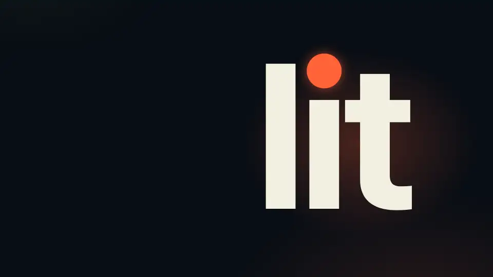

# LitOpenCode 화면 미리 보기

[README](../README-Ko-KR.md) · [English](./screens.md)

LitOpenCode가 화면에 무엇을 출력하고 그리는지 모아 둔 페이지입니다. 설치가 잘 끝났을 때 어떤 모습인지 미리 봐 두면 실제로 마주쳤을 때 낯설지 않습니다.

## 설치 후 화면에서 보이는 것

LitOpenCode가 화면에 무엇을 출력하는지 미리 볼 수 있도록 그림 네 장을 준비했습니다. 각 그림에는 실제 캡처인지 예시 화면인지 밝혀 두었습니다. 그림마다 다크와 라이트 버전이 있고 내용은 같으며, 브라우저 테마에 맞는 쪽이 보입니다.

**설치.** `litopencode install`은 번호가 붙은 다섯 단계를 보여 주고, 끝난 단계마다 체크 표시를 붙인 뒤 초록색 상자로 마무리합니다. 상자에는 설치가 끝났다는 말과 다음에 할 일이 적혀 있습니다. OpenCode를 다시 시작하고 Tab을 눌러 lit-loop를 고르면 됩니다.

<picture><source media="(prefers-color-scheme: dark)" srcset="./assets/readme/install-output-dark.webp" /></picture>

*빈 설정 폴더를 쓰는 격리한 셸에서 실제 `litopencode install --yes`를 실행해 캡처했습니다. 이 명령은 단계 위에 큰 로고 배너도 출력하지만 그림에서는 뺐습니다. 마지막 줄은 명령을 실행한 컴퓨터의 상태를 알려 줍니다.*

**상태 점검.** `litopencode doctor`는 긴 JSON 보고서를 출력합니다. 설치가 제대로 연결됐는지는 그중 install 블록이 알려 주므로, 그림에서는 `jq`로 세 줄만 뽑았습니다. 세 값이 모두 true이면 플러그인과 스킬에 문제가 없다는 뜻입니다.

<picture><source media="(prefers-color-scheme: dark)" srcset="./assets/readme/doctor-output-dark.webp" /></picture>

*같은 격리한 셸에서 실제 `litopencode doctor`를 실행해 캡처했고, 세 항목은 `jq`로 뽑았습니다.*

**첫 프롬프트.** Lit 워크플로가 프롬프트를 받으면 OpenCode 오른쪽 위에 알림이 6초 동안 뜹니다. 다섯 줄짜리 작은 LIT 마크와 LIT IGNITED 문구, 시작된 워크플로 이름이 담겨 있습니다. 경로가 시작됐는지 가장 빨리 알 수 있는 표시입니다. 결과는 작업이 끝난 뒤 직접 확인하세요. 자세한 내용은 [경로가 시작될 때 보이는 것](#경로가-시작될-때-보이는-것)에 있습니다.

<picture><source media="(prefers-color-scheme: dark)" srcset="./assets/readme/ignition-toast-dark.webp" /></picture>

*예시 화면입니다. 알림 문구는 플러그인이 쓰는 점화 알림 함수에서 나왔고, 화면은 OpenCode가 그렸습니다. 모델은 실행하지 않았습니다. 여기서는 lit-loop이며, 다른 워크플로가 시작되면 그 이름이 들어갑니다.*

**계획 에이전트.** `lit-plan`은 계획을 세우면서 프로젝트를 읽기만 합니다. 어떤 권한이 막혀 있는지는 OpenCode에 직접 물어볼 수 있습니다. `opencode debug agent lit-plan`이 OpenCode가 보는 에이전트 정보를 출력하고, `jq`로 거부된 권한만 남겼습니다. 목록에 edit, bash, task가 있으므로 계획 에이전트는 파일을 고치거나 셸 명령을 실행하거나 다른 에이전트에게 일을 넘길 수 없습니다. question, plan_enter, plan_exit도 같은 목록에 나옵니다.

<picture><source media="(prefers-color-scheme: dark)" srcset="./assets/readme/planner-permissions-dark.webp" /></picture>

*같은 격리한 셸에서 빈 설정 폴더에 LitOpenCode를 설치한 뒤 실제 `opencode debug agent lit-plan`을 실행해 캡처했고, 거부된 권한은 `jq`로 남겼습니다.*

## 움직이는 화면으로 보기

22초, 한 단어입니다. 영상은 커다란 `lit`으로 시작해 그 단어를 프롬프트 안으로 줄여 넣고, LitOpenCode가 그다음에 하는 일을 따라갑니다. 알림이 워크플로를 알리고, 계획 에이전트는 edit, bash, task가 잠긴 모습을 보여 주고, 각 단계가 기록에 남고, 새 세션이 그 기록을 읽고 이어갑니다. 영상 속 창은 README가 설명하는 내용을 그린 그림이며, 실제 세션을 캡처한 화면은 아닙니다. 글꼴은 [Pretendard](./assets/readme/promo-source/Pretendard-OFL.txt)이고, 공개 글꼴 라이선스(OFL)에 따라 썼습니다.

<picture><source media="(prefers-reduced-motion: reduce)" srcset="./assets/readme/promo-still.webp" /></picture>

[영상을 MP4로 보기](./assets/readme/promo-ko.mp4)

## 경로가 시작될 때 보이는 것

Lit 경로가 시작됐는지는 바로 알 수 있습니다. 답변이 굵은 점화 문구로 시작하고, OpenCode 화면에 경고 모양의 알림이 6초 동안 뜹니다. 터미널이 마크의 특수 문자를 제대로 표시하면 다섯 줄짜리 작은 로고 아래에 `🔥 LIT IGNITED · <discipline> 🔥` 문구가, 그렇지 않으면 그 문구만 나옵니다. 어느 쪽이든 워크플로가 시작됐다는 표시이니, 결과는 작업이 끝난 뒤 직접 확인하세요.

포스터를 누르면 영상이 열립니다. 직접 고르기 전에는 재생되지 않습니다. 영상과 GIF, 다른 그림은 [브랜드 자료](./brand-Ko-KR.md#ignition-motion)에 모아 두었습니다.
