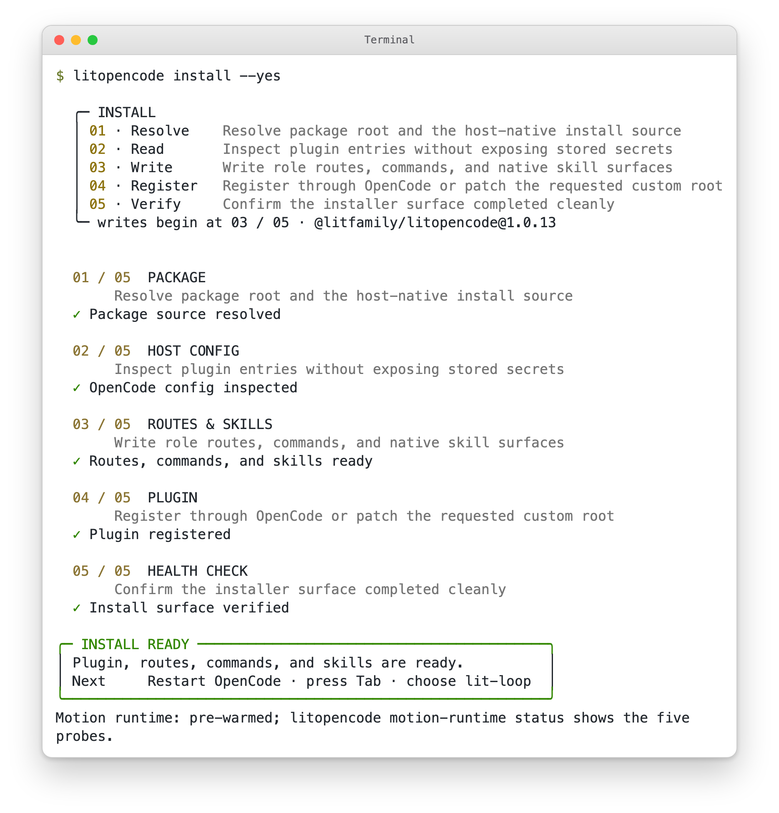
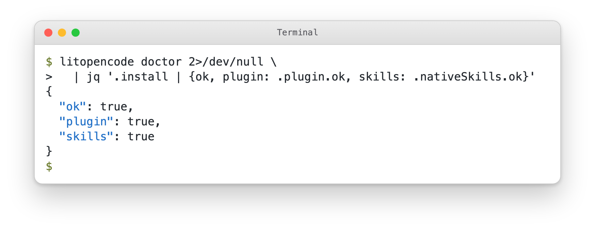
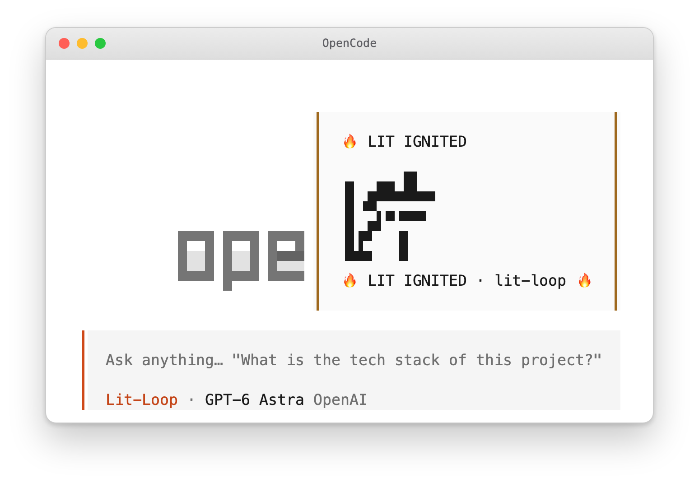
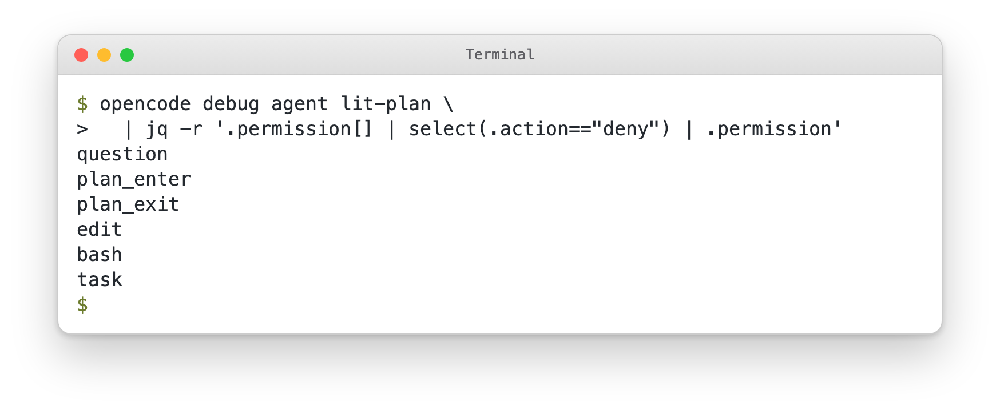
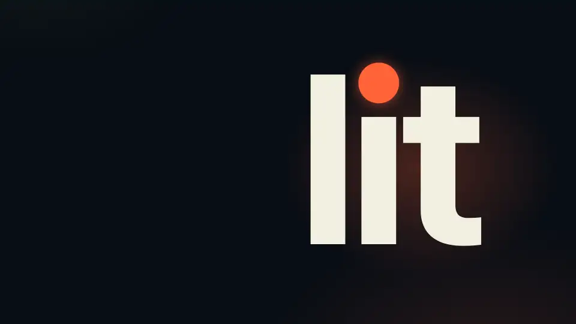

# What LitOpenCode looks like

[README](../README.md) · [한국어](./screens-Ko-KR.md)

This page shows what LitOpenCode prints and draws, so a healthy install looks familiar by the time you get there.

## What you will see on screen

Here is what LitOpenCode prints. Four pictures follow, and each is labelled as a capture or a sample. Every picture comes in a dark and a light version with the same text; your browser shows the one that matches its theme.

**The installer.** `litopencode install` lists five numbered steps, ticks each one off as it finishes, and ends with a green box. The box says the install is ready and what to do next: restart OpenCode, press Tab and choose lit-loop.

<picture><source media="(prefers-color-scheme: dark)" srcset="./assets/readme/install-output-dark.webp" /></picture>

*Captured from the real `litopencode install --yes` in an isolated shell with an empty config folder. The command also prints a large logo banner above the steps, which the picture leaves out. The last line reports the machine the command ran on.*

**A health check.** `litopencode doctor` prints a long JSON report. Its install block answers the first question, whether everything is wired up, so the picture picks out three lines with `jq`. Three true values mean the plugin and its skills check out.

<picture><source media="(prefers-color-scheme: dark)" srcset="./assets/readme/doctor-output-dark.webp" /></picture>

*Captured from the real `litopencode doctor` in the same isolated shell, with three fields picked out by `jq`.*

**The first prompt.** When a Lit workflow picks up your prompt, OpenCode shows a toast in the top-right corner for six seconds. It carries a five-row LIT mark, the words LIT IGNITED and the name of the workflow that started. It is the quickest sign that the route began; check the result yourself once the work finishes. [What you see when a route starts](#what-you-see-when-a-route-starts) has more.

<picture><source media="(prefers-color-scheme: dark)" srcset="./assets/readme/ignition-toast-dark.webp" /></picture>

*Sample output: the toast text comes from the plugin's own activation function, and OpenCode drew it. No model ran. The workflow here is lit-loop; the toast names whichever workflow started.*

**The planner.** `lit-plan` plans and only reads. You can ask OpenCode which permissions it has: `opencode debug agent lit-plan` prints the agent as OpenCode sees it, and `jq` keeps the denied ones. Edit, bash and task are on the list, so the planner cannot change files, run shell commands or hand work to a helper agent. The list names question, plan_enter and plan_exit as well.

<picture><source media="(prefers-color-scheme: dark)" srcset="./assets/readme/planner-permissions-dark.webp" /></picture>

*Captured from the real `opencode debug agent lit-plan` in the same isolated shell, with LitOpenCode installed into an empty config folder. `jq` keeps the denied permissions.*

## Watch it in motion

Twenty-two seconds, one word. The film opens on `lit` set huge, shrinks it into a prompt, and follows what LitOpenCode does with it: a toast announces the workflow, the planner shows edit, bash and task locked, each step lands in a record, and a fresh session reads that record and carries on. The windows in the film are drawings of what the README describes, and nothing in it was captured from a live session. The type is [Pretendard](./assets/readme/promo-source/Pretendard-OFL.txt), used under its open font license.

<picture><source media="(prefers-reduced-motion: reduce)" srcset="./assets/readme/promo-still.webp" /></picture>

[Watch the film as an MP4](./assets/readme/promo.mp4)

## What you see when a route starts

You can tell when a Lit route has started. The reply opens with a bold ignition line, and OpenCode pops up a warning-style toast for six seconds. If your terminal can draw the mark's glyphs, the toast shows a five-row logo above `🔥 LIT IGNITED · <discipline> 🔥`; if it can't, you get just that line. Either way, that's your sign the workflow is under way; check the result yourself once it's done.

The poster opens the optional film, so the video only plays when you choose it. The [brand page](./brand.md#ignition-motion) has the film, its GIF and the other artwork.
