# LitOpenCode 스킬과 명령

[README](../README-Ko-KR.md) · [English](./skills.md) · [사용 안내](./guide-Ko-KR.md) · [상세 안내](./reference-Ko-KR.md)

LitOpenCode가 설치하는 것 전부를, 스킬마다 만들어 내는 결과의 그림과 함께 모았습니다. 예전에는 README에 있던 내용이고, 지금 README에는 처음 쓰는 사람이 가장 먼저 찾는 워크플로 여섯 가지만 남겼습니다.

## 명령어

프롬프트에 `lit`을 붙이거나 슬래시 명령을 입력하면 됩니다. 자주 쓰는 것은 이 정도입니다.

| 입력 | 하는 일 |
| --- | --- |
| 프롬프트 끝의 `lit`, `/lit`, `/litwork` | 범위가 분명한 작업을 시작해 구현하고, 확인한 내용을 기록합니다. |
| `lit-plan` 또는 `/lit-plan` | 구현 전에 계획을 세웁니다. |
| `/start-work <승인된 계획>` | 승인한 계획을 실행합니다. |
| `/review-work` | `lit-plan` 뒤에는 계획을, `lit-loop`나 `/start-work` 뒤에는 끝난 작업을 검토합니다. 있는 것을 보고 고르며 `/review-work plan`, `/review-work work`로 직접 정할 수 있습니다. |
| `lit brainstorm …`, `lit ideation …`, `lit idea …` 또는 `/lit-brainstorm` | 아직 정하지 못한 질문을 여러 선택지로 펼친 뒤 짧은 목록으로 좁히고, 고른 것을 `deep-interview`나 `lit-plan`에 넘깁니다. 직접 만들지는 않습니다. |
| `/litgoal` | 끝나는 지점을 정하고 지킵니다. `lit-loop`와 `/start-work`가 그 목표를 향해 일합니다. |
| `handoff` 또는 `/lit-handoff` | 현재 결과와 다음 할 일을 다음 세션에 넘깁니다. |
| `/lit-recap` | 로컬 기록을 짧게 요약해 보여 줍니다. |
| `/litresearch` 또는 `/lit-research` | 주장마다 출처를 남기며 조사합니다. OpenCode가 허용하면 보조 에이전트가 나눠서 동시에 조사하고, 아니면 차례로 진행합니다. |
| `/lit-code`, `/debugging`, `/refactor` | 코딩, 디버깅, 리팩터링 지침을 씁니다. |
| `/lit-korean` | 의미는 그대로 두고 한국어 문장을 다듬습니다. |
| `/lit-scientific-visualization` | 패키지에 들어 있는 과학 시각화 워크플로를 씁니다. |

`handoff`만 단독으로 입력해도 `/lit-handoff`와 똑같이 동작합니다. 대화가 차오를 때 인수인계를 대신 써 주길 원하면 [자동 인수인계](./guide-Ko-KR.md#자동-인수인계)를 보세요.

경로는 작업을 준비할 뿐이고, 실제 작업은 OpenCode 안의 모델이 합니다. 답변에 어떤 단계를 실행했다거나 화면 확인을 통과했다고 나오면, 믿기 전에 파일이나 페이지를 직접 열어 확인하세요.

Autoresearch, Autoconference, Wikify, UI/UX는 [전체 경로 안내](./reference-Ko-KR.md#주요-명령)에, 저장소 규칙을 두 갈래로 읽는 규칙 엔진은 [규칙 엔진 상세 안내](./reference.md#safety-and-updates)에 있습니다. 예전 스킬 이름은 한 릴리스 동안 별칭으로 계속 동작합니다. 목록은 [마이그레이션 안내](./migration.md#skill-id-renames)를 보세요.

## 스킬 한눈에 보기

스킬마다 만들어 내는 결과, 여는 방법, 얻는 것을 한 줄씩 정리했습니다.

<table>
<tr><th>이렇게 됩니다</th><th>스킬</th><th>얻는 것</th></tr>
<tr>
<td>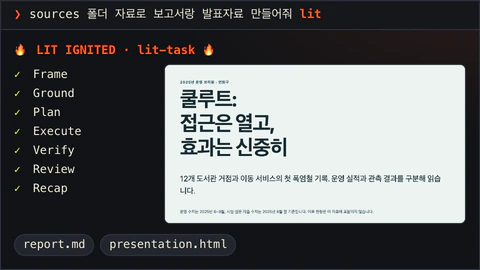</td>
<td><code>litwork</code> · <code>workflow-loop</code> <code>lit</code> · <code>/litwork</code></td>
<td>요청에 <code>lit</code>만 붙이세요. 작업이 틀 잡기, 근거 찾기, 계획, 실행, 검증, 리뷰, 정리 순서로 진행됩니다.</td>
</tr>
<tr>
<td>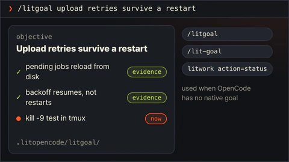</td>
<td><code>litgoal</code> <code>/litgoal</code> · <code>/lit-goal</code></td>
<td>끝나는 지점을 정하고 지킵니다. OpenCode에 목표 기능이 없으므로 확인 가능한 기준이 붙은 목표 하나를 디스크에 남기고, <code>lit-loop</code>와 <code>start-work</code>가 그 목표를 향해 일합니다.</td>
</tr>
<tr>
<td>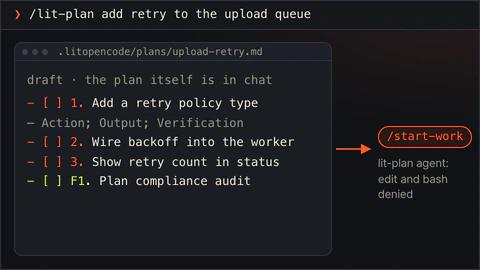</td>
<td><code>lit-plan</code> <code>/lit-plan</code></td>
<td>승인 관문에서 멈추는 체크리스트를 만듭니다. lit-plan 에이전트는 파일 수정도, 셸 명령도 할 수 없습니다.</td>
</tr>
<tr>
<td>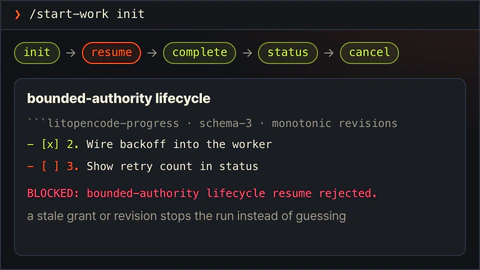</td>
<td><code>start-work</code> <code>/start-work</code></td>
<td>승인된 계획을 한 조각씩 실행하고, 승인이나 계획 버전이 낡았으면 멈춥니다.</td>
</tr>
<tr>
<td>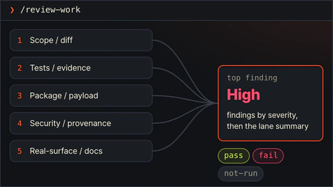</td>
<td><code>review-work</code> <code>/review-work</code> · <code>/review-work plan</code> · <code>/review-work work</code></td>
<td>두 가지 모드가 있고, 있는 것을 보고 고르거나 직접 정합니다. <code>start-work</code> 전에는 계획 검토, 끝난 뒤에는 작업 검토입니다. 작업 검토는 변경을 다섯 방향에서 살펴 심각한 문제부터 보여 주고, 방향마다 통과·실패·미실행을 적습니다.</td>
</tr>
<tr>
<td>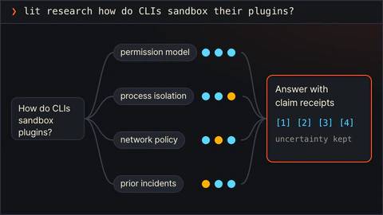</td>
<td><code>litresearch</code> <code>lit research &lt;question&gt;</code> · <code>/litresearch</code></td>
<td>여러 차례에 걸쳐 조사하고, 주장마다 출처와 아직 불확실한 점을 함께 남깁니다.</td>
</tr>
<tr>
<td>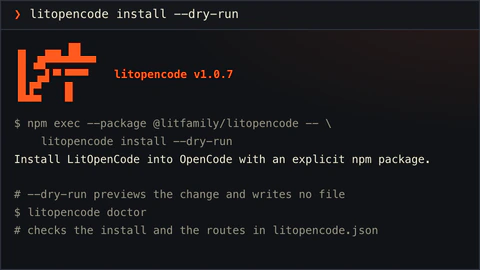</td>
<td><code>doctor-installer</code> <code>litopencode install</code> · <code>litopencode doctor</code></td>
<td>LitOpenCode를 OpenCode에 설치합니다. <code>--dry-run</code>은 바뀔 내용만 보여주고 아무것도 쓰지 않습니다.</td>
</tr>
<tr>
<td>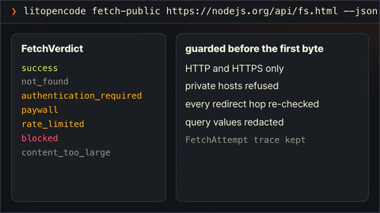</td>
<td><code>lit-fetch</code> <code>/lit-fetch</code> · <code>litopencode fetch-public &lt;url&gt; --json</code></td>
<td>요청이 어디로 갈 수 있는지 먼저 확인한 뒤 공개 페이지를 가져오고, 성공, 페이지 없음, 유료 구독 필요처럼 결과를 이름으로 알려 줍니다.</td>
</tr>
<tr>
<td>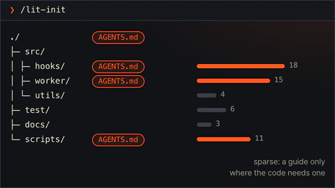</td>
<td><code>lit-init</code> <code>/lit-init</code></td>
<td>필요한 폴더에만 짧은 AGENTS.md 안내서를 만듭니다.</td>
</tr>
<tr>
<td>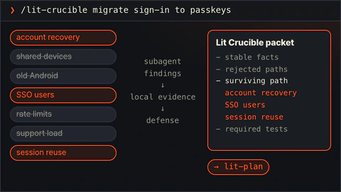</td>
<td><code>lit-crucible</code> <code>/lit-crucible</code></td>
<td>계획 전에 요구사항을 반박해 봅니다. 반박을 견딘 위험만 계획으로 넘어갑니다.</td>
</tr>
<tr>
<td>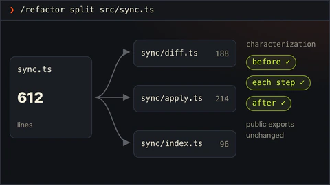</td>
<td><code>refactor</code> <code>/refactor</code></td>
<td>동작을 테스트로 고정한 채 코드 구조를 바꿉니다. 단계마다 확인합니다.</td>
</tr>
<tr>
<td>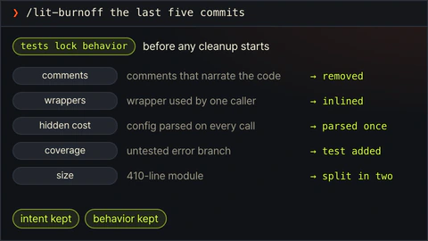</td>
<td><code>lit-burnoff</code> <code>/lit-burnoff</code></td>
<td>테스트로 동작을 먼저 묶어 두고, 변경분에 붙은 AI식 군더더기를 걷어냅니다.</td>
</tr>
<tr>
<td>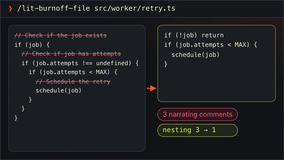</td>
<td><code>lit-burnoff-file</code> <code>/lit-burnoff-file</code></td>
<td>방금 수정한 파일 하나를 그 변경분 기준으로 정리합니다.</td>
</tr>
<tr>
<td>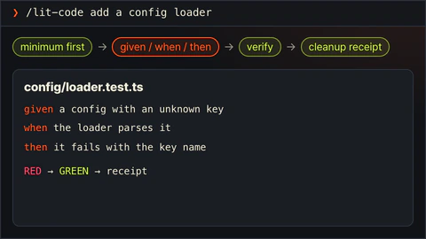</td>
<td><code>lit-code</code> <code>/lit-code</code></td>
<td>필요한 만큼만 코드를 쓰고, Given/When/Then 테스트와 함께 무엇을 정리했는지 적어 둡니다.</td>
</tr>
<tr>
<td>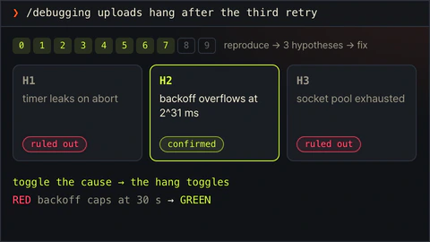</td>
<td><code>debugging</code> <code>/debugging</code></td>
<td>버그를 재현하고, 가설을 세 개 이상 세워 확인한 뒤, 확인된 원인만 고칩니다.</td>
</tr>
<tr>
<td>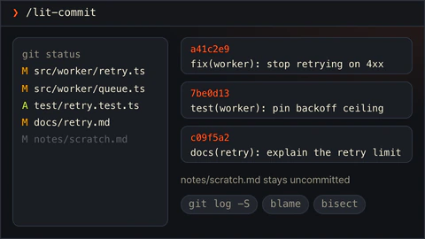</td>
<td><code>lit-commit</code> <code>/lit-commit</code></td>
<td>변경을 저장소 스타일에 맞는 작은 커밋으로 나눕니다. 관계없는 작업은 건드리지 않습니다.</td>
</tr>
<tr>
<td>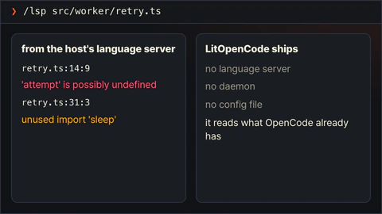</td>
<td><code>lsp</code> <code>/lsp</code></td>
<td>OpenCode가 이미 쓰는 언어 서버에서 오류와 경고를 읽어 옵니다. 언어 서버를 따로 설치하지는 않습니다.</td>
</tr>
<tr>
<td>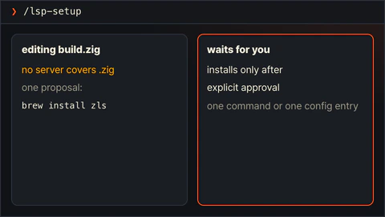</td>
<td><code>lsp-setup</code> <code>/lsp-setup</code></td>
<td>어떤 파일 형식에 언어 서버가 없으면 설치 명령 하나를 제안하고, 승인을 기다립니다.</td>
</tr>
<tr>
<td>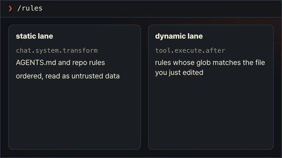</td>
<td><code>rules</code> <code>/rules</code></td>
<td>저장소 규칙을 두 갈래로 읽습니다. 세션 시작 때 한 번, 파일을 수정할 때 다시 한 번.</td>
</tr>
<tr>
<td>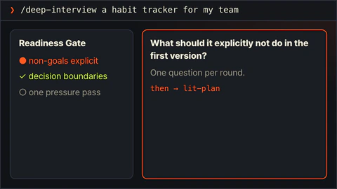</td>
<td><code>deep-interview</code> <code>/deep-interview</code></td>
<td>하지 않을 일과 결정 범위가 분명해질 때까지 한 번에 한 질문씩 묻습니다.</td>
</tr>
<tr>
<td>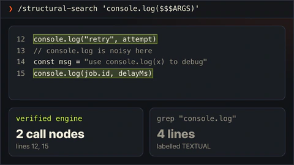</td>
<td><code>structural-search</code> <code>/structural-search</code></td>
<td>검색 엔진이 제대로 도는지 먼저 확인하고 문법 구조로 코드를 찾습니다. 글자만 맞춰 찾은 결과에는 TEXTUAL 표시를 붙입니다.</td>
</tr>
<tr>
<td>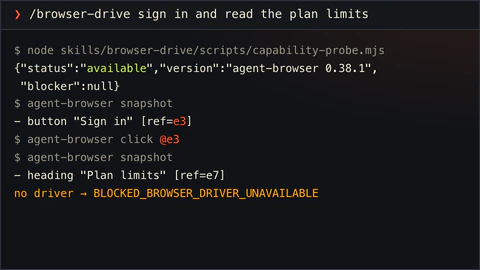</td>
<td><code>browser-drive</code> <code>/browser-drive</code></td>
<td>브라우저 드라이버를 먼저 확인한 뒤 실제 페이지를 조작합니다. 드라이버가 없으면 그렇다고 말합니다.</td>
</tr>
<tr>
<td>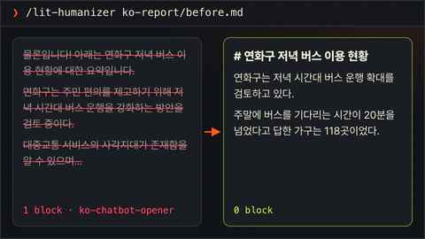</td>
<td><code>lit-humanizer</code> <code>/lit-humanizer</code></td>
<td>딱딱한 AI 문장을 한국어나 영어로 다시 씁니다. 사실과 단서는 남기고 군더더기는 뺍니다.</td>
</tr>
<tr>
<td>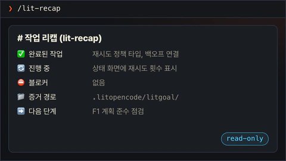</td>
<td><code>lit-recap</code> <code>/lit-recap</code></td>
<td>읽기 전용 요약입니다. 끝난 일, 진행 중인 일, 막힌 곳, 증거 위치, 다음 단계를 보여줍니다.</td>
</tr>
<tr>
<td>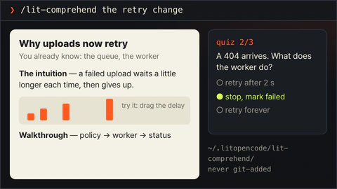</td>
<td><code>lit-comprehend</code> <code>/lit-comprehend</code></td>
<td>에이전트가 쓴 작업을 이해하도록 돕는 설명 페이지입니다. 직관, 흐름 설명, 짧은 퀴즈 순서입니다.</td>
</tr>
<tr>
<td>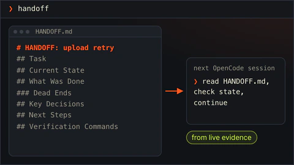</td>
<td><code>lit-handoff</code> <code>handoff</code> · <code>/lit-handoff</code></td>
<td><code>handoff</code>라고 치면 다음 세션이 읽고 이어갈 인수인계 파일이 생깁니다.</td>
</tr>
<tr>
<td>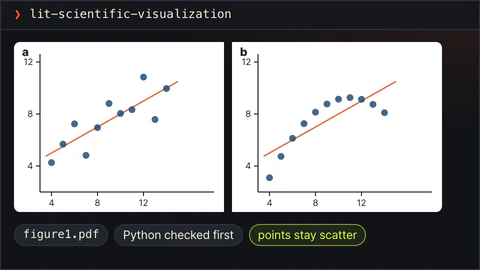</td>
<td><code>lit-scientific-visualization</code> <code>/lit-scientific-visualization</code></td>
<td>학술지 규격 그림을 벡터와 600 DPI로 내보냅니다. 그래프 종류는 데이터 성격에 맞춰 고릅니다.</td>
</tr>
<tr>
<td>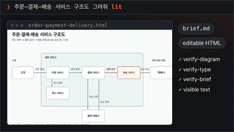</td>
<td><code>lit-diagram-drawer</code> <code>skill picker</code></td>
<td>슬라이드와 문서에 넣을 다이어그램을 편집 가능한 형태로 그리고, 검사한 뒤 PNG와 SVG로 내보냅니다.</td>
</tr>
<tr>
<td>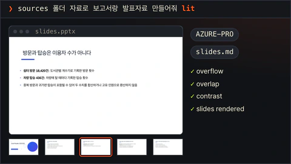</td>
<td><code>lit-pptx</code> <code>skill picker</code></td>
<td><code>lit</code>으로 발표자료를 요청하면 Markdown 원고에서 편집 가능한 PowerPoint 파일을 만듭니다. 만들기 전에 여덟 가지 디자인 방향 중 하나를 골라 알려 주고, 덱 전체를 보는 품질 검사와 렌더링 확인을 거칩니다. 스킬 선택기에서도 열 수 있습니다.</td>
</tr>
<tr>
<td>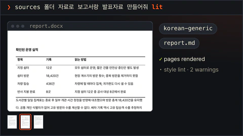</td>
<td><code>lit-docx</code> <code>skill picker</code></td>
<td><code>lit</code>으로 보고서를 요청하면 인쇄해도 차분한 Word 파일과 원고 Markdown이 나옵니다. 쓰기 전에 여섯 가지 문서 형식 중 하나를 골라 알려 주며, 학술지 서식도 그대로 씁니다. 렌더링한 페이지까지 검사합니다. 스킬 선택기에서도 열 수 있습니다.</td>
</tr>
<tr>
<td>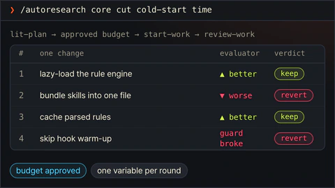</td>
<td><code>autoresearch</code> <code>/autoresearch</code> · <code>/autoresearch-&lt;mode&gt;</code></td>
<td>승인된 예산 안에서 실험을 반복합니다. 한 번에 하나만 바꾸고, 결과에 따라 남기거나 되돌립니다.</td>
</tr>
<tr>
<td>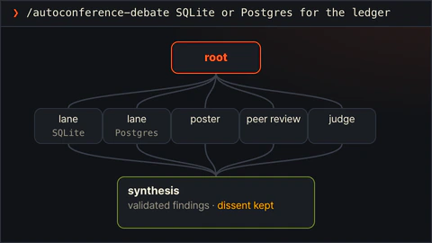</td>
<td><code>autoconference</code> <code>/autoconference</code> · <code>/autoconference-&lt;mode&gt;</code></td>
<td>예산을 정한 연구 회의입니다. 연구자와 리뷰어가 따로 일하고, 종합에는 반대 의견도 남깁니다.</td>
</tr>
<tr>
<td>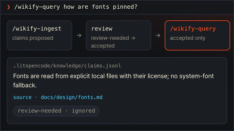</td>
<td><code>wikify</code> <code>/wikify-ingest</code> · <code>/wikify-query</code></td>
<td>검토를 거친 프로젝트 지식을 디스크에 두고, 나중 질문에 출처와 함께 답합니다.</td>
</tr>
<tr>
<td>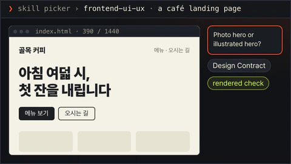</td>
<td><code>frontend-ui-ux</code> <code>skill picker</code></td>
<td>실제로 동작하는 화면을 만들고, 측정 프로브로 일곱 가지 보기에서 확인합니다. 네 가지 폭, 다크 모드, 모션 줄이기, 200% 확대입니다. 스킬 선택기에서 엽니다.</td>
</tr>
<tr>
<td>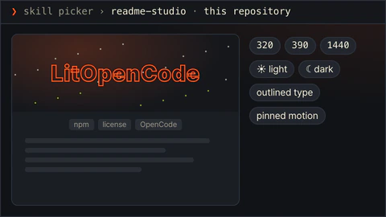</td>
<td><code>readme-studio</code> <code>skill picker</code></td>
<td>사실에 맞는 README와 확인을 거친 커버, 윤곽선 글자를 만듭니다. 스킬 선택기에서 엽니다.</td>
</tr>
<tr>
<td>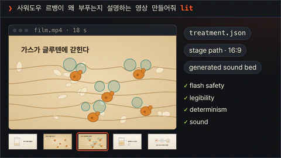</td>
<td><code>lit-typographic-motion</code> <code>skill picker</code></td>
<td><code>lit</code>으로 영상을 요청하면 트리트먼트를 먼저 쓰고, 무대 페이지를 그리거나 글자를 움직입니다. 영상은 검사와 눈으로 보는 확인을 거쳐 넘깁니다. README 커버를 요청하면 이음매가 보이지 않는 무음 루프를 만들고, 완성된 WebP 파일을 그대로 풀어 검사합니다. 스킬 선택기에서도 열 수 있습니다.</td>
</tr>
<tr>
<td>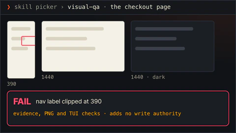</td>
<td><code>visual-qa</code> <code>skill picker</code></td>
<td>실제 화면을 보고 본 것을 그대로 보여 줍니다. 파일을 고칠 권한은 받지 않습니다. 스킬 선택기에서 엽니다.</td>
</tr>
<tr>
<td>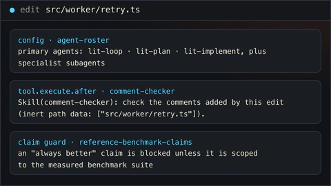</td>
<td><code>agent-roster</code> · <code>reference-benchmark-claims</code> · <code>native-goal-verdict</code> · <code>search-workflow-ideas</code> · <code>release-guardrails</code> · <code>comment-checker</code> · <code>tool-guards</code> 자동 실행</td>
<td>알아서 돌아갑니다. LitOpenCode 에이전트를 등록하고, 수정 뒤 주석을 확인하고, 범위 없는 “항상 더 낫다” 주장을 막습니다.</td>
</tr>
</table>

## 플러그인이 동작하는 방식

OpenCode는 설정 파일을 읽을 때 플러그인을 불러옵니다. 그 뒤로 프롬프트나 명령을 보내면 LitOpenCode가 알맞은 워크플로와 거기에 필요한 설치 스킬을 고릅니다. 작업이 진행되는 동안 도구와 훅이 일어난 일을 프로젝트에 적어 두고, 나중에 돌아오면 그 기록을 읽고 이어 갑니다.

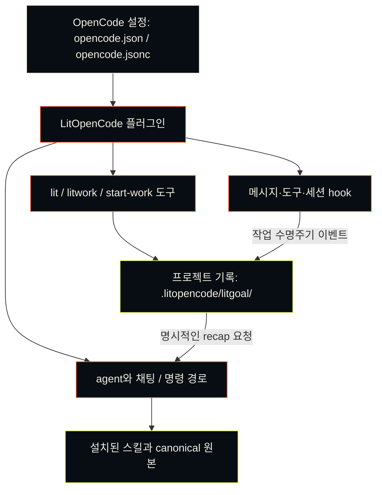

## 디자인, README, 다이어그램

`frontend-ui-ux`는 화면을 만드는 스킬입니다. 원하는 것을 충분히 구체적으로 말하면 실제로 동작하는 화면까지 만들고, 렌더링해서 직접 살펴봅니다. 중요한 디자인 선택이 걸릴 때만 묻고, 받은 답은 기억해 둡니다. 검토나 계획을 부탁하면 읽기만 하고 파일은 건드리지 않습니다.

`readme-studio`는 저장소에 실제로 있는 내용으로 README를 쓰고, 표지도 내 컴퓨터에서 만듭니다. 전용 슬래시 명령이 없어서 OpenCode의 스킬 도구에서 고릅니다. 글자를 윤곽선으로 바꾸는 도구, 버전을 고정한 Remotion·HyperFrames 예제, 정적·동적 출력 절차가 함께 설치됩니다. 이미지 생성 도구가 없으면 `IMAGE_GENERATION_UNAVAILABLE`로 알리고, 사용자가 준 배경으로 이어 갑니다. GitHub나 npm에서 최종적으로 어떻게 보이는지는 따로 확인해야 합니다.

`lit-diagram-drawer`는 개념도를 그리고, 내 컴퓨터에서 검사한 뒤 내보냅니다. 렌더러와 브라우저가 이미 있으면 아무것도 새로 설치하지 않고, 기존 다이어그램도 안전하게 가져옵니다. OpenCode 스킬 선택기에서 고르거나, 범위가 분명한 다이어그램 요청 끝에 `lit`을 붙이면 됩니다. 그러면 워크플로가 그리기 전에 이 스킬을 불러오라고 OpenCode에 안내합니다. 전용 슬래시 명령이나 채팅 경로는 따로 없습니다. 제품 화면은 `frontend-ui-ux`, 측정한 과학 데이터 그림은 `lit-scientific-visualization`이 맡습니다.

## 워드 보고서와 발표자료

`lit-docx`는 마크다운 원고로 편집 가능한 워드 보고서를 만들고, `lit-pptx`는 발표자료를 편집 가능한 파워포인트로 컴파일합니다. 보고서나 발표자료 요청에 `lit`을 붙이면 OpenCode가 알맞은 스킬을 불러오도록 안내하고, 둘 다 요청하면 두 스킬을 모두 씁니다.

이전에는 발표자료가 모두 같은 파란 템플릿에서, 한국어 보고서는 모두 같은 서식에서 출발했습니다. 그래서 투자 제안 덱과 분기 실적 보고가 비슷해 보였습니다. 이제 두 스킬은 첫 장을 만들기 전에 파일이 어떻게 보여야 할지부터 정하고, 무엇을 골랐는지 알려 줍니다.

발표자료를 요청하면 `lit-pptx`가 덱의 용도와 보는 사람을 읽고 여덟 가지 디자인 방향 중 하나를 고릅니다. 꼼꼼히 읽는 실적 보고, 투자 제안, 사진이 이끄는 덱, 강의, 연구 발표, 한국어 보고형 덱, 편집형 포트폴리오, 어두운 화면의 데이터 발표에 각각 맞는 방향이 하나씩 있습니다. 방향마다 색, 글자 크기, 제목 위치, 페이지 구성이 데이터로 정해져 있어서 같은 원고도 방향이 바뀌면 다른 덱이 됩니다. 답변에는 고른 방향과 다른 후보 두 개가 함께 나오고, 그냥 만들어 달라는 요청에는 스타일을 묻지 않습니다. 슬라이드는 정보를 촘촘하게 담고, 데이터 슬라이드마다 출처 줄을 둡니다. 제목에는 주제를 이름처럼 붙이고 주장은 본문에 둡니다. 숫자를 제목보다 크게 부풀리지 않고, 글꼴은 함께 들어 있는 Pretendard를 씁니다. 검사는 슬라이드 하나하나와 덱 전체를 함께 봅니다. 제목 배치와 레이아웃을 몇 가지나 섞었는지, 페이지가 얼마나 비었는지, 문장처럼 끝나는 제목은 없는지도 확인합니다.

보고서를 요청하면 `lit-docx`가 Report, Brief, Manual, Proposal, Memo, Journal 여섯 형식 중 하나를 고릅니다. 형식마다 첫 페이지에 무엇을 두는지, 요약을 어떻게 쓰는지, 절 번호를 어떻게 매기는지, 머리말에 무엇을 넣는지가 다릅니다. 페이지는 여섯 형식 모두 차분합니다. 제목과 본문은 거의 검은 잉크색이고, 표는 가는 선 세 줄만 쓰고 음영을 넣지 않으며, 강조색은 많아야 하나입니다. A4에 좌우 여백 25mm를 두고, 줄 간격은 렌더링한 페이지에서 잰 값으로 맞춥니다. 한국어 문서는 `2026. 10. 1.` 같은 날짜 표기, 표 위의 `<표 1>` 제목, 단위·자료 줄 같은 관례를 따릅니다. 검사는 페이지를 렌더링해서 쪽 끝에 홀로 남은 제목, 굳이 나뉜 표, 스며든 색, 지나치게 많은 상자를 찾아냅니다. 학술지 원고는 Elsevier, ACS, IEEE, Nature, korean-generic 서식을 그대로 씁니다.

두 스킬 모두 처음 쓸 때 필요한 도구를 정해진 버전으로 LitOpenCode 전용 캐시에 설치합니다. 완성 파일과 함께 마크다운 원고도 남기고, 구조·품질 검사를 거칩니다. LibreOffice가 있으면 렌더링된 페이지도 눈으로 확인하게 합니다. 출판사 서식, 기존 DOCX 편집, PDF 변환, 템플릿 학습, 글꼴 포함 방법은 설치된 스킬에 설명되어 있습니다. 준비가 됐는지 보려면 `litopencode doctor`를 실행하세요. 상태만 알려 주고 아무것도 설치하지 않습니다.

## 글 다듬기와 브라우저

글을 제대로 고쳐 써야 하거나 꼼꼼히 검토받고 싶을 때는 `/lit-humanizer`를 쓰세요. 의미와 글쓴이의 목소리, 꼭 필요한 한정 표현은 그대로 둡니다. 예전 명령인 `/lit-korean`, `/text-naturalization`, `/text-neutralization`, `/korean-ai-slop-remover`도 계속 쓸 수 있고 같은 곳으로 연결됩니다. 에이전트가 쓰는 글도 살펴봅니다. 지원하는 텍스트 파일을 저장하려는데 초안 흔적이 뚜렷하면 저장을 막고, 확신이 낮은 문체 신호는 참고 의견으로만 알려 줍니다. 워드·파워포인트 파일과 텍스트를 뽑아낼 수 있는 PDF는 만들어진 직후에 확인합니다.

`browser-drive`를 쓰려면 [vercel-labs/agent-browser](https://github.com/vercel-labs/agent-browser)의 `agent-browser` 엔진을 직접 설치해야 합니다. `npm install -g agent-browser`와 `agent-browser install`을 실행한 뒤 `node skills/browser-drive/scripts/capability-probe.mjs`로 확인하세요. 검증된 최소 버전은 0.34.0입니다. 형식이 올바른 더 새 버전도 받아들이고, 검증한 버전보다 새것이라고 표시합니다.
