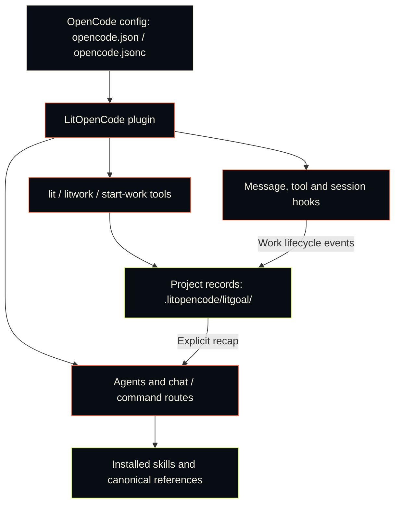

# LitOpenCode skills and commands

[README](../README.md) · [한국어](./skills-Ko-KR.md) · [Guide](./guide.md) · [Workflow reference](./reference.md)

Everything LitOpenCode installs, with a picture of what each skill makes. This material used to sit on the README; the README now keeps only the six workflows most people start with.

## Commands

Add `lit` to a prompt, or type a slash command. These are the ones you'll use most:

| Type | What happens |
| --- | --- |
| `lit` at the end of a prompt, `/lit`, or `/litwork` | Start a task with a clear scope, build it, and record what was checked. |
| `lit-plan` or `/lit-plan` | Prepare a plan before implementation. |
| `/start-work <approved-plan>` | Execute an approved plan. |
| `/review-work` | Review the change and its evidence. |
| `handoff` or `/lit-handoff` | Leave resumable context: the current result and the next step, for another session. |
| `/lit-recap` | Read a short recap from local state. |
| `/litresearch` or `/lit-research` | Research with a source for each claim. Helpers work in parallel when OpenCode allows it, and one after another when it doesn't. |
| `/lit-code`, `/debugging`, `/refactor` | Get coding, debugging, or refactoring guidance. |
| `/lit-korean` | Improve Korean prose without changing its meaning. |
| `/lit-scientific-visualization` | Use the packaged scientific-visualization workflow. |

A bare `handoff`, typed on its own, works the same as `/lit-handoff`. To have the handoff written for you when the conversation fills up, see [Automatic handoff](./guide.md#automatic-handoff).

A route sets the work up; the model inside OpenCode does it. When the reply says a step ran or a visual check passed, open the file or the page and see for yourself before you rely on it.

Autoresearch, Autoconference, Wikify, UI/UX, and the two-lane repository rules engine are in the [full route and skill reference](./reference.md#core-commands). Old skill names keep working as aliases for one release; the [migration notes](./migration.md#skill-id-renames) list them.

## Skills at a glance

Each row shows what a skill produces, how to open it, and what you get.

<table>
<tr><th>What it looks like</th><th>Skill</th><th>What you get</th></tr>
<tr>
<td></td>
<td><code>litwork</code> · <code>workflow-loop</code> <code>lit</code> · <code>/litwork</code></td>
<td>Add <code>lit</code> to a request. The work goes Frame, Ground, Plan, Execute, Verify, Review, Recap.</td>
</tr>
<tr>
<td></td>
<td><code>durable-litgoal</code> <code>/litgoal</code> · <code>/lit-goal</code></td>
<td>One goal with checkable criteria, kept on disk when OpenCode has no native goal.</td>
</tr>
<tr>
<td></td>
<td><code>lit-plan</code> <code>/lit-plan</code></td>
<td>A checklist that stops at an approval gate. The lit-plan agent cannot edit files or run shell commands.</td>
</tr>
<tr>
<td></td>
<td><code>start-work</code> <code>/start-work</code></td>
<td>Runs an approved plan one slice at a time, and stops if its approval or plan revision has gone out of date.</td>
</tr>
<tr>
<td></td>
<td><code>review-work</code> <code>/review-work</code></td>
<td>Reviews the change from five angles, lists findings worst first, and marks each angle pass, fail or not run.</td>
</tr>
<tr>
<td></td>
<td><code>litresearch</code> <code>lit research &lt;question&gt;</code> · <code>/litresearch</code></td>
<td>Researches in rounds and keeps a source for each claim, along with what is still uncertain.</td>
</tr>
<tr>
<td></td>
<td><code>doctor-installer</code> <code>litopencode install</code> · <code>litopencode doctor</code></td>
<td>Installs LitOpenCode into OpenCode. <code>--dry-run</code> previews the change and writes nothing.</td>
</tr>
<tr>
<td></td>
<td><code>lit-fetch</code> <code>/lit-fetch</code> · <code>litopencode fetch-public &lt;url&gt; --json</code></td>
<td>Checks where the request can go, fetches the public page, then names the outcome, such as success, not found or paywall.</td>
</tr>
<tr>
<td></td>
<td><code>lit-init</code> <code>/lit-init</code></td>
<td>Writes sparse AGENTS.md guides, only where the code needs one.</td>
</tr>
<tr>
<td></td>
<td><code>lit-crucible</code> <code>/lit-crucible</code></td>
<td>Pressure-tests a brief before planning. Only the risks that survive critique reach the plan.</td>
</tr>
<tr>
<td></td>
<td><code>refactor</code> <code>/refactor</code></td>
<td>Restructures code while tests pin its behavior before and after every step.</td>
</tr>
<tr>
<td></td>
<td><code>lit-burnoff</code> <code>/lit-burnoff</code></td>
<td>Cleans AI-written bloat out of a change set after tests lock what it does.</td>
</tr>
<tr>
<td></td>
<td><code>lit-burnoff-file</code> <code>/lit-burnoff-file</code></td>
<td>Cleans one just-edited file against its own diff.</td>
</tr>
<tr>
<td></td>
<td><code>lit-code</code> <code>/lit-code</code></td>
<td>Writes the smallest code that does the job, with Given/When/Then tests and a note of what it cleaned up.</td>
</tr>
<tr>
<td></td>
<td><code>debugging</code> <code>/debugging</code></td>
<td>Reproduces the bug, tests at least three explanations, and fixes only the confirmed cause.</td>
</tr>
<tr>
<td></td>
<td><code>lit-commit</code> <code>/lit-commit</code></td>
<td>Splits your changes into atomic commits in the repo's own style and leaves unrelated work alone.</td>
</tr>
<tr>
<td></td>
<td><code>lsp</code> <code>/lsp</code></td>
<td>Reads errors and warnings from the language server OpenCode already runs; LitOpenCode brings none of its own.</td>
</tr>
<tr>
<td></td>
<td><code>lsp-setup</code> <code>/lsp-setup</code></td>
<td>Proposes one install command when no server covers a file type, then waits for your approval.</td>
</tr>
<tr>
<td></td>
<td><code>rules</code> <code>/rules</code></td>
<td>Loads repository rules in two lanes: once for the session, and again for files you edit.</td>
</tr>
<tr>
<td></td>
<td><code>deep-interview</code> <code>/deep-interview</code></td>
<td>Asks one question at a time until it's clear what the work won't touch and which calls need your approval.</td>
</tr>
<tr>
<td></td>
<td><code>structural-search</code> <code>/structural-search</code></td>
<td>Confirms the search engine works, then finds code by its syntax shape. Plain text matches are labelled TEXTUAL.</td>
</tr>
<tr>
<td></td>
<td><code>browser-drive</code> <code>/browser-drive</code></td>
<td>Checks that a browser driver is installed, then works a real page. Without one, it tells you.</td>
</tr>
<tr>
<td></td>
<td><code>lit-humanizer</code> <code>/lit-humanizer</code></td>
<td>Rewrites stiff model prose in English or Korean, keeping the facts and honest hedges and cutting the filler.</td>
</tr>
<tr>
<td></td>
<td><code>lit-recap</code> <code>/lit-recap</code></td>
<td>A read-only summary: done, in progress, blocked, where the evidence is, what comes next.</td>
</tr>
<tr>
<td></td>
<td><code>lit-comprehend</code> <code>/lit-comprehend</code></td>
<td>An explainer page for agent-written work: intuition first, then the walkthrough, then a short quiz.</td>
</tr>
<tr>
<td></td>
<td><code>lit-handoff</code> <code>handoff</code> · <code>/lit-handoff</code></td>
<td>Type <code>handoff</code> to get a continuation file the next session can read and resume from.</td>
</tr>
<tr>
<td></td>
<td><code>lit-scientific-visualization</code> <code>/lit-scientific-visualization</code></td>
<td>A journal-sized figure with vector and 600 DPI exports. The chart type follows the data.</td>
</tr>
<tr>
<td></td>
<td><code>lit-diagram-drawer</code> <code>skill picker</code></td>
<td>A checked, editable diagram for slides and documents, with PNG and Office-safe SVG exports.</td>
</tr>
<tr>
<td></td>
<td><code>lit-pptx</code> <code>skill picker</code></td>
<td>Ask for slides with <code>lit</code> and get an editable PowerPoint deck from a Markdown source, drawn in one of eight design directions that the skill picks and names before building. A deck-wide QA gate and a rendered check follow. It is also in the skill picker.</td>
</tr>
<tr>
<td></td>
<td><code>lit-docx</code> <code>skill picker</code></td>
<td>Ask for a report with <code>lit</code> and get a quiet, print-ready Word file with its Markdown source, set in one of six document styles that the skill names before writing. Journal profiles stay available. A gate checks the rendered pages. It is also in the skill picker.</td>
</tr>
<tr>
<td></td>
<td><code>autoresearch</code> <code>/autoresearch</code> · <code>/autoresearch-&lt;mode&gt;</code></td>
<td>An approved, budgeted experiment loop. Each round changes one thing and keeps or reverts it.</td>
</tr>
<tr>
<td></td>
<td><code>autoconference</code> <code>/autoconference</code> · <code>/autoconference-&lt;mode&gt;</code></td>
<td>A budgeted research conference: separate researchers, reviewers, and a synthesis that keeps disagreement.</td>
</tr>
<tr>
<td></td>
<td><code>wikify</code> <code>/wikify-ingest</code> · <code>/wikify-query</code></td>
<td>Keeps reviewed project knowledge on disk and answers later questions from it, with sources.</td>
</tr>
<tr>
<td></td>
<td><code>frontend-ui-ux</code> <code>skill picker</code></td>
<td>Builds a working interface and checks it with a measured probe in seven views: four widths, dark, reduced motion and 200% zoom. Open it from the skill picker.</td>
</tr>
<tr>
<td></td>
<td><code>readme-studio</code> <code>skill picker</code></td>
<td>A factual README with an inspected cover and outlined type. Open it from the skill picker.</td>
</tr>
<tr>
<td></td>
<td><code>lit-typographic-motion</code> <code>skill picker</code></td>
<td>Ask for a video with <code>lit</code>. It writes a treatment, then draws a stage page or sets the words in motion; the film passes its checks and a look-over before you get it. It is also in the skill picker.</td>
</tr>
<tr>
<td></td>
<td><code>visual-qa</code> <code>skill picker</code></td>
<td>Looks at the real screen and shows you what it saw; it gets no permission to change files. Open it from the skill picker.</td>
</tr>
<tr>
<td></td>
<td><code>agent-roster</code> · <code>reference-benchmark-claims</code> · <code>native-goal-verdict</code> · <code>search-workflow-ideas</code> · <code>release-guardrails</code> · <code>comment-checker</code> · <code>tool-guards</code> runs on its own</td>
<td>Runs on its own: registers the LitOpenCode agents, checks comments after edits, and blocks unscoped “always better” claims.</td>
</tr>
</table>

## How the plugin works

OpenCode loads the plugin when it reads its config. From then on, when you send a prompt or a command, LitOpenCode decides which workflow fits and which installed skills it needs. As the work moves along, its tools and hooks write down what happened in your project, and that record is what you read when you come back.

## Design, READMEs, and diagrams

`frontend-ui-ux` builds interfaces. Describe what you want in enough detail and it carries the work through to a screen that works, then renders it and looks. It only stops to ask about design choices that matter, and it remembers your answers. If you ask it to review or plan, it reads and leaves your files alone.

`readme-studio` writes READMEs from what is really in the repository and builds covers on your machine. You pick it from OpenCode's skill tool, since it has no slash command of its own. It comes with helpers that turn type into outlines and pinned Remotion and HyperFrames recipes. If no image generator is available, it says so with `IMAGE_GENERATION_UNAVAILABLE` and can carry on from a background you give it. How the page finally looks on GitHub or npm is something to check separately.

`lit-diagram-drawer` is for concept diagrams: it draws them, checks them on your machine, and exports them. It installs nothing as long as the renderer and a browser are already there, and it imports existing diagrams safely. Pick it from OpenCode's skill picker, or end a clear diagram request with `lit`, and the workflow tells OpenCode to load it before drawing. It has no slash command or chat route of its own. Product screens belong to `frontend-ui-ux`, and figures of measured scientific data to `lit-scientific-visualization`.

## Word reports and slide decks

`lit-docx` turns a Markdown source into an editable Word report. `lit-pptx` compiles slides into an editable PowerPoint deck. Ask for a report or slides with `lit`, and OpenCode is told to load the matching skill; ask for both and it loads both.

Until this release every deck began from the same blue template and every Korean report from the same style sheet, so a funding pitch and a quarterly review came out looking alike. Both skills now start by deciding how the file should look, the way a designer would before touching the first page, and they tell you what they decided.

For slides, `lit-pptx` reads what the deck is for and who will see it, then picks one of eight design directions. There is one for dense reviews that are read closely, one for pitches, one for decks led by pictures, one for teaching, one for research talks, one for Korean briefing pages, one for editorial portfolios and one for data talks on a dark screen. Each direction is a pack of colours, type sizes, title positions and page layouts that the compiler reads as data, so one source looks different under two of them. The reply names the direction and two alternatives, and a bare request gets no style questions. Slides are dense, with a source line on every data slide. Titles name the topic and leave the claim to the body, no number is blown up past the title size, and everything is set in the bundled Pretendard. The gate reads each slide and the whole deck, including how many title styles and layouts it mixes, how much of each page stays empty and whether any title reads as a sentence.

For documents, `lit-docx` chooses among six styles: Report, Brief, Manual, Proposal, Memo and Journal. Each is built its own way, from what stands on the first page to how the summary is set, how sections are numbered and what the running head carries. All six share one restrained page: near-black headings, tables with three thin rules and no shading, at most one accent colour, A4 with 25 mm margins and leading measured on the rendered page. Korean documents follow Korean conventions such as `2026. 10. 1.` dates, `<표 1>` captions above tables and 단위 and 자료 lines around them. The gate renders the pages and looks for headings stranded at a page foot, tables split without need, colour creeping in and too many boxes. Journal manuscripts keep the Elsevier, ACS, IEEE, Nature and korean-generic profiles.

The first time you use either skill, it installs the exact tool versions it needs into a cache of LitOpenCode's own. Both keep the Markdown source as well as the finished file, and both run their structure and quality checks. If LibreOffice is installed, they also ask for a look at the rendered pages. Publisher styles, editing an existing DOCX, PDF conversion, learning a template and embedding fonts are covered in the installed skills. To see whether everything is ready, run `litopencode doctor`; it only reports and installs nothing.

## Writing and the browser

Use `/lit-humanizer` when a piece of writing needs a real rewrite or a careful read. It keeps the meaning, the writer's voice, and the qualifiers that matter. The older commands `/lit-korean`, `/text-naturalization`, `/text-neutralization` and `/korean-ai-slop-remover` still work and lead to the same place. It also watches what the agent writes. When the agent is about to save a supported text file with obvious drafting leftovers in it, the write is stopped; weaker style signals only come back as advice. Word and PowerPoint files, and PDFs whose text can be extracted, are checked right after they're created.

`browser-drive` needs the `agent-browser` engine from [vercel-labs/agent-browser](https://github.com/vercel-labs/agent-browser), which you install yourself: run `npm install -g agent-browser`, then `agent-browser install`, and check the result with `node skills/browser-drive/scripts/capability-probe.mjs`. The lowest version it has been checked with is 0.34.0. A newer, well-formed version is accepted and reported as newer than that.
